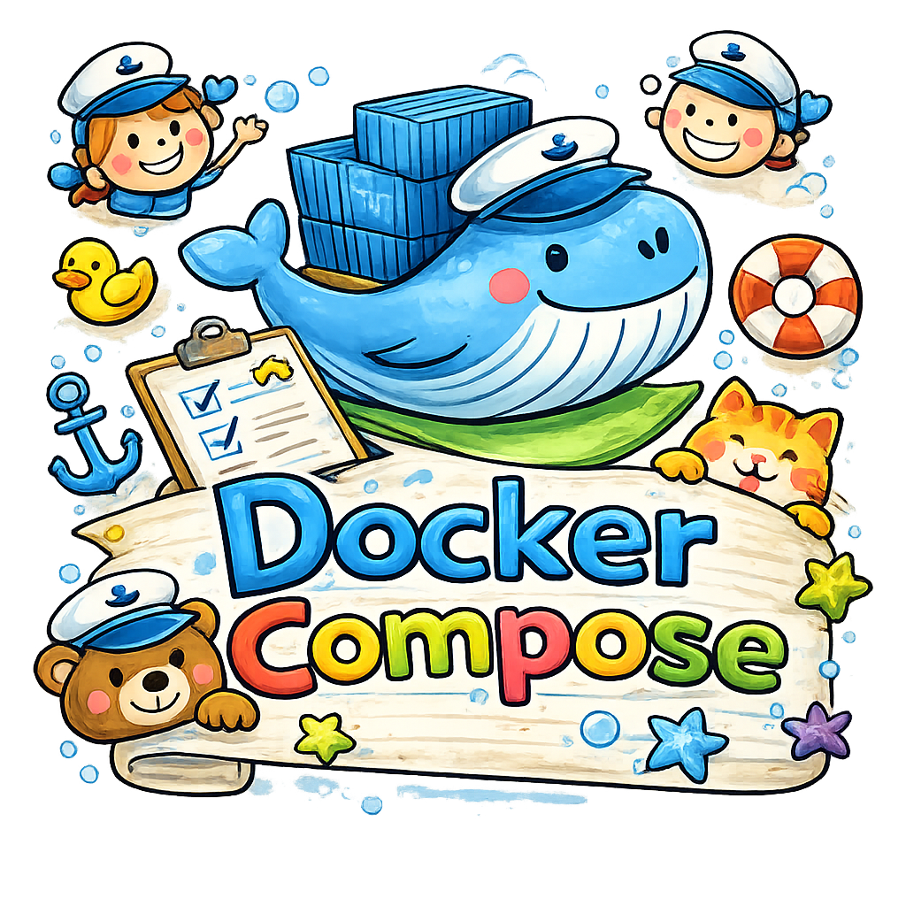
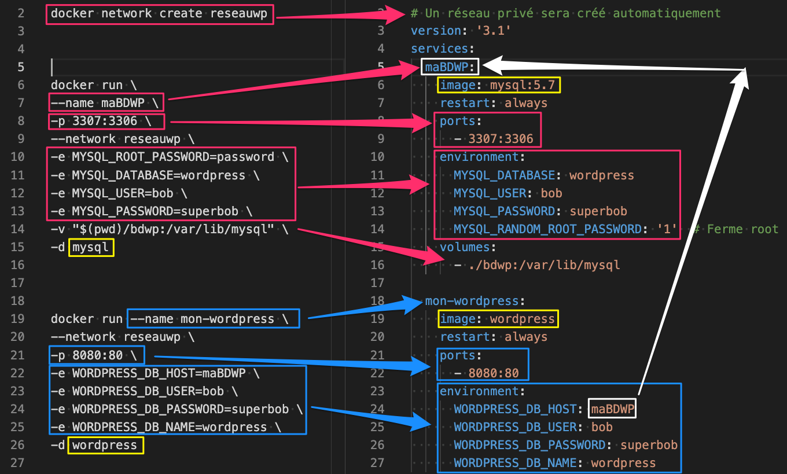

# 15 - 🐳 Docker compose – Introduction - Partie 1

<p align="center">
    
</p>

## 🚀 Démarrage des services

### Mise en situation

Lors des laboratoires précédents, nous avons démarré des conteneurs en utilisant la **ligne de commande** (`docker run`). Nous avons procédé ainsi car les paramètres de configuration étaient simples ou que le nombre de conteneurs pour une application donnée était réduit.

Dans le cas d'une application **multi-services** nécessitant un nombre élevé de micro-services, des réseaux personnalisés ou des volumes persistants, l'approche de démarrage manuel de chacun des services peut devenir une tâche **ardue et complexe**.

Pour adresser ce type de problème, Docker propose le module **`docker compose`**.

En utilisant le langage de représentation des données **YAML**, il est possible de représenter tous les services et paramètres d'un système donné et de démarrer le tout en une **seule ligne de commande**.

Voici un tableau présentant les analogies entre l'utilisation du CLI de Docker et de `docker compose` :




| `docker-compose.yml` | Équivalent `docker run` | Description |
| :--- | :--- | :--- |
| `services:` | `docker run` | Chaque entrée est un conteneur (service). |
| `image:` | `IMAGE` | Nom de l'image (ex: `alpine:latest`). |
| `container_name:` | `--name` | Nom du conteneur. |
| `ports:` | `-p` | Liaison de ports (ex: `"8080:80"`). |
| `volumes:` | `-v` | Liaison de volumes. |
| `networks:` | `--network` | Spécification des réseaux. |
| `environment:` | `-e` | Variables d'environnement. |
| `stdin_open: true` | `-i` | Garde le `stdin` ouvert. |
| `tty: true` | `-t` | Alloue un pseudo-TTY. |
| `depends_on:` | (Aucun) | Définit l'ordre de démarrage des services. |
| `build:` | `docker build` | Spécifie un `Dockerfile` à construire. |

Par les exemples suivants, nous verrons comment ça fonctionne.

-----

## Contenu

- [**1 – Système simple de trois conteneurs Alpine**](#section-1)
- [**2 – Ajout d'options et configuration**](#section-2)

---

## 1 – Système simple de trois conteneurs Alpine {#section-1}

### Action 1.0 – Créer un système à partir de trois Alpine

Créons le fichier **`docker-compose.yml`** :

```yaml
# Fichier: docker-compose.yml
# Auteur: Alain Boudreault
# Date: 2021.02.13
# Description: Mise en place d'un système de 3 alpine

services:
  srv01:
    image: alpine
    container_name: serveur01 # Optionnel
  srv02:
    image: alpine
    container_name: serveur02 # Optionnel
  srv03:
    image: alpine
    container_name: serveur03 # Optionnel
```

> **Note :** Voici le tableau de compatibilité des versions : [https://docs.docker.com/compose/compose-file/compose-file-v3/](https://docs.docker.com/compose/compose-file/compose-file-v3/)

### Action 1.1 – Démarrer les services

```bash
docker compose up
```

**Résultat :**

```
Creating network "lab01-docker compose_default" with the default driver
Pulling srv01 (alpine:)...
...
Status: Downloaded newer image for alpine:latest
Creating serveur02 ... done
Creating serveur01 ... done
Creating serveur03 ... done
Attaching to serveur02, serveur01, serveur03
serveur02 exited with code 0
serveur01 exited with code 0
serveur03 exited with code 0
```

**Observation :**

  * Un **réseau privé** créé pour le service.
  * Trois Alpine créées.
  * Trois Alpine arrêtées (car `alpine` n'a pas de service d'arrière-plan par défaut et la commande par défaut est complétée immédiatement).

**Équivalent `docker run` :**

```bash
docker create network lab01-docker-compose_default
docker run --name serveur01 --network lab01-docker-compose_default alpine
docker run --name serveur02 --network lab01-docker-compose_default alpine
docker run --name serveur03 --network lab01-docker-compose_default alpine
```

### Action 1.2 – Vérification des conteneurs

```bash
docker container ls (-a)
```

### Action 1.3 – Réinitialiser Docker

```bash
docker container stop $(docker container ls -aq)
docker system prune -af --volumes
```

### Action 1.4 – Relancer les services en arrière-plan (`-d`)

```bash
docker compose up -d
```

> **NOTE** : Les conteneurs seront arrêtés quand même s'ils n'ont pas de commande persistante (comme un shell interactif ou un processus serveur).

### Action 1.5 – `attach` et `ping` entre les services

Pour un conteneur qui tourne (par exemple, si vous y avez ajouté une commande persistante comme `sleep 3600`) :

```bash
docker attach serveur01
ping serveur02
CTRL+PQ
```

-----

## 2 – Ajout d'options et configuration {#section-2}

### Action 2.0 – Ajout d'options supplémentaires – partie 01

| Directive `compose` | Équivalent `docker run` |
| :--- | :--- |
| `stdin_open` | `-i` |
| `tty` | `-t` |
| `networks` | `--net` |
| `environment` | `-e` |

### Action 2.1 – Réinitialiser Docker

### Action 2.2 – Modifier le fichier `docker-compose.yml`

Nous ajoutons des options interactives (`stdin_open`, `tty`), un réseau personnalisé (`reseauAlpine`) et des variables d'environnement.

```yaml
services:
  srv01:
    image: alpine
    container_name: serveur01
    stdin_open: true # docker run -i
    tty: true # docker run -t
    networks:
      - reseauAlpine
    environment:
      - JESUIS=Le spécialiste de la paresse
    # command: sh  # Décommenter pour laisser le conteneur actif

  srv02:
    image: alpine
    container_name: serveur02
    stdin_open: true # docker run -i
    tty: true # docker run -t
    networks:
      - reseauAlpine
    environment:
      - JESUIS=Celui qui fait du sur place
    # command: top # Décommenter pour laisser le conteneur actif

networks:
  reseauAlpine:
    name: jeSuisLeReseauAlpine
    driver: bridge
```

**Note :** Pour les variables d'environnement, il est possible d'utiliser les trois syntaxes suivantes :

 1. **Paires Clé:Valeur :**

     ```yaml
     environment:
       MYSQL_ROOT_PASSWORD: donttell
       MYSQL_USER: Bob
     ```

 2.  **Tableau de chaînes sans guillemets :**

     ```yaml
     environment:
       - MYSQL_ROOT_PASSWORD=donttell
     ```

 3.  **Tableau de chaînes avec guillemets :**

     ```yaml
     environment:
       - "MYSQL_ROOT_PASSWORD=donttell"
     ```

### Action 2.3 – Relancer les services en arrière-plan (`-d`)

### Action 2.4 – Explorer le résultat

(Vérifier le réseau créé, l'état des conteneurs, et les variables d'environnement.)

### Action 2.5 – Ajout d'options supplémentaires – partie 02

| Directive `compose` | Équivalent `docker run` |
| :--- | :--- |
| `volumes` | `-v` |
| `ports` | `-p` |

#### Action 2.5.1 – Alpine avec un volume, fichier **`docker-comp01.yml`**

```yaml
# Fichier: docker-comp01.yml
services:
  srv99:
    image: alpine
    container_name: serveur99
    stdin_open: true # docker run -i
    tty: true # docker run -t
    volumes:
      - ./:/420
    # command: sh # Ajouter cette ligne pour garder le conteneur actif
```

### Action 2.5.2 – Démarrer le système

```bash
docker compose -f docker-comp01.yml up -d
```

### Action 2.5.3 – Connexion au service Alpine

```bash
docker exec -it serveur99 /bin/sh
/ # ls
/ # ls /420
/ # touch /420/note.txt
```

*(Le fichier `note.txt` est créé dans le répertoire hôte courant grâce à la liaison de volume.)*

### Action 2.6 – Configuration d'un service Nginx

Exemple de configuration utilisant les volumes (pour le fichier de configuration et le contenu Web) et les ports.

```yaml
services:
  serveurweb:
    image: nginx
    container_name: serveurWEB
    volumes:
      - ./templates/site.template:/etc/nginx/templates
      - ./contenuweb:/usr/share/nginx/html:rw
    ports:
      - "8080:80"
    environment:
      - NGINX_HOST=monServeurWeb.com
      - NGINX_PORT=80 # N'est pas utilisée dans cet exemple
```

[Partie 2 de Docker-compose](Docker-compose-p2.md)

---

## Crédits

*Document rédigé par Alain Boudreault © 2021-2026*  
*Version 2025.12.03.1 - Révision 2026.11.07.1*  
*Site par ve2cuy*
