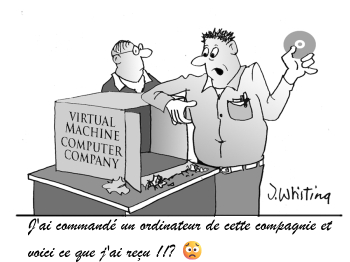
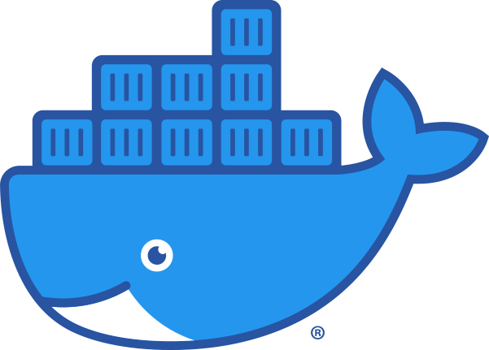

# 1 - 📚 Conteneurs et Kubernetes

*Révision du 2026.11.07*

Ce document vise à expliquer le rôle et la synergie entre les technologies de conteneurisation (comme Docker) et une plateforme d'orchestration comme Kubernetes (K8s).

---

## Contenu

- [**1 – VM vs. Conteneurs : Le Modèle de Virtualisation**](#section-1)
- [**2 – Conteneur versus Virtualization (VM)**](#section-2)
  - [2.1 – La Machine Virtuelle (VM) : Virtualisation de Matériel](#section-2-1)
  - [2.2 – Le Conteneur : Virtualisation au Niveau du Système d'Exploitation](#section-2-2)
- [**3 – Tableau Comparatif**](#section-3)
- [**4 – Conclusion**](#section-4)
- [**5 – Les Conteneurs (Docker) : La Révolution de l'Emballage 📦**](#section-5)
  - [5.1 – Qu'est-ce qu'un Conteneur?](#section-5-1)
  - [5.2 – Rôle et Avantages Clés des Conteneurs](#section-5-2)
  - [5.3 – Docker](#section-5-3)
- [**6 – Kubernetes (K8s) : L'Orchestrateur Géant 🎼**](#section-6)
  - [6.1 – Qu'est-ce que Kubernetes?](#section-6-1)
  - [6.2 – Rôle et Objectifs Clés de Kubernetes](#section-6-2)
  - [6.3 – Les Composants Clés de K8s](#section-6-3)
- [**7 – Pourquoi Utiliser les Deux? La Synergie ✨**](#section-7)
- [**8 – Alternatives à Docker : Runtimes et Outils de Construction**](#section-8)
  - [8.1 – Runtimes d'Exécution de Conteneurs (Core Runtimes)](#section-8-i)
  - [8.2 – Outils de Construction et de Gestion (Daemonless)](#section-8-ii)
  - [8.2.1 – Podman](#section-8-1)
  - [8.2.2 – Buildah](#section-8-2)
  - [8.2.3 – Kaniko](#section-8-3)
  - [8.3 – Synthèse de l'Écosystème](#section-8-iii)

---

## 1 – VM vs. Conteneurs : Le Modèle de Virtualisation {#section-1}

## 2 – Conteneur versus Virtualization (VM) {#section-2}

La principale différence entre les **Machines Virtuelles (VM)** et les **Conteneurs** réside dans la manière dont ils virtualisent les ressources et leur relation avec le système d'exploitation hôte.

---

### 2.1 – La Machine Virtuelle (VM) : Virtualisation de Matériel {#section-2-1}

    

Une **Machine Virtuelle** est une émulation d'un système informatique physique.

* **Mécanisme de Virtualisation :** Elle utilise un logiciel appelé **Hyperviseur** (comme VMware, Hyper-V ou KVM) pour simuler une couche matérielle complète (CPU, RAM, disques, cartes réseau).
* **Composants Inclus :** Chaque VM doit inclure son propre **Système d'Exploitation (OS) invité complet** (ex. : Windows Server ou une distribution Linux).
* **Isolation :** L'isolation est assurée par l'Hyperviseur, au niveau du **matériel**. Les VM sont complètement isolées les unes des autres.
* **Taille et Démarrage :** Elles sont **lourdes** (plusieurs Go) et **lentes à démarrer** (minutes), car elles doivent lancer un OS complet.

### 2.2 – Le Conteneur : Virtualisation au Niveau du Système d'Exploitation {#section-2-2}

Un **Conteneur** (comme ceux créés par Docker) est une unité d'exécution logicielle isolée.

* **Mécanisme de Virtualisation :** Il utilise le **moteur de conteneurisation** (comme Docker ou Podman) et les fonctionnalités d'isolation du **noyau (Kernel) du Système d'Exploitation hôte**.
* **Composants Inclus :** Le conteneur ne contient que l'**application et ses dépendances**. Il **partage le noyau de l'OS de l'hôte**.
* **Isolation :** L'isolation est assurée par des fonctionnalités du noyau (comme **cgroups** et **namespaces** sous Linux), au niveau du **processus**. L'isolation est forte, mais moins complète que celle d'une VM.
* **Taille et Démarrage :** Ils sont **légers** (Mo) et **très rapides à démarrer** (secondes), car ils ne lancent pas d'OS complet.

---

## 3 – Tableau Comparatif {#section-3}

| Caractéristique | Machine Virtuelle (VM) | Conteneur (Docker, Podman) |
| :--- | :--- | :--- |
| **Couche Virtualisée** | Matériel (Hardware) | Système d'Exploitation (OS Kernel) |
| **Logiciel Clé** | Hyperviseur | Moteur de Conteneurisation |
| **Inclus dans le Paquet** | **OS invité complet** (Gros) | **Application et dépendances** (Mince) |
| **Temps de Démarrage** | Long (minutes) | Très court (secondes) |
| **Taille** | Lourd (Plusieurs Go) | Léger (Quelques Mo) |
| **Isolation** | Très forte (Sécurité maximale) | Forte (Partage le noyau hôte) |
| **Exemple d'Utilisation** | Hébergement de services nécessitant un OS différent (ex. : Windows sur un hôte Linux) ou isolation maximale. | Déploiement rapide d'applications monolithiques ou microservices, environnements DevOps. |

---

## 4 – Conclusion {#section-4}

Les **VM** sont excellentes pour fournir une **isolation matérielle complète** et exécuter des systèmes d'exploitation différents.

Les **Conteneurs** sont la solution préférée pour le **développement moderne** et les **microservices** car ils offrent une **portabilité** et une **densité** (plus d'applications sur le même serveur) bien supérieures.

---

## 5 – Les Conteneurs (Docker) : La Révolution de l'Emballage 📦 {#section-5}

    

### 5.1 – Qu'est-ce qu'un Conteneur? {#section-5-1}

Un conteneur est une unité logicielle standardisée qui **regroupe le code d'une application et toutes ses dépendances** (bibliothèques, fichiers de configuration, etc.). Il permet à l'application de s'exécuter de manière **fiable** et **cohérente** dans n'importe quel environnement.

> **Analogie :** Il s'agit d'une boîte d'expédition standardisée. Peu importe le contenu (l'application), la boîte (le conteneur) est gérée de la même manière par la chaîne logistique (les serveurs).

### 5.2 – Rôle et Avantages Clés des Conteneurs {#section-5-2}

* **Isolation :** Les conteneurs isolent l'application de l'environnement hôte et des autres conteneurs, assurant la stabilité.
* **Portabilité :** Le logiciel fonctionne de la même manière partout. (Fin du problème : "Ça fonctionne sur ma machine!")
* **Légèreté :** Contrairement à une **Machine Virtuelle (VM)** qui inclut un OS complet, un conteneur **partage le noyau de l'OS** de l'hôte. Ils sont donc rapides à démarrer et consomment peu de ressources.

### 5.3 – Docker {#section-5-3}

**Docker** est un l'outil populaire pour créer, déployer et gérer des conteneurs. Il fournit le format et les outils nécessaires pour l'empaquetage.  **Note**: d'autres solutions sont aussi disponibles, par exemple, podman.

----

## 6 – Kubernetes (K8s) : L'Orchestrateur Géant 🎼 {#section-6}

    

Lorsque des applications modernes nécessitent la gestion de centaines ou de milliers de conteneurs, un outil d'orchestration devient indispensable.

### 6.1 – Qu'est-ce que Kubernetes? {#section-6-1}

**Kubernetes (K8s)** est une **plateforme open source** conçue pour **automatiser** le déploiement, la mise à l'échelle (scaling) et la gestion des applications conteneurisées.

### 6.2 – Rôle et Objectifs Clés de Kubernetes {#section-6-2}

Kubernetes prend en charge l'exploitation complexe des conteneurs à grande échelle :

* **Gestion des Déploiements :** Assure que l'application maintient l'état désiré (ex. : toujours 5 copies en cours d'exécution).
* **Mise à l'Échelle Automatique (Scaling) :** Ajoute ou supprime automatiquement des instances de conteneurs en fonction de la charge (demande).
* **Autoréparation (Self-Healing) :** Détecte un conteneur défaillant et le remplace immédiatement.
* **Équilibrage de Charge (Load Balancing) :** Distribue le trafic entrant uniformément entre les différentes copies de l'application.
* **Découverte de Service :** Permet aux conteneurs de se trouver et de communiquer entre eux de manière fiable.

### 6.3 – Les Composants Clés de K8s {#section-6-3}

| Composant | Rôle |
| :--- | :--- |
| **Cluster** | L'ensemble des machines (nœuds) gérées. |
| **Nœud (Node)** | La machine (physique ou virtuelle) sur laquelle les conteneurs s'exécutent. |
| **Pod** | La plus petite unité de déploiement de K8s, regroupant un ou plusieurs conteneurs. |
| **Contrôleur Maître (Control Plane)** | Le cerveau de K8s, responsable de la prise de décision et de la surveillance. |

## 7 – Pourquoi Utiliser les Deux? La Synergie ✨ {#section-7}

L'efficacité opérationnelle maximale est atteinte en combinant les deux technologies :

1.  **Le Conteneur (Docker) :** Crée un **paquet applicatif** portable et fiable.
2.  **Kubernetes (K8s) :** Gère des **milliers de ces paquets** 24/7 sur de multiples serveurs, assurant haute disponibilité et adaptation à la demande.

Ensemble, ils permettent le déploiement rapide et fréquent d'applications (pratiques **DevOps**) tout en garantissant une robustesse et une utilisation optimale des ressources.

-----

## 8 – Alternatives à Docker : Runtimes et Outils de Construction {#section-8}

Bien que Docker soit le pionnier de la conteneurisation, le marché a évolué pour offrir des alternatives axées sur la sécurité, la légèreté et la conformité aux spécifications **OCI (Open Container Initiative)**.

### 8.1 – Runtimes d'Exécution de Conteneurs (Core Runtimes) {#section-8-i}

Ces outils remplacent le moteur central de Docker (le *daemon*) et gèrent le cycle de vie des conteneurs. Ils sont souvent utilisés directement par Kubernetes.

| Alternative | Description | Principal Usage | Avantage Clé |
| :--- | :--- | :--- | :--- |
| **containerd** | Runtime léger, standard de l'industrie, initialement développé par Docker, mais géré par la CNCF. | Runtime par défaut de Kubernetes depuis la v1.24. | **Standardisation et Légèreté** ; se concentre uniquement sur le cycle de vie. |
| **CRI-O** | Moteur spécifiquement conçu pour l'interface **CRI (Container Runtime Interface)** de Kubernetes. | Clusters Kubernetes. | **Optimisé pour K8s** (K8s-native), très léger et simple. |

### 8.2 – Outils de Construction et de Gestion (Daemonless) {#section-8-ii}

Ces outils offrent une expérience utilisateur similaire à Docker, mais fonctionnent souvent sans le besoin d'un processus central et avec des fonctionnalités axées sur la sécurité.

#### 8.2.1 – Podman {#section-8-1}

**Podman** est souvent considéré comme l'alternative la plus complète à Docker pour l'utilisateur final.

* **Caractéristique Principale :** Architecture **sans *daemon*** (*daemonless*).
* **Sécurité :** Peut exécuter des conteneurs et des *pods* (groupes de conteneurs) en tant qu'utilisateur **non-root**, améliorant considérablement la sécurité.
* **Compatibilité :** Utilise les mêmes images que Docker et prend en charge les mêmes commandes de base (`podman run` au lieu de `docker run`).

#### 8.2.2 – Buildah {#section-8-2}

**Buildah** est l'outil compagnon de Podman, spécialisé dans la construction d'images.

* **Focus :** Construction d'images de conteneurs OCI, couche par couche.
* **Avantage :** Permet un contrôle fin sur la création d'images et peut créer des images sans dépendre d'un *Dockerfile* (bien qu'il les supporte).

#### 8.2.3 – Kaniko {#section-8-3}

**Kaniko** est un constructeur d'images conçu pour les environnements CI/CD (Intégration et Livraison Continues).

* **Usage :** Construit des images *à l'intérieur* d'un conteneur ou d'un cluster Kubernetes.
* **Avantage :** Ne nécessite pas d'accès aux privilèges `root` sur la machine hôte ou le nœud K8s, ce qui le rend idéal pour les pipelines.

### 8.3 – Synthèse de l'Écosystème {#section-8-iii}

| Contexte | Outil Recommandé | Raison |
| :--- | :--- | :--- |
| **Développement Local** | **Docker** ou **Podman** | Expérience utilisateur riche et simplicité. |
| **Environnement Kubernetes** | **containerd** ou **CRI-O** | Légèreté, performance et conformité aux standards K8s. |
| **Construction Sécurisée d'Images** | **Buildah** ou **Kaniko** | Contrôle granulaire et exécution sans privilèges `root`. |

---

## Crédits

*Document rédigé par Alain Boudreault © 2021-2027*  
*Version 2025.12.03.1 - Révision 2026.11.07.1*  
*Site par ve2cuy*
