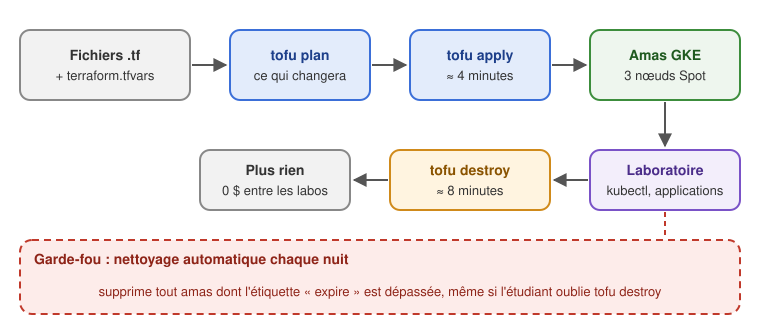

# 43b - Amas GKE à la demande avec Terraform

*Révision du 2026.11.07*

<p align="center">
    
</p>

**Objectif de la lecture** : créer un amas Kubernetes sur Google Cloud (GKE) en une commande au début d'un laboratoire, et le détruire en une commande à la fin, grâce à l'infrastructure en tant que code (Terraform / OpenTofu).

*A.B. aka ve2cuy*

> 💡 Le [document 43](Kubernetes-Google.cloud.md) présente GKE et la création d'un amas par la console. Ce document automatise la création **et la destruction**.

## Contenu

- [**1 – Le problème : des amas oubliés**](#section-1)
- [**2 – L'infrastructure en tant que code**](#section-2)
  - [2.1 – Terraform, OpenTofu, Crossplane ou Config Connector?](#section-2-1)
  - [2.2 – Les notions de Terraform](#section-2-2)
- [**3 – Préparer le poste de travail**](#section-3)
- [**4 – Le module du cours**](#section-4)
  - [4.1 – Les fichiers](#section-4-1)
  - [4.2 – L'amas et ses nœuds](#section-4-2)
- [**5 – Créer, utiliser et détruire l'amas**](#section-5)
- [**6 – Les garde-fous contre les coûts**](#section-6)
- [**7 – Laboratoire (durée 60 minutes)**](#section-7)
- [**8 – Gestion des erreurs**](#section-8)

---

## 1 – Le problème : des amas oubliés {#section-1}

Un amas GKE coûte **tant qu'il existe**, même si personne ne s'en sert : frais de gestion de l'amas, nœuds (VM), disques, adresses IP et équilibreurs de charge. L'an dernier, des amas créés à la main pour un laboratoire sont restés allumés pendant des semaines.

Ordre de grandeur, pour un petit amas de 3 nœuds `e2-medium` (tarifs 2026, à vérifier dans le [calculateur de Google](https://cloud.google.com/products/calculator)) :

| Durée | Amas oublié (nœuds standard) | Amas du cours (nœuds Spot, détruit après le labo) |
|-------|------------------------------|---------------------------------------------------|
| Un labo de 3 heures | environ 0,60 $ | environ 0,40 $ |
| Une journée | environ 5 $ | 0 $ (détruit) |
| Une semaine | environ 35 $ | 0 $ |
| × 30 étudiants, 4 semaines (un labo par semaine) | **environ 4 200 $** | **environ 50 $** |

Calcul : frais de gestion de 0,10 $ l'heure par amas (le crédit gratuit n'en couvre qu'un par compte de facturation), plus environ 0,037 $ l'heure par nœud `e2-medium` standard, ou environ 0,011 $ en Spot. Les disques, les adresses IP et les équilibreurs de charge s'ajoutent.

La solution : ne jamais laisser l'amas exister entre deux laboratoires. Le recréer prend 4 minutes, à condition que sa création soit **décrite dans du code** plutôt que faite à la main dans la console.



---

## 2 – L'infrastructure en tant que code {#section-2}

L'**infrastructure en tant que code** (*IaC*) décrit des ressources (réseaux, VM, amas…) dans des fichiers texte, versionnés dans Git. Un outil compare la description avec ce qui existe et fait les changements nécessaires. Vagrant ([document 34](Kubernetes-Installation-cluster.md)) applique la même idée aux VM locales.

### 2.1 – Terraform, OpenTofu, Crossplane ou Config Connector? {#section-2-1}

| Outil | Principe | Pour nos amas de laboratoire |
|-------|----------|------------------------------|
| **Terraform** (HashiCorp) | Fichiers `.tf` (langage HCL); `apply` crée, `destroy` supprime | ✅ Standard de l'industrie; rien ne tourne entre les labos |
| **OpenTofu** | Version libre de Terraform (fondation Linux), créée en 2023 quand Terraform a changé de licence; mêmes fichiers, commande `tofu` | ✅ **Notre choix** : identique à Terraform pour ce cours |
| Crossplane | Les ressources du nuage sont décrites en YAML, comme des objets Kubernetes; un opérateur les crée | ❌ Il faut un **amas de gestion toujours allumé** : on paierait justement ce qu'on veut éviter |
| Config Connector | L'opérateur Kubernetes de Google, même principe que Crossplane | ❌ Même défaut (amas GKE ou Config Controller permanent) |

> 💡 Toutes les commandes de ce document fonctionnent aussi avec `terraform` au lieu de `tofu`.

### 2.2 – Les notions de Terraform {#section-2-2}

| Notion | Description |
|--------|-------------|
| **Fournisseur** (*provider*) | Le greffon qui parle à un nuage : ici `hashicorp/google` |
| **Ressource** | Un objet à créer : `google_container_cluster`, `google_container_node_pool` |
| **Variable** | Un paramètre du module (`var.etudiant`), dont la valeur est dans `terraform.tfvars` |
| **État** (*state*) | Le fichier `terraform.tfstate` : ce que Terraform a créé. **Sans lui, Terraform ne sait plus quoi détruire** |
| `tofu init` | Télécharge le fournisseur (une seule fois par dossier) |
| `tofu plan` | Montre ce qui sera créé, modifié ou détruit, **sans rien faire** |
| `tofu apply` | Applique le plan |
| `tofu destroy` | Détruit tout ce que l'état contient |

---

## 3 – Préparer le poste de travail {#section-3}

| Poste | Google Cloud CLI | OpenTofu |
|-------|------------------|----------|
| Windows 11 | `winget install Google.CloudSDK` | `winget install OpenTofu.Tofu` |
| macOS | `brew install --cask gcloud-cli` | `brew install opentofu` |
| Ubuntu | [dépôt apt de Google](https://cloud.google.com/sdk/docs/install#deb) | `sudo snap install --classic opentofu` |

```bash
# Le greffon qui permet à kubectl de s'authentifier auprès de GKE
gcloud components install gke-gcloud-auth-plugin

# Se connecter (le fureteur s'ouvre), pour gcloud...
gcloud auth login
# ... et pour Terraform/OpenTofu (« Application Default Credentials »)
gcloud auth application-default login

# Le projet du cours
gcloud config set project info420

# Une seule fois par projet (l'enseignant) : les API de GKE et de Compute Engine
gcloud services enable container.googleapis.com compute.googleapis.com
```

> 💡 Ubuntu installé par apt : `sudo apt install google-cloud-cli-gke-gcloud-auth-plugin` au lieu de `gcloud components install`.

---

## 4 – Le module du cours {#section-4}

### 4.1 – Les fichiers {#section-4-1}

Le module est dans le dépôt du cours : [Installation/Kubernetes/GKE](https://github.com/ve2cuy/4204d4/tree/main/Installation/Kubernetes/GKE).

| Fichier | Rôle |
|---------|------|
| `versions.tf` | Version d'OpenTofu et du fournisseur Google (`~> 8.10`) |
| `variables.tf` | Les paramètres : projet, étudiant, zone, nombre et type de nœuds, Spot, date d'expiration |
| `main.tf` | L'amas et son groupe de nœuds |
| `outputs.tf` | Ce qui est affiché après `apply` : nom de l'amas, commande de connexion |
| `terraform.tfvars.exemple` | Modèle des valeurs de chaque étudiant |
| `.gitignore` | `terraform.tfvars`, l'état et `.terraform/` ne vont jamais dans Git |

Les valeurs de chaque étudiant, dans `terraform.tfvars` (copie de `terraform.tfvars.exemple`) :

```hcl
projet   = "info420"
etudiant = "e1234567"       # matricule ou nom, en minuscules
expire   = "2026-11-08"     # le lendemain : nettoyage automatique après cette date
```

Les autres variables ont une valeur par défaut :

| Variable | Défaut | Description |
|----------|--------|-------------|
| `zone` | `northamerica-northeast1-a` | Montréal |
| `nb_noeuds` | `3` | Nœuds ouvriers |
| `type_machine` | `e2-medium` | 2 vCPU partagés, 4 Go |
| `spot` | `true` | Nœuds Spot |

### 4.2 – L'amas et ses nœuds {#section-4-2}

```hcl
locals {
  etiquettes = {
    cours    = "4204d4"
    etudiant = var.etudiant
    expire   = var.expire
  }
}

resource "google_container_cluster" "labo" {
  name     = "labo-${var.etudiant}"
  location = var.zone

  # Pas de groupe de nœuds par défaut (ni initial_node_count ni node_config ici) :
  # les nœuds viennent du groupe « noeuds » ci-dessous

  # Sans cette ligne, « tofu destroy » refuse de supprimer l'amas
  deletion_protection = false

  release_channel {
    channel = "REGULAR"
  }

  resource_labels = local.etiquettes
}

resource "google_container_node_pool" "noeuds" {
  name       = "noeuds"
  cluster    = google_container_cluster.labo.id
  location   = var.zone
  node_count = var.nb_noeuds

  node_config {
    machine_type    = var.type_machine
    spot            = var.spot
    disk_type       = "pd-standard"
    disk_size_gb    = 30
    labels          = local.etiquettes
    resource_labels = local.etiquettes
    oauth_scopes    = ["https://www.googleapis.com/auth/cloud-platform"]
  }
}
```

Les choix qui réduisent les coûts :

| Choix | Pourquoi |
|-------|----------|
| `location = var.zone` (une **zone**, pas une région) | Un amas **zonal** : ses frais de gestion sont couverts par le crédit gratuit de GKE (un amas par compte de facturation). Un amas régional triplerait les nœuds (un par zone). |
| `spot = true` | Nœuds **Spot** : de 60 à 90 % moins chers. Google peut les reprendre avec 30 secondes d'avis; Kubernetes recrée alors les Pods ailleurs. Parfait pour un laboratoire. |
| `disk_type = "pd-standard"`, 30 Go | Le disque le moins cher, assez grand pour les images |
| `deletion_protection = false` | Permet `tofu destroy` (protégé par défaut dans le fournisseur Google 8) |
| Étiquettes `cours`, `etudiant`, `expire` | Retrouver l'amas d'un étudiant dans la facture, et le supprimer automatiquement après sa date d'expiration ([section 6](#section-6)) |

---

## 5 – Créer, utiliser et détruire l'amas {#section-5}

```bash
cd 4204d4/Installation/Kubernetes/GKE
cp terraform.tfvars.exemple terraform.tfvars     # puis l'éditer

tofu init       # une seule fois : télécharge le fournisseur Google
tofu plan       # ce qui sera créé, sans rien faire
```

```
Plan: 2 to add, 0 to change, 0 to destroy.
```

```bash
tofu apply      # répondre « yes »
```

```
google_container_cluster.labo: Creation complete after 2m55s
google_container_node_pool.noeuds: Creation complete after 1m22s

Apply complete! Resources: 2 added, 0 changed, 0 destroyed.

Outputs:
amas = "labo-e1234567"
connexion = "gcloud container clusters get-credentials labo-e1234567 --zone northamerica-northeast1-a --project info420"
```

**Se connecter et utiliser l'amas** : la commande `connexion` ajoute l'amas au fichier `~/.kube/config`.

```bash
gcloud container clusters get-credentials labo-e1234567 --zone northamerica-northeast1-a --project info420

kubectl get nodes -L cloud.google.com/gke-spot,expire
```

```
NAME                                       STATUS   ROLES    AGE   VERSION               GKE-SPOT   EXPIRE
gke-labo-e1234567-noeuds-7858dcbb-vl2n     Ready    <none>   22s   v1.36.4-gke.2046003   true       2026-11-08
gke-labo-e1234567-noeuds-7858dcbb-xhq4     Ready    <none>   22s   v1.36.4-gke.2046003   true       2026-11-08
gke-labo-e1234567-noeuds-7858dcbb-ztg5     Ready    <none>   21s   v1.36.4-gke.2046003   true       2026-11-08
```

```bash
# Une application exposée par un équilibreur de charge de Google
kubectl create deployment web --image=nginx:1.28 --replicas=3
kubectl expose deployment web --port=80 --type=LoadBalancer
kubectl get service web -w        # attendre l'EXTERNAL-IP (environ 1 minute)
```

**À la fin du laboratoire** : d'abord les services `LoadBalancer`, **ensuite** l'amas.

```bash
# 1. Les équilibreurs de charge créés par Kubernetes ne sont pas dans l'état de Terraform :
#    les effacer avant l'amas, sinon ils peuvent rester (et coûter) après sa destruction
kubectl delete service --all

# 2. Détruire l'amas (environ 8 minutes)
tofu destroy    # répondre « yes »
```

```
google_container_node_pool.noeuds: Destruction complete after 3m1s
google_container_cluster.labo: Destruction complete after 5m2s

Destroy complete! Resources: 2 destroyed.
```

```bash
# 3. Vérifier qu'il ne reste rien
gcloud container clusters list
gcloud compute forwarding-rules list
gcloud compute disks list
```

---

## 6 – Les garde-fous contre les coûts {#section-6}

`tofu destroy` dépend de la discipline de chacun. Les garde-fous suivants ne dépendent pas des étudiants :

| Garde-fou | Effet |
|-----------|-------|
| **Nettoyage automatique chaque nuit** | Une tâche planifiée (GitHub Actions) supprime chaque amas dont l'étiquette `expire` est dépassée, même si l'étudiant a oublié `tofu destroy`. *À venir.* |
| **Budget et alertes** | Un budget sur le compte de facturation envoie un courriel à 50, 90 et 100 %. ⚠️ Une alerte **n'arrête rien** : elle prévient seulement. |
| **Nœuds Spot, amas zonal** | Réduisent le coût de chaque heure (section 4.2) |
| **Vérifier les restes** | `gcloud container clusters list --filter="resourceLabels.cours=4204d4"` : les amas du cours encore en vie |

> ⚠️ **Le fichier d'état est essentiel.** Si `terraform.tfstate` est perdu (dossier effacé, autre poste), `tofu destroy` ne sait plus quoi détruire. Supprimer alors l'amas avec `gcloud container clusters delete labo-<etudiant> --zone northamerica-northeast1-a`.

---


<br>

## 7 – Laboratoire (durée 60 minutes) {#section-7}

1. Préparer `terraform.tfvars` avec votre matricule et la date de demain. Lancer `tofu plan` : combien de ressources seront créées?
2. Créer l'amas (`tofu apply`) et noter la durée. Se connecter avec la commande `connexion`.
3. Déployer l'application superMinou du [document 30](Kubernetes-partie-2.md) avec un service `LoadBalancer`, et l'ouvrir dans le fureteur par son adresse externe.
4. Dans `terraform.tfvars`, ajouter `nb_noeuds = 2`. Que montre `tofu plan`? L'amas est-il recréé ou seulement modifié? Appliquer, puis observer les Pods avec `kubectl get pods -o wide`.
5. Dans la console Google Cloud (Kubernetes Engine), retrouver votre amas et ses étiquettes.
6. Effacer les services `LoadBalancer`, détruire l'amas, puis vérifier qu'il ne reste rien (section 5).
7. **Question** : que se passerait-il si vous effaciez le dossier du module avant `tofu destroy`? Comment supprimer l'amas dans ce cas?

---

## 8 – Gestion des erreurs {#section-8}

#### 🤚 « could not find default credentials »

Terraform/OpenTofu ne trouve pas d'identité : `gcloud auth application-default login`.

#### 🤚 « Kubernetes Engine API has not been used in project … »

L'API n'est pas activée dans le projet : `gcloud services enable container.googleapis.com compute.googleapis.com` (droits de l'enseignant).

#### 🤚 « Cannot destroy cluster because deletion_protection is set to true »

La ligne `deletion_protection = false` est absente : l'ajouter, `tofu apply`, puis `tofu destroy`.

#### 🤚 « Quota 'CPUS' exceeded » ou « IN_USE_ADDRESSES »

Le projet a atteint une limite de la région (processeurs, adresses IP) : trop d'amas en même temps. Réduire `nb_noeuds`, détruire les amas inutiles, ou demander une hausse de quota (console : *IAM et administration* → *Quotas*).

#### 🤚 kubectl : « gke-gcloud-auth-plugin not found »

Installer le greffon (section 3), puis refaire `gcloud container clusters get-credentials …`.

#### 🤚 Un nœud disparaît, puis revient

Normal avec les nœuds Spot : Google a repris la VM. GKE en crée une autre et Kubernetes y replace les Pods.

---

## Références

* [OpenTofu](https://opentofu.org/docs/) et [Terraform](https://developer.hashicorp.com/terraform/docs)
* [Fournisseur Google : google_container_cluster](https://registry.terraform.io/providers/hashicorp/google/latest/docs/resources/container_cluster)
* [GKE : nœuds Spot](https://cloud.google.com/kubernetes-engine/docs/concepts/spot-vms)
* [GKE : tarifs et crédit gratuit](https://cloud.google.com/kubernetes-engine/pricing)
* [Crossplane](https://www.crossplane.io/) et [Config Connector](https://cloud.google.com/config-connector/docs/overview)

---

## Crédits

*Document rédigé par Alain Boudreault © 2021-2027*  
*Révision 2026.11.07.1*  

*Contenu par [VE2CUY](https://ve2cuy.github.io/blog/)*
