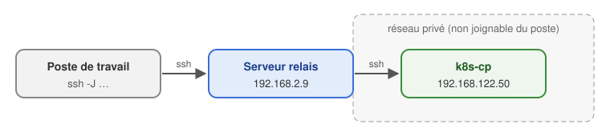

# 24b - Installation manuelle de K8S

*Révision du 2026.11.10*

> ✅ **Nouvelle version du document 24.** Toutes les commandes ont été vérifiées le 2026.11.07 sur un amas de quatre VM (Ubuntu 26.04.1 LTS, noyau 7.0, processeur Intel Xeon) : Kubernetes v1.37.2, containerd 2.2.2, Flannel v0.28.

<p align="center">
    
</p>

**Objectif de la lecture** : installer, avec `kubeadm`, un amas (cluster) Kubernetes de quatre serveurs : un contrôleur (*control-plane*) et trois nœuds ouvriers (*worker nodes*).

*A.B. aka ve2cuy*

| Composant | Version |
|-----------|---------|
| Système d'exploitation | Ubuntu Server 26.04.1 LTS |
| Kubernetes (kubeadm, kubelet, kubectl) | v1.37 |
| Moteur de conteneurs | containerd 2.2 (paquet d'Ubuntu) |
| Réseau des Pods (CNI) | Flannel |

## Contenu

- [**1 – Architecture et prérequis**](#section-1)
  - [1.1 – Les serveurs de l'amas](#section-1-1)
  - [1.2 – Prérequis de chaque serveur](#section-1-2)
  - [1.3 – Ports réseau](#section-1-3)
  - [1.4 – Se connecter aux serveurs par un serveur relais (ssh -J)](#section-1-4)
- [**2 – Préparer chaque serveur (les quatre)**](#section-2)
  - [2.1 – Nom d'hôte et fichier hosts](#section-2-1)
  - [2.2 – Désactiver le fichier d'échange (swap)](#section-2-2)
  - [2.3 – Modules du noyau et configuration réseau](#section-2-3)
  - [2.4 – Installer et configurer containerd](#section-2-4)
- [**3 – Installer kubeadm, kubelet et kubectl (les quatre)**](#section-3)
  - [3.1 – Choisir la version de Kubernetes](#section-3-1)
  - [3.2 – Ajouter le dépôt de Kubernetes](#section-3-2)
  - [3.3 – Installer les applications](#section-3-3)
  - [3.4 – Aligner l'image « pause » de containerd](#section-3-4)
- [**4 – Initialiser le contrôleur (control-plane)**](#section-4)
  - [4.1 – kubeadm init](#section-4-1)
  - [4.2 – Configurer kubectl](#section-4-2)
  - [4.3 – Installer le réseau des Pods (Flannel)](#section-4-3)
- [**5 – Joindre les trois nœuds ouvriers**](#section-5)
- [**6 – Vérifier et tester l'amas**](#section-6)
- [**7 – Laboratoire (durée 30 minutes)**](#section-7)
- [**8 – Option : amas d'un seul serveur**](#section-8)
- [**9 – Gestion des erreurs**](#section-9)
- [**10 – Mise à jour de l'amas**](#section-10)
- [**11 – Retirer un nœud, réinitialiser un serveur**](#section-11)
- [**12 – Installation automatique par scripts**](#section-12)
- [**13 – Un amas sur le poste de travail avec `kind`**](#section-13)

---

## 1 – Architecture et prérequis {#section-1}

### 1.1 – Les serveurs de l'amas {#section-1-1}

| Rôle | Nom d'hôte | Adresse IP (exemple) |
|------|------------|----------------------|
| Contrôleur (control-plane) | `k8s-cp` | 192.168.139.50 |
| Nœud ouvrier 1 | `k8s-w1` | 192.168.139.51 |
| Nœud ouvrier 2 | `k8s-w2` | 192.168.139.52 |
| Nœud ouvrier 3 | `k8s-w3` | 192.168.139.53 |

> 💡 Adapter les adresses IP à votre réseau. Elles doivent être **fixes** : un nœud qui change d'adresse ne peut plus joindre l'amas.

Le contrôleur héberge le plan de contrôle : serveur d'API, ordonnanceur (scheduler), gestionnaire de contrôle et la base etcd. Les Pods des applications roulent sur les trois nœuds ouvriers.

### 1.2 – Prérequis de chaque serveur {#section-1-2}

* Ubuntu Server 26.04.1 LTS, processeur x86-64 (Intel ou AMD) ou ARM64
* **2 vCPU** et **2 Go de mémoire vive** au minimum (4 Go recommandés pour le contrôleur)
* 20 Go de disque
* Un accès Internet (téléchargement des paquets et des images)
* Un **nom d'hôte unique**, une **adresse MAC unique** et un **identifiant unique** (`product_uuid`, `machine-id`)

> ⚠️ **VM clonées** : un clone garde le `machine-id` de la VM d'origine. Deux nœuds avec le même identifiant causent des erreurs difficiles à diagnostiquer. Vérifier, puis régénérer au besoin :

```bash
# Ces valeurs doivent être différentes sur chaque serveur
cat /etc/machine-id
sudo cat /sys/class/dmi/id/product_uuid
ip link    # adresses MAC

# Sur un clone : régénérer le machine-id, puis redémarrer
sudo rm /etc/machine-id
sudo systemd-machine-id-setup
sudo reboot
```

### 1.3 – Ports réseau {#section-1-3}

Le pare-feu d'Ubuntu (`ufw`) est désactivé par défaut. S'il est actif, il faut ouvrir les ports suivants :

| Serveur | Ports | Usage |
|---------|-------|-------|
| Contrôleur | TCP 6443 | Serveur d'API de Kubernetes |
| Contrôleur | TCP 2379-2380 | etcd |
| Contrôleur | TCP 10257, 10259 | Gestionnaire de contrôle, ordonnanceur |
| Tous | TCP 10250 | kubelet |
| Tous | TCP 10256 | kube-proxy |
| Ouvriers | TCP 30000-32767 | Services de type NodePort |
| Tous | UDP 8472 | Réseau Flannel (VXLAN) |

```bash
# Vérifier l'état du pare-feu
sudo ufw status
```

### 1.4 – Se connecter aux serveurs par un serveur relais (`ssh -J`) {#section-1-4}

Les serveurs d'un amas sont souvent dans un **réseau privé** : VM derrière le NAT d'un hyperviseur, réseau isolé d'un laboratoire, nuage. Ils ne sont pas joignables directement du poste de travail. On passe alors par un **serveur relais** (*jump host* ou *bastion*), joignable des deux côtés.



L'option `-J` (*ProxyJump*) de `ssh` fait les deux connexions en une seule commande :

```bash
ssh -J claude@192.168.2.9 etudiant@192.168.122.50
```

* `ssh` se connecte d'abord au relais (`claude@192.168.2.9`), puis, à travers lui, à la destination (`etudiant@192.168.122.50`).
* **Deux mots de passe** sont demandés : celui du relais, puis celui de la destination. Ce n'est pas une authentification à deux facteurs : ce sont deux connexions SSH, chacune avec sa propre authentification (mot de passe ou clé).
* La connexion vers la destination est chiffrée **de bout en bout** : le relais transmet les paquets sans pouvoir les lire. Aucune clé privée n'est copiée sur le relais.

**Plusieurs relais, copie de fichiers :**

```bash
# Deux relais successifs, séparés par une virgule
ssh -J usager@relais1,usager@relais2 etudiant@192.168.122.50

# scp et rsync acceptent aussi le relais
scp -J claude@192.168.2.9 manifeste.yml etudiant@192.168.122.50:~
```

> 💡 **Windows 11** : le client OpenSSH est installé avec le système. `ssh`, `scp`, `-J` et `-L` fonctionnent tels quels dans PowerShell ou le Terminal Windows.

**Configuration permanente** dans le fichier `~/.ssh/config` du poste de travail (Windows : `C:\Users\<nom>\.ssh\config`, sans extension) :

```
Host relais
    HostName 192.168.2.9
    User claude

Host k8s-cp k8s-w1 k8s-w2 k8s-w3
    User etudiant
    ProxyJump relais

Host k8s-cp
    HostName 192.168.122.50
Host k8s-w1
    HostName 192.168.122.51
Host k8s-w2
    HostName 192.168.122.52
Host k8s-w3
    HostName 192.168.122.53
```

```bash
# Ensuite, simplement :
ssh k8s-cp
scp manifeste.yml k8s-w1:~

# Créer une paire de clés (une seule fois), puis copier la clé publique
# sur le relais et sur le contrôleur : plus de mot de passe à taper
ssh-keygen -t ed25519
ssh-copy-id relais
ssh-copy-id k8s-cp
```

`ssh-copy-id` n'existe pas sous Windows. Dans PowerShell :

```powershell
type $env:USERPROFILE\.ssh\id_ed25519.pub | ssh relais "mkdir -p ~/.ssh && cat >> ~/.ssh/authorized_keys"
type $env:USERPROFILE\.ssh\id_ed25519.pub | ssh k8s-cp "mkdir -p ~/.ssh && cat >> ~/.ssh/authorized_keys"
```

**Tunnel vers un service de l'amas** : l'option `-L port_local:destination:port` rend un port du réseau privé accessible sur le poste de travail. L'option `-N` ouvre le tunnel sans ouvrir de session (pas d'invite de commande sur le relais).

```bash
# Le NodePort 30080 du nœud k8s-w1 devient http://localhost:30080 sur le poste de travail
ssh -N -L 30080:192.168.122.51:30080 claude@192.168.2.9
```

> ⚠️ Le tunnel se lance **sur le poste de travail**, là où le fureteur ou `kubectl` l'utilisera. Lancé dans une session déjà ouverte sur le relais (invite `claude@srvclaude:~$`), il écoute sur le relais lui-même : le poste reçoit alors `connection refused`.

**Au premier plan ou en arrière-plan**

| Mode | Commande | Pour l'arrêter |
|------|----------|----------------|
| **Premier plan** : le terminal reste occupé, rien n'est affiché | `ssh -N -L 30080:192.168.122.51:30080 claude@192.168.2.9` | `Ctrl+C` dans ce terminal |
| **Arrière-plan** (macOS, Linux, WSL) : `ssh` rend la main après le mot de passe | `ssh -f -N -L 30080:192.168.122.51:30080 claude@192.168.2.9` | `pkill -f "30080:192.168.122.51"` |

* Au premier plan, le tunnel vit tant que le terminal reste ouvert : le plus simple, dans un deuxième onglet.
* En arrière-plan, le tunnel survit à la fermeture du terminal; il faut penser à l'arrêter. Ajouter `-o ExitOnForwardFailure=yes` pour que `ssh` s'arrête en erreur si le port local est déjà pris, plutôt que de passer en arrière-plan sans tunnel.
* **Windows** (PowerShell) : l'option `-f` n'est pas offerte par le client OpenSSH de Windows. Utiliser le premier plan dans un deuxième onglet du Terminal Windows, ou, avec une clé SSH (pas de mot de passe à taper), une fenêtre réduite :

```powershell
Start-Process ssh -ArgumentList "-N -L 30080:192.168.122.51:30080 relais" -WindowStyle Minimized
# Pour l'arrêter : fermer cette fenêtre, ou
Get-Process ssh | Stop-Process
```

**`kubectl` sur le poste de travail, par un tunnel vers l'API** (port 6443 du contrôleur)

`kubectl` lit sa configuration (adresse de l'API, certificats, clé de l'administrateur) dans un fichier *kubeconfig*. Celui de l'amas est sur le contrôleur, dans `~/.kube/config`. On en fait une copie sur le poste de travail, **dans un fichier à part** pour ne pas écraser la configuration existante (Docker Desktop, autre amas), et la variable d'environnement `KUBECONFIG` indique à `kubectl` quel fichier utiliser.

Prérequis : `kubectl` sur le poste (Windows : `winget install Kubernetes.kubectl`; macOS : `brew install kubectl`; Docker Desktop l'installe aussi).

**macOS, Linux ou WSL :**

```bash
# 1. Copier le fichier config du contrôleur sur le poste (une seule fois)
mkdir -p ~/.kube
scp -J claude@192.168.2.9 etudiant@192.168.122.50:.kube/config ~/.kube/amas-24b.yaml
chmod 600 ~/.kube/amas-24b.yaml          # il contient la clé de l'administrateur de l'amas

# 2. Le faire pointer vers le tunnel. Le certificat de l'API ne contient pas
#    127.0.0.1 : tls-server-name lui présente le nom k8s-cp, qui y figure.
kubectl --kubeconfig ~/.kube/amas-24b.yaml config set-cluster kubernetes \
  --server=https://127.0.0.1:6443 --tls-server-name=k8s-cp

# 3. Ouvrir le tunnel (premier plan dans un autre terminal, ou -f)
ssh -f -N -L 6443:192.168.122.50:6443 claude@192.168.2.9

# 4. Choisir ce fichier avec la variable d'environnement, puis utiliser kubectl
export KUBECONFIG=~/.kube/amas-24b.yaml
kubectl get nodes
```

**Windows (PowerShell) :**

```powershell
# 1. Copier le fichier config du contrôleur sur le poste (une seule fois)
mkdir -Force $HOME\.kube
scp -J claude@192.168.2.9 etudiant@192.168.122.50:.kube/config $HOME\.kube\amas-24b.yaml

# 2. Le faire pointer vers le tunnel
kubectl --kubeconfig $HOME\.kube\amas-24b.yaml config set-cluster kubernetes `
  --server=https://127.0.0.1:6443 --tls-server-name=k8s-cp

# 3. Ouvrir le tunnel, dans un deuxième onglet du Terminal Windows (le laisser ouvert)
ssh -N -L 6443:192.168.122.50:6443 claude@192.168.2.9

# 4. Choisir ce fichier avec la variable d'environnement, puis utiliser kubectl
$env:KUBECONFIG = "$HOME\.kube\amas-24b.yaml"
kubectl get nodes
```

**La variable d'environnement `KUBECONFIG`**

| Portée | macOS, Linux, WSL | Windows (PowerShell) |
|--------|-------------------|----------------------|
| Ce terminal seulement | `export KUBECONFIG=~/.kube/amas-24b.yaml` | `$env:KUBECONFIG = "$HOME\.kube\amas-24b.yaml"` |
| Tous les prochains terminaux | ajouter la ligne `export` à `~/.zshrc` (macOS) ou `~/.bashrc` (Linux, WSL) | `[Environment]::SetEnvironmentVariable("KUBECONFIG", "$HOME\.kube\amas-24b.yaml", "User")`, puis ouvrir un nouveau terminal |
| Revenir à `~/.kube/config` | `unset KUBECONFIG` | `Remove-Item Env:KUBECONFIG` (et, si elle est permanente : `[Environment]::SetEnvironmentVariable("KUBECONFIG", $null, "User")`) |
| Vérifier | `echo $KUBECONFIG` | `$env:KUBECONFIG` |

* Sans la variable, l'option `--kubeconfig` choisit le fichier pour une seule commande : `kubectl --kubeconfig ~/.kube/amas-24b.yaml get nodes`.
* `kubectl config view --minify` affiche la configuration utilisée; la ligne `server:` doit être `https://127.0.0.1:6443`.

> 💡 Si `ssh` répond `bind: Address already in use`, un autre logiciel occupe déjà le port local 6443 (par exemple Kubernetes de Docker Desktop). Prendre un autre port local, `-L 16443:192.168.122.50:6443`, et `--server=https://127.0.0.1:16443` à l'étape 2.

> 💡 Un relais est aussi une mesure de sécurité : seul le relais est exposé au réseau extérieur, et tous les accès aux serveurs de l'amas passent par lui.

---

## 2 – Préparer chaque serveur (les quatre) {#section-2}

👉 Les étapes des sections 2 et 3 sont à faire sur **les quatre serveurs**.

### 2.1 – Nom d'hôte et fichier hosts {#section-2-1}

```bash
# Sur chaque serveur, avec son propre nom : k8s-cp, k8s-w1, k8s-w2 ou k8s-w3
sudo hostnamectl set-hostname k8s-cp

# Sur chaque serveur : les quatre noms dans /etc/hosts
cat <<EOF | sudo tee -a /etc/hosts
192.168.139.50 k8s-cp
192.168.139.51 k8s-w1
192.168.139.52 k8s-w2
192.168.139.53 k8s-w3
EOF

# Vérifier
hostname
ping -c 1 k8s-w1
```

### 2.2 – Désactiver le fichier d'échange (swap) {#section-2-2}

Par défaut, `kubelet` refuse de démarrer si la mémoire virtuelle (swap) est active.

```bash
# Désactiver tout de suite
sudo swapoff -a

# Désactiver de façon permanente : mettre en commentaire la ligne swap de /etc/fstab
# (fonctionne avec des espaces ou des tabulations)
sudo sed -i -E 's/^([^#].*[[:space:]]swap[[:space:]].*)$/#\1/' /etc/fstab

# Vérifier : aucune ligne ne doit s'afficher
swapon --show
grep swap /etc/fstab     # la ligne doit commencer par #
```

> 💡 Dans le doute, tester la commande `sed` sans l'option `-i` : le résultat s'affiche sans modifier le fichier.

### 2.3 – Modules du noyau et configuration réseau {#section-2-3}

```bash
# Modules requis par containerd et par le réseau des Pods
cat <<EOF | sudo tee /etc/modules-load.d/k8s.conf
overlay
br_netfilter
EOF
sudo modprobe overlay
sudo modprobe br_netfilter

# Permettre le routage des paquets IP entre les Pods et les nœuds
cat <<EOF | sudo tee /etc/sysctl.d/k8s.conf
net.bridge.bridge-nf-call-iptables  = 1
net.bridge.bridge-nf-call-ip6tables = 1
net.ipv4.ip_forward                 = 1
EOF
sudo sysctl --system

# Vérifier : les trois valeurs doivent être 1
sysctl net.bridge.bridge-nf-call-iptables net.bridge.bridge-nf-call-ip6tables net.ipv4.ip_forward
```

### 2.4 – Installer et configurer containerd {#section-2-4}

> **Note**: **containerd** est le moteur de conteneurs utilisé par Kubernetes. C'est un projet de la CNCF (Cloud Native Computing Foundation), aussi utilisé par Docker. Kubernetes n'utilise pas Docker : il n'est pas nécessaire de l'installer sur les nœuds.

```bash
sudo apt-get update
sudo apt-get install -y containerd

# Créer le fichier de configuration par défaut
sudo mkdir -p /etc/containerd
containerd config default | sudo tee /etc/containerd/config.toml > /dev/null

# Utiliser le gestionnaire de cgroups de systemd (le même que kubelet)
sudo sed -i 's/SystemdCgroup = false/SystemdCgroup = true/' /etc/containerd/config.toml

sudo systemctl restart containerd
sudo systemctl enable containerd

# Vérifier
containerd --version
grep SystemdCgroup /etc/containerd/config.toml    # SystemdCgroup = true
```

---

## 3 – Installer kubeadm, kubelet et kubectl (les quatre) {#section-3}

### 3.1 – Choisir la version de Kubernetes {#section-3-1}

```bash
# Dernière version stable
curl -Ls https://dl.k8s.io/release/stable.txt
# Exemple de résultat : v1.37.2
```

👉 L'historique des versions est [ici](https://kubernetes.io/releases/). Tous les serveurs d'un amas doivent avoir la **même version mineure** (ex. 1.37).

### 3.2 – Ajouter le dépôt de Kubernetes {#section-3-2}

```bash
# Version mineure seulement : v1.37.2 -> v1.37
export K8S_VERSION=v1.37

sudo apt-get install -y ca-certificates curl gpg
sudo mkdir -p -m 755 /etc/apt/keyrings
curl -fsSL https://pkgs.k8s.io/core:/stable:/${K8S_VERSION}/deb/Release.key | sudo gpg --dearmor --yes -o /etc/apt/keyrings/kubernetes-apt-keyring.gpg
echo "deb [signed-by=/etc/apt/keyrings/kubernetes-apt-keyring.gpg] https://pkgs.k8s.io/core:/stable:/${K8S_VERSION}/deb/ /" | sudo tee /etc/apt/sources.list.d/kubernetes.list
```

> **NOTE**: Le dépôt `pkgs.k8s.io` ne contient qu'une version mineure. Pour passer à une version suivante, il faudra changer `K8S_VERSION` (voir la [section 10](#section-10)).

### 3.3 – Installer les applications {#section-3-3}

```bash
sudo apt-get update
sudo apt-get install -y kubelet kubeadm kubectl

# Bloquer les mises à jour automatiques : une mise à jour de Kubernetes se fait à la main
sudo apt-mark hold kubelet kubeadm kubectl

# Vérifier
kubeadm version -o short
```

### 3.4 – Aligner l'image « pause » de containerd {#section-3-4}

Chaque Pod démarre avec un petit conteneur, l'image `pause`. La version proposée par containerd (`pause:3.10.1` sous Ubuntu 26.04) n'est pas celle attendue par kubeadm 1.37 (`pause:3.10.2`). Sans correction, `kubeadm init` affiche un avertissement.

```bash
# Version attendue par kubeadm
PAUSE=$(kubeadm config images list 2>/dev/null | grep pause)
echo $PAUSE

# La renseigner dans la configuration de containerd (clé « sandbox »)
sudo sed -i "s#registry.k8s.io/pause:[0-9.]*#${PAUSE}#" /etc/containerd/config.toml
sudo systemctl restart containerd

# Vérifier
grep "sandbox =" /etc/containerd/config.toml
```

---

## 4 – Initialiser le contrôleur (control-plane) {#section-4}

👉 Section 4 : **sur le contrôleur seulement** (`k8s-cp`).

### 4.1 – kubeadm init {#section-4-1}

```bash
sudo kubeadm init \
  --pod-network-cidr=10.244.0.0/16 \
  --apiserver-advertise-address=192.168.139.50
```

* `--pod-network-cidr` : plage d'adresses des Pods; `10.244.0.0/16` est la valeur attendue par Flannel.
* `--apiserver-advertise-address` : adresse IP du contrôleur. Indispensable si le serveur a plusieurs cartes réseau (VM VirtualBox, Vagrant…).

À la fin, `kubeadm` affiche la commande qui permet aux nœuds ouvriers de joindre l'amas :

```
Your Kubernetes control-plane has initialized successfully!
...
Then you can join any number of worker nodes by running the following on each as root:

kubeadm join 192.168.139.50:6443 --token abcdef.0123456789abcdef \
	--discovery-token-ca-cert-hash sha256:1234...cdef
```

> 💡 Copier cette commande dans un fichier : elle servira à la section 5. Le jeton (token) expire après 24 heures; il est possible d'en obtenir un nouveau (section 5).

### 4.2 – Configurer kubectl {#section-4-2}

```bash
mkdir -p $HOME/.kube
sudo cp -i /etc/kubernetes/admin.conf $HOME/.kube/config
sudo chown $(id -u):$(id -g) $HOME/.kube/config

kubectl get nodes
# NAME     STATUS     ROLES           AGE   VERSION
# k8s-cp   NotReady   control-plane   1m    v1.37.2
```

> **NOTE**: Le statut est `NotReady` : il manque le réseau des Pods (**C**ontainer **N**etwork **I**nterface).

### 4.3 – Installer le réseau des Pods (Flannel) {#section-4-3}

```bash
kubectl apply -f https://github.com/flannel-io/flannel/releases/latest/download/kube-flannel.yml

# Attendre que le contrôleur passe à Ready (moins d'une minute)
kubectl get nodes -w
```

---

## 5 – Joindre les trois nœuds ouvriers {#section-5}

**Sur chaque nœud ouvrier** (`k8s-w1`, `k8s-w2`, `k8s-w3`), après les sections 2 et 3, exécuter la commande `kubeadm join` affichée par `kubeadm init`, avec `sudo` :

```bash
sudo kubeadm join 192.168.139.50:6443 --token abcdef.0123456789abcdef \
	--discovery-token-ca-cert-hash sha256:1234...cdef

# Résultat attendu:
# This node has joined the cluster
```

Commande perdue, ou jeton expiré? **Sur le contrôleur**, en produire une nouvelle :

```bash
sudo kubeadm token create --print-join-command
```

**Sur le contrôleur**, donner le rôle `worker` aux trois nœuds (c'est seulement une étiquette, affichée par `kubectl get nodes`) :

```bash
kubectl label node k8s-w1 node-role.kubernetes.io/worker=
kubectl label node k8s-w2 node-role.kubernetes.io/worker=
kubectl label node k8s-w3 node-role.kubernetes.io/worker=
```

---

## 6 – Vérifier et tester l'amas {#section-6}

```bash
kubectl get nodes -o wide
# NAME     STATUS   ROLES           AGE    VERSION   INTERNAL-IP      OS-IMAGE             KERNEL-VERSION     CONTAINER-RUNTIME
# k8s-cp   Ready    control-plane   110s   v1.37.2   192.168.139.50   Ubuntu 26.04.1 LTS   7.0.0-38-generic   containerd://2.2.2
# k8s-w1   Ready    worker          48s    v1.37.2   192.168.139.51   Ubuntu 26.04.1 LTS   7.0.0-38-generic   containerd://2.2.2
# k8s-w2   Ready    worker          45s    v1.37.2   192.168.139.52   Ubuntu 26.04.1 LTS   7.0.0-38-generic   containerd://2.2.2
# k8s-w3   Ready    worker          41s    v1.37.2   192.168.139.53   Ubuntu 26.04.1 LTS   7.0.0-38-generic   containerd://2.2.2

# Les composantes du plan de contrôle et du réseau
kubectl get pods -n kube-system
kubectl get pods -n kube-flannel -o wide     # un Pod Flannel par nœud
```

**Tester un déploiement** : trois réplicas de nginx, exposés par un service NodePort.

```yaml
# Fichier: test-nginx.yml
apiVersion: apps/v1
kind: Deployment
metadata:
  name: test-nginx
spec:
  replicas: 3
  selector:
    matchLabels:
      app: test-nginx
  template:
    metadata:
      labels:
        app: test-nginx
    spec:
      containers:
      - name: nginx
        image: nginx:1.28
        ports:
        - containerPort: 80
---
apiVersion: v1
kind: Service
metadata:
  name: test-nginx
spec:
  type: NodePort
  selector:
    app: test-nginx
  ports:
  - port: 80
    targetPort: 80
    nodePort: 30080
```

```bash
kubectl apply -f test-nginx.yml

# Les trois Pods sont répartis sur les nœuds ouvriers (colonne NODE)
kubectl get pods -o wide

# Le service répond sur le port 30080 de n'importe quel nœud
curl http://192.168.139.51:30080
curl http://192.168.139.53:30080

# Effacer
kubectl delete -f test-nginx.yml
```

> 💡 Aucun Pod de l'application n'est placé sur le contrôleur : il porte la contrainte (taint) `node-role.kubernetes.io/control-plane:NoSchedule`, ce qui est la configuration recommandée pour un amas de plusieurs serveurs.

---


<br>

## 7 – Laboratoire (durée 30 minutes) {#section-7}

Sur l'amas de quatre serveurs :

1. Déployer `nginx:1.28` avec **6 réplicas** et vérifier qu'il y a deux Pods par nœud ouvrier.
2. Retirer temporairement le nœud `k8s-w3` du service : `kubectl drain k8s-w3 --ignore-daemonsets`. Où sont maintenant les 6 Pods?
3. Remettre le nœud en service : `kubectl uncordon k8s-w3`. Les Pods reviennent-ils d'eux-mêmes sur `k8s-w3`? Pourquoi?
4. Arrêter la VM `k8s-w2` (sans `drain`). Combien de temps faut-il avant que `kubectl get nodes` l'affiche `NotReady`, puis avant que ses Pods soient recréés ailleurs?
5. Redémarrer `k8s-w2` et vérifier qu'il redevient `Ready` sans autre intervention.

---

## 8 – Option : amas d'un seul serveur {#section-8}

Pour apprendre sur un seul serveur, il est possible de faire rouler les Pods sur le contrôleur. Après la section 4, retirer la contrainte (taint) du contrôleur :

```bash
kubectl taint nodes --all node-role.kubernetes.io/control-plane-
```

> ⚠️ À ne pas faire dans un amas de plusieurs serveurs : les applications partageraient les ressources du plan de contrôle.

---

## 9 – Gestion des erreurs {#section-9}

#### 🤚 kubelet ne démarre pas après un redémarrage

```bash
kubectl get nodes
# The connection to the server 192.168.139.50:6443 was refused - did you specify the right host or port?

systemctl status kubelet
journalctl -fu kubelet
# ... "failed to run Kubelet: running with swap on is not supported, please disable swap!"
```

**Raison**: le fichier d'échange (swap) est encore actif au démarrage. Refaire la [section 2.2](#section-2-2), puis `sudo systemctl restart kubelet`.

#### 🤚 bridge-nf-call-iptables does not exist

```
[ERROR FileContent--proc-sys-net-bridge-bridge-nf-call-iptables]: /proc/sys/net/bridge/bridge-nf-call-iptables does not exist
```

**Raison**: le module `br_netfilter` n'est pas chargé. Refaire la [section 2.3](#section-2-3).

#### 🤚 Image « pause » incohérente

```
detected that the sandbox image "registry.k8s.io/pause:3.10.1" of the container runtime is inconsistent
with that used by kubeadm. It is recommended to use "registry.k8s.io/pause:3.10.2" as the CRI sandbox image.
```

**Raison**: la [section 3.4](#section-3-4) n'a pas été faite.

#### 🤚 Un nœud reste NotReady

```bash
kubectl describe node k8s-w1 | grep -A5 Conditions
kubectl get pods -n kube-flannel -o wide
```

**Raisons possibles**: Pod Flannel en erreur sur ce nœud (port UDP 8472 bloqué, mauvaise carte réseau), containerd arrêté, ou deux nœuds avec le même `machine-id` ([section 1.2](#section-1-2)).

#### 🤚 kubeadm join : token invalide ou expiré

Produire une nouvelle commande sur le contrôleur : `sudo kubeadm token create --print-join-command`.

---

## 10 – Mise à jour de l'amas {#section-10}

Kubernetes se met à jour **une version mineure à la fois** (ex. 1.37 → 1.38, jamais 1.36 → 1.38) : d'abord le contrôleur, puis chaque nœud ouvrier, un à la fois.

**Étape 1 – Pointer apt sur le dépôt de la nouvelle version** (sur chaque serveur)

```bash
export K8S_VERSION=v1.38
curl -fsSL https://pkgs.k8s.io/core:/stable:/${K8S_VERSION}/deb/Release.key | sudo gpg --dearmor --yes -o /etc/apt/keyrings/kubernetes-apt-keyring.gpg
echo "deb [signed-by=/etc/apt/keyrings/kubernetes-apt-keyring.gpg] https://pkgs.k8s.io/core:/stable:/${K8S_VERSION}/deb/ /" | sudo tee /etc/apt/sources.list.d/kubernetes.list
sudo apt update

# Versions offertes, ex. 1.38.0-1.1
apt-cache madison kubeadm
```

**Étape 2 – Le contrôleur**

```bash
# Remplacer 1.38.0-1.1 par la version affichée par apt-cache madison
sudo apt-mark unhold kubeadm
sudo apt install -y kubeadm='1.38.0-1.1'
sudo apt-mark hold kubeadm

sudo kubeadm upgrade plan
sudo kubeadm upgrade apply v1.38.0

kubectl drain k8s-cp --ignore-daemonsets
sudo apt-mark unhold kubelet kubectl
sudo apt install -y kubelet='1.38.0-1.1' kubectl='1.38.0-1.1'
sudo apt-mark hold kubelet kubectl
sudo systemctl daemon-reload
sudo systemctl restart kubelet
kubectl uncordon k8s-cp
```

**Étape 3 – Chaque nœud ouvrier**, un à la fois

```bash
# Sur le nœud : kubeadm (comme à l'étape 2), puis
sudo kubeadm upgrade node

# Sur le contrôleur
kubectl drain k8s-w1 --ignore-daemonsets --delete-emptydir-data

# Sur le nœud : kubelet et kubectl
sudo apt-mark unhold kubelet kubectl
sudo apt install -y kubelet='1.38.0-1.1' kubectl='1.38.0-1.1'
sudo apt-mark hold kubelet kubectl
sudo systemctl daemon-reload
sudo systemctl restart kubelet

# Sur le contrôleur
kubectl uncordon k8s-w1
kubectl get nodes
```

**Référence :** [Mettre à jour un amas kubeadm](https://kubernetes.io/docs/tasks/administer-cluster/kubeadm/kubeadm-upgrade/)

---

## 11 – Retirer un nœud, réinitialiser un serveur {#section-11}

```bash
# Sur le contrôleur : déplacer les Pods ailleurs, puis retirer le nœud de l'amas
kubectl drain k8s-w3 --ignore-daemonsets --delete-emptydir-data
kubectl delete node k8s-w3

# Sur le serveur retiré (ou sur le contrôleur, pour tout recommencer)
sudo kubeadm reset -f
sudo rm -rf /etc/cni/net.d $HOME/.kube
```

---

## 12 – Installation automatique par scripts {#section-12}

Les scripts suivants regroupent les sections 2 à 4 (contrôleur) et 2 à 3 (nœud) :

```bash
# Contrôleur
curl https://raw.githubusercontent.com/ve2cuy/4204d4/refs/heads/main/Installation/Kubernetes/server.sh | bash

# Nœud ouvrier, puis la commande kubeadm join du contrôleur
curl https://raw.githubusercontent.com/ve2cuy/4204d4/refs/heads/main/Installation/Kubernetes/node.sh | bash
```

> 💡 Toujours lire un script avant de l'exécuter avec `curl … | bash`.

---

## 13 – Un amas sur le poste de travail avec `kind` {#section-13}

[kind](https://kind.sigs.k8s.io) (*Kubernetes in Docker*) crée un amas de plusieurs nœuds dans des conteneurs Docker. Pratique pour des essais, mais ce n'est pas un vrai amas de serveurs.

```yaml
# Fichier: mon-cluster.yaml
kind: Cluster
apiVersion: kind.x-k8s.io/v1alpha4
nodes:
- role: control-plane
- role: worker
- role: worker
- role: worker
```

```bash
kind create cluster --name mon-amas --config mon-cluster.yaml
kubectl get nodes

# Pour effacer
kind delete cluster --name mon-amas
```

**Référence :** [kind – Quick Start](https://kind.sigs.k8s.io/docs/user/quick-start/)

---

## Références

* [Installer kubeadm](https://kubernetes.io/docs/setup/production-environment/tools/kubeadm/install-kubeadm/)
* [Créer un amas avec kubeadm](https://kubernetes.io/docs/setup/production-environment/tools/kubeadm/create-cluster-kubeadm/)
* [Moteurs de conteneurs (containerd)](https://kubernetes.io/docs/setup/production-environment/container-runtimes/)
* [Ports et protocoles](https://kubernetes.io/docs/reference/networking/ports-and-protocols/)
* [Flannel](https://github.com/flannel-io/flannel)

**NOTE**: Voir les alias K8s dans la section [copier/coller](../CopierColler.md)

---

## Crédits

*Document rédigé par Alain Boudreault © 2021-2027*  
*Révision 2026.11.10.1*  

*Contenu par [VE2CUY](https://ve2cuy.github.io/blog/)*
