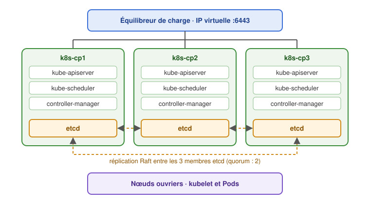
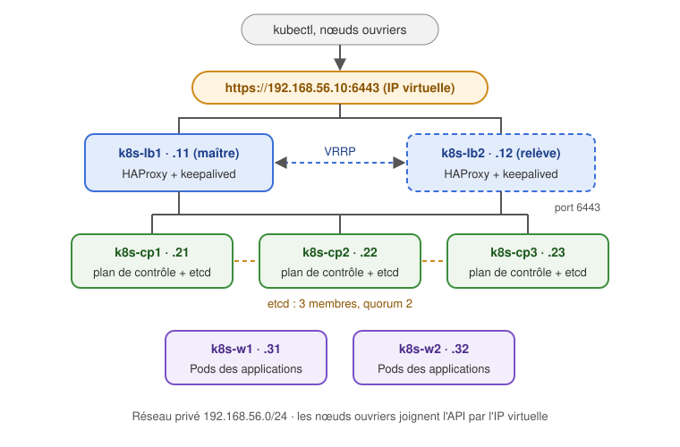
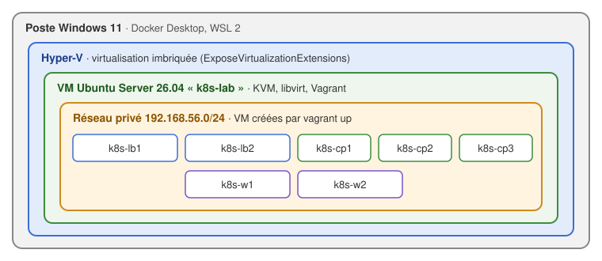
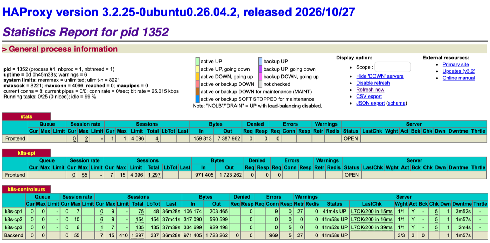

# 34 - Installation d'un amas HA

*Révision du 2026.11.09*

<p align="center">
    
</p>

**Objectif de la lecture** : comprendre la haute disponibilité (HA) d'un amas Kubernetes, puis déployer, avec Vagrant, un amas HA complet : deux équilibreurs de charge, trois contrôleurs et deux nœuds ouvriers, dans une VM Ubuntu sous Hyper-V.

*A.B. aka ve2cuy*

> 💡 Ce document suppose que l'installation manuelle d'un amas avec `kubeadm` est connue : [document 24b](Installation-manuelle-K8S.md).

## Contenu

- [**1 – La haute disponibilité (HA)**](#section-1)
  - [1.1 – Le point de défaillance unique](#section-1-1)
  - [1.2 – Les composantes à redonder](#section-1-2)
  - [1.3 – etcd et le quorum](#section-1-3)
  - [1.4 – Les deux topologies de kubeadm](#section-1-4)
  - [1.5 – L'équilibreur de charge de l'API](#section-1-5)
- [**2 – Le système que nous allons déployer**](#section-2)
- [**3 – Le poste de travail : Hyper-V et une VM Ubuntu**](#section-3)
  - [3.1 – Créer la VM Ubuntu Server sous Hyper-V](#section-3-1)
  - [3.2 – Préparer la VM : KVM, libvirt et Vagrant](#section-3-2)
  - [3.3 – Vagrant](#section-3-3)
  - [3.4 – Un premier Vagrantfile](#section-3-4)
- [**4 – L'amas HA entièrement défini dans Vagrant**](#section-4)
  - [4.1 – Les fichiers du projet](#section-4-1)
  - [4.2 – Le Vagrantfile](#section-4-2)
  - [4.3 – La CA et les secrets préparés d'avance](#section-4-3)
  - [4.4 – Lancer l'amas](#section-4-4)
- [**5 – Ce que font les scripts, étape par étape**](#section-5)
  - [5.1 – Les équilibreurs de charge : HAProxy et keepalived](#section-5-1)
  - [5.2 – Le premier contrôleur](#section-5-2)
  - [5.3 – Les autres contrôleurs](#section-5-3)
  - [5.4 – Les nœuds ouvriers](#section-5-4)
  - [5.5 – Le piège des deux cartes réseau](#section-5-5)
- [**6 – Vérifier l'amas HA**](#section-6)
- [**7 – Laboratoire : tests de panne (durée 45 minutes)**](#section-7)
- [**8 – Gestion des erreurs**](#section-8)
- [**9 – Gérer les VM avec Vagrant**](#section-9)

---

## 1 – La haute disponibilité (HA) {#section-1}

### 1.1 – Le point de défaillance unique {#section-1-1}

L'amas du document 24b a **un seul contrôleur** (`k8s-cp`). C'est un *point de défaillance unique* (*SPOF*, *single point of failure*). Si ce serveur tombe :

* les Pods déjà en marche sur les nœuds ouvriers continuent de rouler;
* mais l'API de Kubernetes ne répond plus : plus de `kubectl`, plus de déploiement, plus de mise à l'échelle;
* et plus rien ne remplace un Pod qui tombe, puisque l'ordonnanceur et les contrôleurs sont arrêtés;
* si le disque du contrôleur est perdu, la base etcd l'est aussi : **tout l'état de l'amas disparaît**.

Un amas **hautement disponible** (*HA, high availability*) n'a aucun point de défaillance unique : chaque composante essentielle existe en plusieurs exemplaires, sur des serveurs différents.

### 1.2 – Les composantes à redonder {#section-1-2}

| Composante | Comment elle devient redondante |
|------------|---------------------------------|
| `kube-apiserver` | Sans état : plusieurs instances actives en même temps, derrière un **équilibreur de charge** |
| `etcd` | Base de données répartie : plusieurs membres qui se répliquent (algorithme Raft) et votent (**quorum**) |
| `kube-scheduler`, `kube-controller-manager` | Une instance par contrôleur, mais **une seule active** : les autres attendent (élection d'un leader) |
| Applications | Plusieurs réplicas, répartis sur plusieurs nœuds ouvriers |
| Équilibreur de charge de l'API | Deux équilibreurs et une **IP virtuelle** qui passe de l'un à l'autre |

### 1.3 – etcd et le quorum {#section-1-3}

etcd ne confirme une écriture que si la **majorité** de ses membres l'a acceptée : c'est le **quorum**. Un membre isolé ne peut donc jamais écrire seul, ce qui évite que deux moitiés d'un réseau coupé en deux modifient l'amas chacune de leur côté (*split brain*).

| Membres etcd | Quorum (majorité) | Pannes tolérées |
|:------------:|:-----------------:|:---------------:|
| 1 | 1 | 0 |
| 2 | 2 | **0** |
| 3 | 2 | **1** |
| 4 | 3 | 1 |
| 5 | 3 | **2** |

> 💡 Toujours un **nombre impair** de membres : 2 membres ne tolèrent aucune panne (pire qu'un seul : deux fois plus de chances d'en perdre un), et 4 membres n'en tolèrent pas plus que 3. Un amas HA commence donc à **trois contrôleurs**.

### 1.4 – Les deux topologies de kubeadm {#section-1-4}

[La documentation de Kubernetes](https://kubernetes.io/docs/setup/production-environment/tools/kubeadm/ha-topology/) propose deux topologies.

**etcd empilé** (*stacked etcd*) : chaque contrôleur héberge aussi un membre etcd. C'est la topologie par défaut de `kubeadm`.



**etcd externe** : les membres etcd sont sur leurs propres serveurs.

| | etcd empilé | etcd externe |
|---|---|---|
| Serveurs requis | 3 contrôleurs | 3 contrôleurs **+ 3 serveurs etcd** |
| Installation | Simple : `kubeadm init` et `kubeadm join --control-plane` | Plus complexe : etcd installé et sécurisé à part |
| Perte d'un contrôleur | Perte d'une instance de l'API **et** d'un membre etcd | Perte d'une instance de l'API seulement |
| Usage | La majorité des amas | Grands amas, exigences élevées |

👉 Nous utiliserons la topologie **etcd empilé**.

### 1.5 – L'équilibreur de charge de l'API {#section-1-5}

Les nœuds, `kubectl` et les contrôleurs eux-mêmes doivent joindre l'API par **une seule adresse**, peu importe le contrôleur qui répond. Cette adresse est le **point d'entrée du plan de contrôle**, donné à `kubeadm init` par l'option `--control-plane-endpoint`. Elle ne peut plus être changée facilement après l'installation.

Derrière cette adresse, un équilibreur de charge répartit les connexions TCP (port 6443) entre les contrôleurs **en santé**. Plusieurs solutions sont possibles :

| Solution | Description |
|----------|-------------|
| **HAProxy + keepalived** | HAProxy répartit les connexions; keepalived (protocole VRRP) porte une **IP virtuelle** (VIP) sur un des équilibreurs et la déplace sur l'autre en cas de panne. Classique, sur des serveurs dédiés. |
| kube-vip | IP virtuelle portée directement par les contrôleurs, dans un Pod statique. Pas de serveur de plus. |
| Équilibreur du nuage | Google Cloud, AWS, Azure : un service géré joue ce rôle. |

👉 Nous utiliserons **HAProxy + keepalived** sur deux serveurs dédiés : un seul équilibreur serait lui-même un point de défaillance unique.

---

## 2 – Le système que nous allons déployer {#section-2}

Sept VM Ubuntu Server 26.04 LTS, dans le réseau privé `192.168.56.0/24` :

| VM | Rôle | Adresse IP | vCPU | Mémoire |
|----|------|------------|:----:|:-------:|
| — | **IP virtuelle de l'API** (`k8s-api`) | **192.168.56.10** | | |
| `k8s-lb1` | Équilibreur de charge (maître VRRP) | 192.168.56.11 | 1 | 512 Mo |
| `k8s-lb2` | Équilibreur de charge (relève) | 192.168.56.12 | 1 | 512 Mo |
| `k8s-cp1` | Contrôleur + etcd | 192.168.56.21 | 2 | 2 Go |
| `k8s-cp2` | Contrôleur + etcd | 192.168.56.22 | 2 | 2 Go |
| `k8s-cp3` | Contrôleur + etcd | 192.168.56.23 | 2 | 2 Go |
| `k8s-w1` | Nœud ouvrier | 192.168.56.31 | 2 | 2 Go |
| `k8s-w2` | Nœud ouvrier | 192.168.56.32 | 2 | 2 Go |



**Logiciels** : Kubernetes v1.37, containerd 2.2, Flannel, HAProxy et keepalived (paquets d'Ubuntu).

**Ressources** : les sept VM demandent environ 11 Go de mémoire vive et 20 Go de disque. Elles roulent dans une VM Ubuntu Server de 14 Go (section 3); avec moins de mémoire, réduire `NB_WORKERS` à 1.

---

## 3 – Le poste de travail : Hyper-V et une VM Ubuntu {#section-3}

En classe, l'amas est créé **dans une VM Ubuntu Server** qui roule sous **Hyper-V** sur le poste Windows 11. Les sept VM de l'amas sont des VM **imbriquées** : des VM (KVM) dans une VM (Hyper-V).



Pourquoi Hyper-V? Docker Desktop et WSL 2 utilisent Hyper-V. Quand Hyper-V est actif, VirtualBox et VMware Workstation ne peuvent plus offrir la virtualisation matérielle (VT-x, AMD-V) à leurs VM : seul Hyper-V permet alors la **virtualisation imbriquée**. Docker Desktop, WSL et l'amas cohabitent ainsi sur le même poste.

### 3.1 – Créer la VM Ubuntu Server sous Hyper-V {#section-3-1}

**Prérequis** : Windows 11 Pro, Éducation ou Entreprise (Hyper-V n'existe pas dans l'édition Famille), droits d'administrateur, 24 Go de mémoire vive ou plus sur le poste, l'image ISO d'[Ubuntu Server 26.04 LTS](https://ubuntu.com/download/server).

| VM `k8s-lab` | Valeur |
|--------------|--------|
| Génération | 2 (UEFI) |
| Processeurs | 8 vCPU (au moins 6) |
| Mémoire | 14 Go, **statique** (la mémoire dynamique empêche la virtualisation imbriquée) |
| Disque | 80 Go |
| Réseau | Commutateur `Default Switch` (NAT de Windows) |

Dans **PowerShell, en administrateur** :

```powershell
# 1. Activer Hyper-V (redémarrage demandé), s'il ne l'est pas déjà
Enable-WindowsOptionalFeature -Online -FeatureName Microsoft-Hyper-V -All

# 2. Créer la VM
New-VM -Name k8s-lab -Generation 2 -MemoryStartupBytes 14GB `
  -NewVHDPath "C:\VM\k8s-lab.vhdx" -NewVHDSizeBytes 80GB -SwitchName "Default Switch"
Set-VMMemory    -VMName k8s-lab -DynamicMemoryEnabled $false
Set-VMProcessor -VMName k8s-lab -Count 8 -ExposeVirtualizationExtensions $true
Set-VMFirmware  -VMName k8s-lab -SecureBootTemplate MicrosoftUEFICertificateAuthority
Set-VM          -VMName k8s-lab -AutomaticCheckpointsEnabled $false

# 3. Démarrer sur l'ISO d'Ubuntu Server
Add-VMDvdDrive  -VMName k8s-lab -Path "C:\ISO\ubuntu-26.04.1-live-server-amd64.iso"
Set-VMFirmware  -VMName k8s-lab -FirstBootDevice (Get-VMDvdDrive -VMName k8s-lab)
Start-VM k8s-lab
vmconnect localhost k8s-lab
```

* `-ExposeVirtualizationExtensions $true` : **la** commande qui permet la virtualisation imbriquée. Elle ne s'applique qu'à une VM arrêtée.
* `-SecureBootTemplate MicrosoftUEFICertificateAuthority` : le démarrage sécurisé accepte Linux (le modèle par défaut n'accepte que Windows).

**Installer Ubuntu Server** dans la fenêtre de la VM : nom de la machine `k8s-lab`, un usager (ex. `etudiant`), et cocher **Install OpenSSH server**. Après l'installation, noter l'adresse IP de la VM :

```bash
ip -4 -br addr show eth0
```

> 💡 Le `Default Switch` donne une adresse en `172.x.x.x` qui peut changer au redémarrage de Windows. Se connecter du **Terminal Windows** par `ssh etudiant@<adresse>`, ou par le nom `ssh etudiant@k8s-lab.mshome.net` (nom publié par le `Default Switch`).

### 3.2 – Préparer la VM : KVM, libvirt et Vagrant {#section-3-2}

Dans la VM `k8s-lab` (session SSH) :

```bash
# La virtualisation imbriquée fonctionne si /dev/kvm existe
ls -l /dev/kvm

# Récupérer le projet du cours et préparer la VM (environ 5 minutes)
git clone https://github.com/ve2cuy/4204d4.git
bash 4204d4/Installation/Kubernetes/HA/preparer-hote.sh

# Fermer la session et se reconnecter : l'usager vient d'être ajouté au groupe libvirt
exit
```

Le script [preparer-hote.sh](https://github.com/ve2cuy/4204d4/blob/main/Installation/Kubernetes/HA/preparer-hote.sh) installe :

| Logiciel | Rôle |
|----------|------|
| `qemu-system-x86`, `libvirt-daemon-system` | L'hyperviseur KVM et son gestionnaire, libvirt |
| `ovmf` | Le micrologiciel UEFI des VM |
| Vagrant (dépôt apt de HashiCorp) | La création des VM à partir du `Vagrantfile` |
| `vagrant-libvirt` (greffon, compilé sur place) | Le fournisseur libvirt de Vagrant |

Il crée aussi la réserve de stockage `default` de libvirt et fait de libvirt le fournisseur par défaut de Vagrant (`VAGRANT_DEFAULT_PROVIDER`). Résultat attendu :

```
>>> Virtualisation matérielle
/dev/kvm présent, 8 processeur(s) avec VT-x/AMD-V
...
>>> Prêt : Vagrant 2.4.9, vagrant-libvirt (0.12.2, global)
>>> Fermer la session et se reconnecter (groupe libvirt), puis : vagrant up
```

### 3.3 – Vagrant {#section-3-3}

[Vagrant](https://developer.hashicorp.com/vagrant) (HashiCorp) crée et configure des machines virtuelles à partir d'un fichier texte, le `Vagrantfile`. C'est de l'**infrastructure en tant que code** (*IaC*) : le même fichier produit les mêmes VM, sur tous les postes, autant de fois que nécessaire.

| Notion | Description |
|--------|-------------|
| **Box** | Image de base d'une VM (système déjà installé), téléchargée du [catalogue de Vagrant](https://portal.cloud.hashicorp.com/vagrant/discover). Ex. `bento/ubuntu-26.04`. |
| **Fournisseur** (*provider*) | Le logiciel de virtualisation : VirtualBox (par défaut), libvirt/KVM (Linux), VMware, Parallels, Hyper-V. |
| **Approvisionnement** (*provisioner*) | Ce qui configure la VM après son premier démarrage : script shell, copie de fichiers, Ansible… |
| **Réseau** | Une carte NAT (gérée par Vagrant, pour Internet et `vagrant ssh`) et, au besoin, un réseau privé (`private_network`) entre les VM et le poste. |

**Les commandes essentielles** (dans la VM `k8s-lab`) :

| Commande | Action |
|----------|--------|
| `vagrant up [nom]` | Créer (première fois) et démarrer les VM |
| `vagrant status` | État des VM du projet |
| `vagrant ssh nom` | Se connecter à une VM (usager `vagrant`, `sudo` sans mot de passe) |
| `vagrant halt [nom]` | Arrêter proprement |
| `vagrant reload [nom]` | Redémarrer (et relire le Vagrantfile) |
| `vagrant provision [nom]` | Relancer l'approvisionnement |
| `vagrant snapshot save nom photo` | Photo d'une VM (VirtualBox, libvirt) |
| `vagrant destroy -f [nom]` | Effacer les VM |
| `vagrant global-status` | Toutes les VM Vagrant du poste |
| `vagrant box list` | Les boîtes téléchargées |

### 3.4 – Un premier Vagrantfile {#section-3-4}

Un `Vagrantfile` est écrit en Ruby. Voici une VM Ubuntu avec une adresse dans un réseau privé et un script d'approvisionnement :

```ruby
# Fichier: Vagrantfile
Vagrant.configure("2") do |config|
  config.vm.box = "bento/ubuntu-26.04"
  config.vm.hostname = "essai"
  config.vm.network "private_network", ip: "192.168.56.5"
  config.vm.provider "libvirt" do |lv|
    lv.driver   = "kvm"                                  # la boîte demande « qemu » (émulation)
    lv.cpu_mode = "host-passthrough"
    lv.loader   = "/usr/share/OVMF/OVMF_CODE_4M.fd"      # la boîte démarre en UEFI
    lv.nvram    = "/var/lib/libvirt/qemu/nvram/essai_VARS.fd"
    lv.memory   = 1024
    lv.cpus     = 1
  end
  config.vm.provision "shell", inline: <<-SHELL
    apt-get update
    apt-get install -y nginx
  SHELL
end
```

```bash
mkdir essai && cd essai          # y placer le Vagrantfile
vagrant up                       # quelques minutes la première fois (téléchargement de la boîte)
curl http://192.168.56.5         # page d'accueil de nginx
vagrant ssh                      # exit pour sortir
vagrant destroy -f
```

> 💡 Le `Vagrantfile` du projet HA (section 4) contient aussi les réglages de VirtualBox : sur un poste Linux ou macOS **sans** Hyper-V, il fonctionne directement avec VirtualBox (`vagrant up --provider=virtualbox`).

---

## 4 – L'amas HA entièrement défini dans Vagrant {#section-4}

### 4.1 – Les fichiers du projet {#section-4-1}

Les fichiers sont dans le dépôt du cours : [Installation/Kubernetes/HA](https://github.com/ve2cuy/4204d4/tree/main/Installation/Kubernetes/HA).

| Fichier | Rôle |
|---------|------|
| `Vagrantfile` | Les 7 VM, leurs adresses, la CA et les secrets |
| `preparer-hote.sh` | Préparation de la VM `k8s-lab` : KVM, libvirt, Vagrant (section 3.2) |
| `scripts/commun.sh` | Préparation d'un serveur K8s (document 24b, sections 2 et 3) |
| `scripts/equilibreur.sh` | HAProxy + keepalived |
| `scripts/controleur.sh` | `kubeadm init` (cp1) ou `kubeadm join --control-plane` (cp2, cp3) |
| `scripts/ouvrier.sh` | `kubeadm join` (w1, w2) |
| `.gitignore`, `.gitattributes` | `pki/` et `.vagrant/` jamais dans Git; scripts en fins de ligne Unix |

Le projet a été récupéré dans la VM `k8s-lab` à la section 3.2 (`git clone`).

### 4.2 – Le Vagrantfile {#section-4-2}

Les paramètres sont en tête du fichier :

```ruby
K8S_VERSION = "v1.37"                 # version mineure de Kubernetes
BOITE       = "bento/ubuntu-26.04"    # Ubuntu 26.04 (VirtualBox et libvirt)
RESEAU      = "192.168.56"            # réseau privé des VM
VIP         = "#{RESEAU}.10"          # IP virtuelle de l'API (keepalived)
NB_CP       = 3                       # contrôleurs : nombre impair (3, 5)
NB_WORKERS  = (ENV["NB_WORKERS"] || 2).to_i   # nœuds ouvriers (ou : NB_WORKERS=3 vagrant up)
```

Chaque type de VM reçoit ses scripts, et les valeurs dont ils ont besoin par des variables d'environnement (`env:`). Par exemple, les contrôleurs :

```ruby
  CPS.each_with_index do |(nom, ip), i|
    config.vm.define nom do |n|
      n.vm.hostname = nom
      n.vm.network "private_network", ip: ip
      ressources(n.vm, nom, 2048, 2)
      commun(n.vm, ip)                                  # scripts/commun.sh
      if i == 0                                         # le premier contrôleur reçoit la CA
        n.vm.provision "file", source: "pki/ca.crt", destination: "/tmp/ca.crt"
        n.vm.provision "file", source: "pki/ca.key", destination: "/tmp/ca.key"
      end
      n.vm.provision "shell", name: "controleur", path: "scripts/controleur.sh",
        env: { "PREMIER" => (i == 0 ? "oui" : "non"), "IP" => ip, "VIP" => VIP,
               "RESEAU" => RESEAU, "JETON" => JETON, "CA_HASH" => CA_HASH, "CLE_CRT" => CLE_CRT }
    end
  end
```

Points à remarquer :

* Les VM sont créées **une à la fois**, dans l'ordre du fichier : équilibreurs, contrôleurs, puis nœuds ouvriers (`VAGRANT_NO_PARALLEL`).
* Aucun dossier partagé (`synced_folder … disabled: true`) : les fichiers utiles sont copiés par l'approvisionnement `file`. Le projet fonctionne ainsi avec libvirt comme avec VirtualBox.
* Le même fichier sert aux deux fournisseurs : les blocs `provider "virtualbox"` et `provider "libvirt"` fixent la mémoire et les processeurs.
* La boîte `bento/ubuntu-26.04` démarre en **UEFI** seulement. Avec libvirt, il faut donc le micrologiciel OVMF (`lv.loader`, paquet `ovmf`) et forcer KVM (`lv.driver = "kvm"`) : la boîte demande `qemu`, une émulation des centaines de fois plus lente.

```ruby
    vm.provider "libvirt" do |lv|
      lv.driver   = "kvm"
      lv.cpu_mode = "host-passthrough"
      lv.loader   = "/usr/share/OVMF/OVMF_CODE_4M.fd"
      lv.nvram    = "/var/lib/libvirt/qemu/nvram/ha_#{nom}_VARS.fd"
    end
```

### 4.3 – La CA et les secrets préparés d'avance {#section-4-3}

Pour joindre un amas, un nœud a besoin de trois informations, normalement affichées par `kubeadm init` :

| Information | Option de `kubeadm join` | Rôle |
|-------------|--------------------------|------|
| Jeton | `--token` | Authentifie le nœud auprès de l'API (valide 24 heures) |
| Empreinte de la CA | `--discovery-token-ca-cert-hash` | Le nœud vérifie qu'il parle au **bon** amas (pas à un imposteur) |
| Clé des certificats | `--certificate-key` | Contrôleurs seulement : déchiffre les certificats partagés (valide 2 heures) |

Dans une installation automatisée, `kubeadm init` n'a pas encore été exécuté quand Vagrant prépare les VM. Le Vagrantfile crée donc ces informations **d'avance**, une seule fois, dans le dossier `pki/` du poste de travail :

* l'**autorité de certification** (CA) de l'amas : `pki/ca.crt` et `pki/ca.key`, avec la bibliothèque OpenSSL de Ruby (incluse dans Vagrant, aucun outil à installer). `kubeadm init` utilise une CA déjà présente dans `/etc/kubernetes/pki` au lieu d'en créer une : l'empreinte est donc connue d'avance;
* le **jeton** (`pki/jeton`) et la **clé des certificats** (`pki/cle-certificats`), passés à `kubeadm init --token … --certificate-key …`.

```ruby
CA_HASH = "sha256:" + OpenSSL::Digest::SHA256.hexdigest(
  OpenSSL::X509::Certificate.new(File.read(File.join(PKI, "ca.crt"))).public_key.public_to_der)
```

> ⚠️ `pki/ca.key` donne un contrôle total sur l'amas : il ne doit jamais être publié (`.gitignore`). Pour un nouvel amas, effacer le dossier `pki/` après `vagrant destroy`.

### 4.4 – Lancer l'amas {#section-4-4}

```bash
# Dans la VM k8s-lab
cd ~/4204d4/Installation/Kubernetes/HA
vagrant up
```

La première fois, Vagrant télécharge la boîte (environ 1 Go), puis crée et configure les sept VM l'une après l'autre : compter de **20 à 30 minutes**. Chaque étape est affichée (`>>> …`) :

```
    k8s-lb1: >>> k8s-lb1 prêt (priorité 110, carte eth1)
    k8s-lb2: >>> k8s-lb2 prêt (priorité 100, carte eth1)
    k8s-cp1: >>> kubeadm init
    k8s-cp1: >>> Flannel (carte du réseau 192.168.56.0/24)
    k8s-cp1: >>> k8s-cp1 : contrôleur prêt
    k8s-cp2: >>> kubeadm join --control-plane
    k8s-cp2: {"level":"warn", ... "logger":"etcd-client", ... "retrying of unary invoker failed" ...}
    k8s-cp2: >>> k8s-cp2 : contrôleur prêt
    ...
    k8s-w2: >>> k8s-w2 : nœud ouvrier prêt
```

> 💡 Les messages `{"level":"warn" ... "etcd-client" ...}` pendant le `join` d'un contrôleur sont normaux : le nouveau membre etcd est d'abord ajouté comme *learner* (apprenti), et kubeadm réessaie jusqu'à ce qu'il soit synchronisé avec le leader.

```bash
vagrant status
vagrant ssh k8s-cp1
kubectl get nodes
```

---

## 5 – Ce que font les scripts, étape par étape {#section-5}

Les scripts reprennent l'installation manuelle du [document 24b](Installation-manuelle-K8S.md). Cette section explique ce qui change pour un amas HA; les mêmes commandes peuvent être tapées à la main sur des serveurs sans Vagrant.

### 5.1 – Les équilibreurs de charge : HAProxy et keepalived {#section-5-1}

Sur `k8s-lb1` et `k8s-lb2` ([scripts/equilibreur.sh](https://github.com/ve2cuy/4204d4/blob/main/Installation/Kubernetes/HA/scripts/equilibreur.sh)) :

```bash
sudo apt install -y haproxy keepalived
```

**HAProxy** (`/etc/haproxy/haproxy.cfg`) : le port 6443 est réparti entre les trois contrôleurs; un contrôleur dont `/livez` ne répond pas est retiré de la liste.

```
frontend k8s-api
    bind *:6443
    default_backend k8s-controleurs

backend k8s-controleurs
    balance roundrobin
    option httpchk GET /livez
    http-check expect status 200
    server k8s-cp1 192.168.56.21:6443 check check-ssl verify none inter 3s fall 3 rise 2
    server k8s-cp2 192.168.56.22:6443 check check-ssl verify none inter 3s fall 3 rise 2
    server k8s-cp3 192.168.56.23:6443 check check-ssl verify none inter 3s fall 3 rise 2
```

* `mode tcp` (dans `defaults`) : HAProxy ne déchiffre pas le TLS de l'API, il transmet les connexions.
* `check-ssl verify none` : la vérification de santé interroge `https://<contrôleur>:6443/livez`.
* Une page de statistiques est offerte sur le port 8404 de chaque équilibreur : `http://192.168.56.11:8404/`.

Le réseau `192.168.56.0/24` est dans la VM `k8s-lab` : depuis le fureteur de Windows, passer par un tunnel SSH ([document 24b, section 1.4](Installation-manuelle-K8S.md#section-1-4)), dans le Terminal Windows :

```bash
# lb1 sur http://localhost:8404/, lb2 sur http://localhost:8405/
ssh -N -L 8404:192.168.56.11:8404 -L 8405:192.168.56.12:8404 etudiant@<adresse de k8s-lab>
```



Dans le tableau `k8s-controleurs`, chaque contrôleur est vert (`UP`); la colonne `LastChk` donne le résultat de la dernière vérification de santé (`L7OK/200` : `/livez` a répondu 200). Un contrôleur arrêté passe au rouge (`DOWN`) après trois vérifications ratées (`fall 3`).

**keepalived** (`/etc/keepalived/keepalived.conf`) : les deux équilibreurs s'échangent des annonces VRRP chaque seconde. Celui qui a la plus haute priorité (`k8s-lb1` : 110, `k8s-lb2` : 100) porte l'IP virtuelle `192.168.56.10`.

```
vrrp_script verifier_haproxy {
    script "/usr/bin/systemctl is-active --quiet haproxy"
    interval 2
    weight -20
}

vrrp_instance API_K8S {
    state BACKUP
    interface eth1
    virtual_router_id 51
    priority 110
    advert_int 1
    virtual_ipaddress {
        192.168.56.10/24
    }
    track_script {
        verifier_haproxy
    }
}
```

* Si `k8s-lb1` s'arrête, `k8s-lb2` ne reçoit plus d'annonces et prend l'IP virtuelle.
* Si HAProxy s'arrête sur `k8s-lb1`, sa priorité baisse de 20 (110 − 20 = 90 < 100) : il cède l'IP virtuelle.

### 5.2 – Le premier contrôleur {#section-5-2}

Sur `k8s-cp1`, après les sections 2 et 3 du document 24b ([scripts/controleur.sh](https://github.com/ve2cuy/4204d4/blob/main/Installation/Kubernetes/HA/scripts/controleur.sh)) :

```bash
sudo kubeadm init \
  --control-plane-endpoint "192.168.56.10:6443" \
  --apiserver-advertise-address "192.168.56.21" \
  --pod-network-cidr 10.244.0.0/16 \
  --upload-certs
```

| Option | Rôle |
|--------|------|
| `--control-plane-endpoint` | **L'IP virtuelle** de l'équilibreur : tous les certificats et tous les fichiers `kubeconfig` la désignent. C'est ce qui rend l'amas HA. |
| `--apiserver-advertise-address` | L'adresse de **ce** contrôleur (son API et son membre etcd) |
| `--upload-certs` | Chiffre les certificats partagés (CA, etcd, comptes de service) et les dépose dans l'amas (Secret `kubeadm-certs`), pour les autres contrôleurs |

À la fin, `kubeadm init` affiche **deux** commandes `kubeadm join` : une pour les contrôleurs (avec `--control-plane --certificate-key`), une pour les nœuds ouvriers. Le script utilise le jeton et la clé préparés par le Vagrantfile (`--token`, `--certificate-key`).

Ensuite : `~/.kube/config` et Flannel, comme dans le document 24b.

### 5.3 – Les autres contrôleurs {#section-5-3}

Sur `k8s-cp2` et `k8s-cp3` :

```bash
sudo kubeadm join 192.168.56.10:6443 \
  --token <jeton> \
  --discovery-token-ca-cert-hash sha256:<empreinte> \
  --control-plane \
  --certificate-key <clé des certificats> \
  --apiserver-advertise-address 192.168.56.22
```

`kubeadm` télécharge les certificats partagés, démarre une instance de l'API, du scheduler et du controller-manager, puis ajoute un membre à etcd.

> ⚠️ Les certificats déposés par `--upload-certs` sont effacés **après 2 heures**. Pour joindre un contrôleur plus tard, les déposer de nouveau sur un contrôleur existant (voir la [section 8](#section-8)).

### 5.4 – Les nœuds ouvriers {#section-5-4}

Sur `k8s-w1` et `k8s-w2` ([scripts/ouvrier.sh](https://github.com/ve2cuy/4204d4/blob/main/Installation/Kubernetes/HA/scripts/ouvrier.sh)) : la même commande que dans le document 24b, mais vers **l'IP virtuelle** :

```bash
sudo kubeadm join 192.168.56.10:6443 \
  --token <jeton> \
  --discovery-token-ca-cert-hash sha256:<empreinte>
```

Le kubelet de chaque nœud parle à l'API par l'IP virtuelle : il ne dépend d'aucun contrôleur en particulier.

### 5.5 – Le piège des deux cartes réseau {#section-5-5}

Une VM Vagrant a **deux cartes réseau** :

| Carte | Réseau | Adresse |
|-------|--------|---------|
| 1re (`eth0`, `enp0s3`) | NAT de Vagrant : Internet et `vagrant ssh` | **La même sur toutes les VM** sous VirtualBox (`10.0.2.15`) |
| 2e (`eth1`, `enp0s8`) | Réseau privé `192.168.56.0/24` | Une par VM |

Par défaut, Kubernetes choisit la carte de la route par défaut, donc la **première**. Trois réglages l'en empêchent :

```bash
# 1. kubelet annonce l'adresse du réseau privé (scripts/commun.sh)
echo "KUBELET_EXTRA_ARGS=--node-ip=192.168.56.21" | sudo tee /etc/default/kubelet

# 2. L'API et etcd écoutent sur cette adresse (kubeadm init/join)
--apiserver-advertise-address 192.168.56.21

# 3. Flannel transporte les paquets des Pods par cette carte (option ajoutée au manifeste)
- --iface-regex=^192.168.56\.
```

Sans ces réglages : `kubectl get nodes -o wide` affiche `10.0.2.15` pour tous les nœuds, et `kubectl exec` ou `kubectl logs` échouent (`unable to upgrade connection`).

---

## 6 – Vérifier l'amas HA {#section-6}

Sur `k8s-cp1` (`vagrant ssh k8s-cp1`) :

```bash
kubectl get nodes -o wide
```

```
NAME      STATUS   ROLES           AGE     VERSION   INTERNAL-IP     OS-IMAGE           KERNEL-VERSION     CONTAINER-RUNTIME
k8s-cp1   Ready    control-plane   10m     v1.37.2   192.168.56.21   Ubuntu 26.04 LTS   7.0.0-22-generic   containerd://2.2.2
k8s-cp2   Ready    control-plane   7m41s   v1.37.2   192.168.56.22   Ubuntu 26.04 LTS   7.0.0-22-generic   containerd://2.2.2
k8s-cp3   Ready    control-plane   4m51s   v1.37.2   192.168.56.23   Ubuntu 26.04 LTS   7.0.0-22-generic   containerd://2.2.2
k8s-w1    Ready    <none>          2m50s   v1.37.2   192.168.56.31   Ubuntu 26.04 LTS   7.0.0-22-generic   containerd://2.2.2
k8s-w2    Ready    <none>          33s     v1.37.2   192.168.56.32   Ubuntu 26.04 LTS   7.0.0-22-generic   containerd://2.2.2
```

```bash
# Le rôle « worker » est seulement une étiquette, à ajouter
kubectl label node k8s-w1 node-role.kubernetes.io/worker=
kubectl label node k8s-w2 node-role.kubernetes.io/worker=

# L'adresse de l'API dans la configuration de kubectl : l'IP virtuelle
kubectl config view -o jsonpath='{.clusters[0].cluster.server}'; echo

# Les trois instances de chaque composante du plan de contrôle
kubectl get pods -n kube-system -o wide | grep -E 'apiserver|etcd|scheduler|controller'
```

**Les membres etcd** :

```bash
kubectl -n kube-system exec etcd-k8s-cp1 -- etcdctl \
  --endpoints=https://127.0.0.1:2379 \
  --cacert=/etc/kubernetes/pki/etcd/ca.crt \
  --cert=/etc/kubernetes/pki/etcd/server.crt \
  --key=/etc/kubernetes/pki/etcd/server.key \
  member list -w table
```

| ID | STATUS | NAME | PEER ADDRS | CLIENT ADDRS | IS LEARNER |
|----|--------|------|------------|--------------|------------|
| 28a928fb76407458 | started | k8s-cp3 | https://192.168.56.23:2380 | https://192.168.56.23:2379 | false |
| 49dea182b4aa06a3 | started | k8s-cp2 | https://192.168.56.22:2380 | https://192.168.56.22:2379 | false |
| a654cb086123e8d9 | started | k8s-cp1 | https://192.168.56.21:2380 | https://192.168.56.21:2379 | false |

**Le leader du scheduler et du controller-manager** (un seul actif) :

```bash
kubectl -n kube-system get lease kube-scheduler kube-controller-manager \
  -o custom-columns=COMPOSANTE:.metadata.name,LEADER:.spec.holderIdentity
```

```
COMPOSANTE                LEADER
kube-scheduler            k8s-cp1_a15cd319-49ff-42f5-b01a-99fba7a88f15
kube-controller-manager   k8s-cp1_f54692cf-33dd-429a-bf25-3ae9e437e2ec
```

**L'IP virtuelle et HAProxy** :

```bash
# Quel équilibreur porte l'IP virtuelle?
vagrant ssh k8s-lb1 -c "ip -4 -br addr"

# État des contrôleurs vu par HAProxy : http://192.168.56.11:8404/ dans le fureteur, ou :
vagrant ssh k8s-cp1 -c "curl -s 'http://192.168.56.11:8404/;csv' | cut -d, -f1,2,18 | grep k8s-cp"
```

```
eth1             UP             192.168.56.11/24 192.168.56.10/24      ← k8s-lb1 porte l'IP virtuelle

k8s-controleurs,k8s-cp1,UP
k8s-controleurs,k8s-cp2,UP
k8s-controleurs,k8s-cp3,UP
```

---


<br>

## 7 – Laboratoire : tests de panne (durée 45 minutes) {#section-7}

Voici, en animation, ce que les tests de cette section vont montrer : six états de l'amas, du fonctionnement normal à la perte du quorum, puis le retour à la normale. Suivre les appels de `kubectl` (en bleu) et le trafic de l'application (en vert).



*L'animation dure 36 secondes ([l'ouvrir seule](../images/ha/ha-pannes-anime.svg)).*


Garder un terminal ouvert sur `k8s-cp1` avec une commande qui interroge l'API chaque seconde :

```bash
while true; do date +%T; kubectl get nodes --no-headers | awk '{print $1, $2}' | tr '\n' ' '; echo; sleep 1; done
```

Et déployer une application de 6 réplicas :

```bash
kubectl create deployment web --image=nginx:1.28 --replicas=6
kubectl expose deployment web --port=80 --type=NodePort
```

**Test 1 – Panne d'un équilibreur**

1. Repérer l'équilibreur qui porte l'IP virtuelle (section 6).
2. L'arrêter : `vagrant halt k8s-lb1`.
3. L'API répond-elle encore? Combien de secondes d'interruption? Où est maintenant l'IP virtuelle?
4. `vagrant up k8s-lb1` : l'IP virtuelle revient-elle sur `k8s-lb1`? Pourquoi (priorité)?

**Test 2 – Panne d'un contrôleur**

1. Arrêter le contrôleur qui détient le leader du scheduler : `vagrant halt k8s-cp2` (adapter).
2. L'API répond-elle encore? Que montre la page de statistiques de HAProxy?
3. Quel contrôleur détient maintenant le leader (lease)?
4. `etcdctl member list` (depuis un contrôleur en marche) : combien de membres? Le quorum est-il atteint?
5. Supprimer un Pod de l'application : est-il recréé?

**Test 3 – Perte du quorum**

1. Avec `k8s-cp2` toujours arrêté, arrêter aussi `k8s-cp3`.
2. L'API répond-elle? Pourquoi, alors que `k8s-cp1` est en marche (voir [1.3](#section-1-3))?
3. Les Pods de l'application répondent-ils encore? Dans la VM `k8s-lab` : `curl http://192.168.56.31:<NodePort>`.
4. Redémarrer `k8s-cp3` : après combien de temps l'API répond-elle de nouveau?
5. Redémarrer `k8s-cp2`.

**Test 4 – Ajouter un nœud ouvrier**

1. Dans le Vagrantfile, passer `NB_WORKERS` à 3 (ou, pour une commande seulement : `NB_WORKERS=3 vagrant up k8s-w3`; PowerShell : `$env:NB_WORKERS=3`).
2. `vagrant up k8s-w3`, puis vérifier avec `kubectl get nodes` et ajouter l'étiquette `worker`.
3. Retirer le nœud proprement : `kubectl drain`, `kubectl delete node k8s-w3`, puis `vagrant destroy -f k8s-w3`.
4. Le jeton est valide 24 heures : si l'amas a plus d'une journée, que faut-il faire (section 8)?

<details markdown="1">
<summary>Résultats de nos essais (2026.11.07, VM KVM sur un Xeon E5-2650 v2)</summary>

| Test | Résultat observé |
|------|------------------|
| 1 – arrêt de `k8s-lb1` | IP virtuelle sur `k8s-lb2`; **0,5 s** sans API. Au redémarrage, `k8s-lb1` reprend l'IP virtuelle (priorité 110 > 100) sans interruption. |
| 2 – arrêt de `k8s-cp1` (leader) | **2,5 s** sans API; HAProxy : `k8s-cp1 DOWN`; leaders du scheduler et du controller-manager passés à `k8s-cp3`; etcd : 2 membres sur 3 en santé (quorum atteint); un Pod effacé est recréé (6/6). |
| 3 – `k8s-cp1` et `k8s-cp3` arrêtés | L'API ne répond plus (1 membre etcd sur 3 : pas de quorum), **mais l'application répond** (HTTP 200) : les Pods et kube-proxy continuent sans le plan de contrôle. API de retour **47 s** après `vagrant up k8s-cp3`. |
| 4 – `k8s-w3` | Ajouté en 4 minutes avec le jeton et l'empreinte du Vagrantfile. |

</details>

---

## 8 – Gestion des erreurs {#section-8}

#### 🤚 kubeadm join : jeton expiré (amas de plus de 24 heures)

Créer de nouveau, sur un contrôleur, le jeton du Vagrantfile (valeur du fichier `pki/jeton` du poste) :

```bash
sudo kubeadm token create <valeur de pki/jeton>
```

#### 🤚 kubeadm join --control-plane : « secret kubeadm-certs not found »

Les certificats déposés par `--upload-certs` sont effacés après 2 heures. Sur un contrôleur en marche, les déposer de nouveau avec la clé du Vagrantfile :

```bash
sudo kubeadm init phase upload-certs --upload-certs --certificate-key <valeur de pki/cle-certificats>
```

#### 🤚 Tous les nœuds ont l'adresse 10.0.2.15

Le réglage `--node-ip` est absent : voir la [section 5.5](#section-5-5).

#### 🤚 /dev/kvm absent dans la VM k8s-lab

La virtualisation imbriquée n'est pas activée. VM arrêtée, dans PowerShell administrateur :

```powershell
Stop-VM -Name k8s-lab
Set-VMProcessor -VMName k8s-lab -ExposeVirtualizationExtensions $true
Set-VMMemory    -VMName k8s-lab -DynamicMemoryEnabled $false
Start-VM -Name k8s-lab
```

#### 🤚 vagrant up : « Waiting for domain to get an IP address... » sans fin

La VM ne démarre pas. Causes possibles : `lv.loader` absent (la boîte démarre en UEFI seulement : la console montre « No bootable device »), ou `lv.driver = "kvm"` absent (émulation `qemu`, des dizaines de minutes). Vérifier les réglages `provider "libvirt"` du Vagrantfile, puis `vagrant destroy -f` et `vagrant up`.

#### 🤚 vagrant up : « Storage pool not found: no storage pool with matching name 'default' »

La réserve de stockage de libvirt n'existe pas : relancer `preparer-hote.sh`, ou :

```bash
sudo virsh pool-define-as default dir --target /var/lib/libvirt/images
sudo virsh pool-start default && sudo virsh pool-autostart default
```

#### 🤚 vagrant up : « Permission denied » sur `/var/run/libvirt/libvirt-sock`

L'usager n'est pas encore dans le groupe `libvirt` : fermer la session SSH et se reconnecter.

#### 🤚 VirtualBox (poste sans Hyper-V) : « The IP address configured for the host-only network is not within the allowed ranges »

Depuis VirtualBox 6.1.28, les réseaux privés doivent être dans `192.168.56.0/21`. Pour une autre plage, créer le fichier `/etc/vbox/networks.conf` :

```
* 10.0.0.0/8 192.168.0.0/16
```

#### 🤚 L'IP virtuelle ne répond pas

```bash
vagrant ssh k8s-lb1 -c "systemctl status keepalived haproxy --no-pager; ip -4 addr"
```

Les annonces VRRP circulent en multidiffusion : elles doivent pouvoir passer entre `k8s-lb1` et `k8s-lb2` (réseau privé de Vagrant : oui).

---

## 9 – Gérer les VM avec Vagrant {#section-9}

```bash
vagrant halt                    # arrêter tout l'amas (à la fin d'une séance)
vagrant up                      # le redémarrer : l'approvisionnement n'est pas refait
vagrant snapshot save k8s-cp1 avant-test     # photo d'une VM
vagrant snapshot restore k8s-cp1 avant-test
vagrant destroy -f && rm -rf pki   # tout effacer, CA comprise
```

**Complétion de code pour kubectl** (sur un contrôleur) :

```bash
cat >> ~/.bashrc <<'EOF'
source <(kubectl completion bash)
alias k=kubectl
complete -o default -F __start_kubectl k
EOF
source ~/.bashrc
```

---

## Références

* [Options de topologie HA](https://kubernetes.io/docs/setup/production-environment/tools/kubeadm/ha-topology/)
* [Créer un amas HA avec kubeadm](https://kubernetes.io/docs/setup/production-environment/tools/kubeadm/high-availability/)
* [Équilibrage de charge logiciel (HAProxy, keepalived, kube-vip)](https://github.com/kubernetes/kubeadm/blob/main/docs/ha-considerations.md)
* [etcd : tolérance aux pannes](https://etcd.io/docs/latest/faq/#what-is-failure-tolerance)
* [Vagrant](https://developer.hashicorp.com/vagrant/docs), [vagrant-libvirt](https://vagrant-libvirt.github.io/vagrant-libvirt/)
* [Document 24b : installation manuelle de K8S](Installation-manuelle-K8S.md)

---

## Crédits

*Document rédigé par Alain Boudreault © 2021-2027*  
*Révision 2026.11.09.1*  

*Contenu par [VE2CUY](https://ve2cuy.github.io/blog/)*
