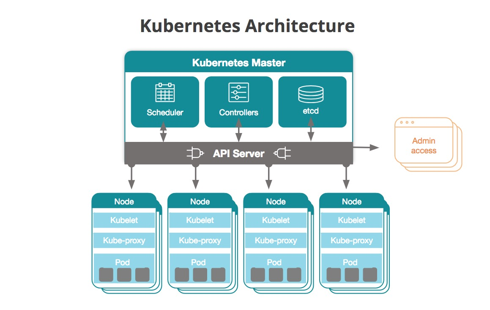
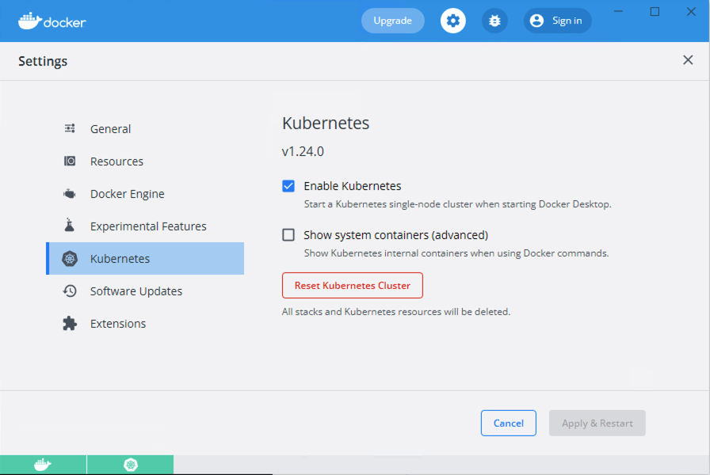
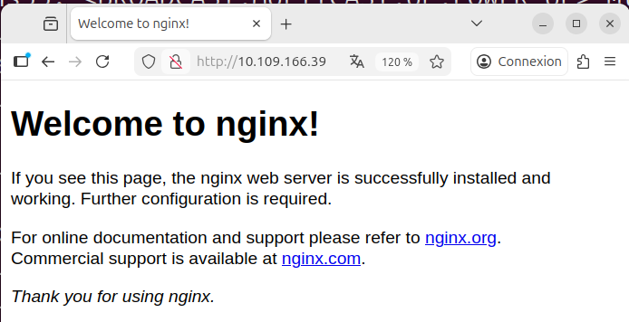

# 25 - Kubernetes – Introduction

*Révision du 2026.11.07*

<p align="center">
    
</p>


## Contenu

- [**1 – Qu'est-ce que Kubernetes (grec pour « timonier ») ?**](#section-1)
  - [1.1 – Les avantages des outils d'orchestration de K8s](#section-1-1)
  - [1.2 – Les particularités](#section-1-2)
  - [1.3 – Les composantes de Kubernetes](#section-1-3)
- [**2 – L'amas (cluster) et kubectl**](#section-2)
  - [2.7 – Le manifeste de déploiement – un fichier YAML](#section-2-7)
  - [Labo 2.11 – Exercice](#section-2-11)
- [**3 – Les manifestes de K8s**](#section-3)
  - [3.1 – Manifeste d'un Pod](#section-3-1)
  - [3.2 – Manifeste d'un déploiement](#section-3-2)
- [**4 – Kubernetes avec Docker Desktop**](#section-4)
  - [4.1 – Activer Kubernetes](#section-4-1)
  - [4.2 – Le contexte de kubectl](#section-4-2)
  - [4.3 – Accéder aux services](#section-4-3)
  - [4.4 – Utiliser une image construite localement](#section-4-4)
  - [4.5 – Volumes et accès au nœud](#section-4-5)
  - [4.6 – Réinitialiser ou désactiver l'amas](#section-4-6)
  - [4.7 – Laboratoire (durée 20 minutes)](#section-4-7)
- [**5 – Référence : les types de ressources K8S**](#section-5)

---

## 1 – Qu'est-ce que Kubernetes (grec pour « timonier ») ? {#section-1}

À l'origine développé par Google, [Kubernetes](https://kubernetes.io/fr/) est un projet 'open-source' d'[orchestration](https://fr.wikipedia.org/wiki/Orchestration_informatique) de conteneurs conçu pour automatiser le déploiement, la mise à l'échelle ainsi que la gestion d'applications conteneurisées. La version 1.0 de Kubernetes a été publiée en 2015.

Kubernetes s'est imposé comme le standard de facto pour l'orchestration de conteneurs et est le projet phare de la [Cloud Native Computing Foundation (CNCF)](https://www.cncf.io/), soutenu par des acteurs clés tels que Google, AWS, Microsoft, IBM, Intel, Cisco et Red Hat.

### En bref

* Développé à l'origine par Google (projet **Borg** – comme dans **Star Trek**)
* Kubernetes, aussi nommé **K8s**, est un projet source ouvert (open source) d'orchestration de conteneurs
  + ***Fun fact**: Le nom original de Kubernetes en interne fut 'Project Seven', en référence au personnage de Star Trek, 7 of 9. Les sept rayons de la barre du logo de Kubernetes sont une référence au nom original.*
* Permet de gérer et de déployer, en utilisant une approche descriptive via un manifeste YAML – *par exemple, j'aimerais avoir 50 instances nginx* – des applications conteneurisées proposant, parfois, des centaines de micro-services

### 1.1 – Les avantages des outils d'orchestration de K8s {#section-1-1}

* Forte disponibilité des services (peu de moments de panne)
* Évolution du système en fonction de la demande, haute performance
* Récupération simplifiée en cas de catastrophe – sauvegarde et restauration

### 1.2 – Les particularités {#section-1-2}

1. Kubernetes permet un déploiement rapide des applications
2. Kubernetes propose une utilisation efficace des ressources (moins coûteux en ressources que des VM)
3. Kubernetes est fortement intégré aux services des fournisseurs de solutions en nuage: *Amazon AWS*, *Linode*, *Microsoft Azure*, *Google Cloud Platform*
4. Les fournisseurs de solutions en nuage proposent des solutions Kubernetes clé en main: serveurs maîtres, nœuds et répartiteurs de charges déjà installés

### 1.3 – [Les composantes de Kubernetes](https://kubernetes.io/fr/docs/concepts/overview/components/) {#section-1-3}

1. **Le(s) serveur(s) maître(s) (master node)**
   * L'API du serveur (API Server)
   * L'ordonnanceur (Scheduler)
   * Le gestionnaire de contrôle (Controller Manager)
   * etcd (informations, paires clé/valeur, sur l'état du système)

2. **Les nœuds (ou nœuds ouvriers – worker node)**
   * Processus `kube-proxy`
     - Gestion du réseau IP
     - Équilibreur de tâches
   * Processus `kubelet`
     - Gestion de l'état du nœud
     - Démarrage, arrêt et maintenance des conteneurs (pods)
     - Optimisation de la performance en concordance avec le plan de déploiement
   * Un conteneur `runtime`. Habituellement, [containerd](https://containerd.io/)

3. **Pod**, la plus petite unité sous K8s, une abstraction de conteneur, dans le but de ne pas être lié à une technologie (par exemple, Docker)
   * Règle générale, un service par Pod. Mais il peut y en avoir plus
   * Chaque Pod obtient une adresse IP à l'intérieur d'un réseau K8s
   * Les Pods sont éphémères. Lors de la mise hors service d'un Pod, un autre sera créé et une nouvelle adresse IP lui sera attribuée
   * Dans le but d'assurer un accès IP prévisible, K8s propose l'objet de type 'Service'
     - Les services sont de type (Attention, ne pas confondre service et micro-service):
       * **internes**, par exemple, une base de données interne, ou
       * **externes**, par exemple, l'accès à une application web

4. **Le Déploiement** (objet YAML)
   * À partir d'un manifeste descriptif du système donné:
     - Déploiement d'images
     - Déploiement de services (accès réseaux)

5. **Le ReplicaSet**
   * S'assure que le nombre de pod requis est atteint. 

6. **Le DaemonSet**
   * Déploit un Pod donné sur chacun des noeuds. 

7. **L'espace de nom (NameSpace)**
   * Pour regrouper (isoler) les Pods en sous-systèmes

8. **Les étiquettes (Labels)**
   * Sert de sélecteur dans les manifestes 

9.  **Les StatefulSets**
   * Utilisés pour le déploiement de bases de données

10. **Le CLI de K8s, kubectl**

Voici un schéma présentant l'architecture de base de Kubernetes:




### Helm

[Helm](https://helm.sh/) est un gestionnaire de paquets (charts) d'applications pour K8s. Les charts sont publiés dans des dépôts, que l'on peut chercher sur :

[artifacthub.io](https://artifacthub.io)

---

## 2 – L'amas (cluster) et kubectl {#section-2}

### Description

La commande `kubectl` est l'outil standard, en ligne de commande, de gestion d'un amas (cluster) Kubernetes. Elle s'adresse au serveur d'API du serveur maître pour créer, lister, modifier et effacer les ressources de l'amas.

### Pré-requis

* Un amas Kubernetes fonctionnel, au choix :
  * le serveur d'un seul nœud du [document 24](Installation-un-seul-noeud.md) (kubeadm), ou un amas créé avec [kind](https://kind.sigs.k8s.io);
  * Docker Desktop, avec l'option `Enable Kubernetes` (voir l'image suivante et la [section 4](#section-4)).
* Installation de [kubectl](https://kubernetes.io/fr/docs/tasks/tools/install-kubectl/) (déjà présent sur le serveur du document 24 et avec Docker Desktop)



### Action 2.1 – Interaction avec l'amas (cluster) de nœuds (les serveurs)

La commande `kubectl`

```bash
$ kubectl get nodes

# Résultat:
NAME           STATUS   ROLES                  AGE    VERSION
k8stest        Ready    control-plane          106s   v1.29.15
```

**NOTE:** Selon la configuration du cluster, il est possible qu'il n'y ait qu'un seul nœud, le `control-plane` (serveur maître/ouvrier) qui est le gestionnaire de l'orchestration et aussi le nœud ouvrier.

### Action 2.2 – Obtenir la liste des 'pods'

Le pod est une abstraction du conteneur.

```bash
$ kubectl get pod

# Résultat:
No resources found in default namespace.
```

**Note**: Vide, nous n'avons pas encore lancé de déploiement.

### Action 2.3 – Obtenir la liste des 'services'

```bash
$ kubectl get services

# Résultat:
NAME         TYPE        CLUSTER-IP   EXTERNAL-IP   PORT(S)   AGE
kubernetes   ClusterIP   10.96.0.1    <none>        443/TCP   7m15s
```

**Note:** Un seul service, par défaut, qui renseigne sur le réseau de l'amas.

**Nous allons maintenant ajouter des pods à notre système.**

### Action 2.4 – Afficher l'aide de la commande create

```bash
$ kubectl create -h

# Résultat:
Create a resource from a file or from stdin.

JSON and YAML formats are accepted.

Examples:
  # Create a pod using the data in pod.json.
  kubectl create -f ./pod.json
  
  # Create a pod based on the JSON passed into stdin.
  cat pod.json | kubectl create -f -
  
  # Edit the data in docker-registry.yaml in JSON then create the resource using the edited data.
  kubectl create -f docker-registry.yaml --edit -o json

Available Commands:
  clusterrole         Create a ClusterRole.
  clusterrolebinding  Create a ClusterRoleBinding for a particular ClusterRole
  configmap           Create a configmap from a local file, directory or literal value
  cronjob             Create a cronjob with the specified name.
  deployment          Create a deployment with the specified name.
  job                 Create a job with the specified name.
# ...
```

**NOTE:** Avec Kubernetes, le `pod` est la plus petite unité possible d'une application. Ils sont habituellement créés par l'intermédiaire d'un `deployment`. L'objet `deployment` permet d'assurer la présence constante des `pods` constituant une application.

### Action 2.4.1a – Créer un pod

```bash
$ kubectl run ma-alpine --image=alpine

# Résultat:
pod/ma-alpine created

$ kubectl get pod

NAME        READY   STATUS              RESTARTS   AGE
ma-alpine   0/1     ContainerCreating   0          5s

$ kubectl get pod

NAME        READY   STATUS             RESTARTS   AGE
ma-alpine   0/1     CrashLoopBackOff   1          9s
```

**Note**: Le Pod de type 'alpine' n'a rien à exécuter alors il est terminé puis, redémarré à l'infini.

Nous allons l'effacer:

```bash
$ kubectl delete pod ma-alpine

# Résultat:
pod "ma-alpine" deleted
```

Alternative de création pour prévenir le 'CrashLoopBackOff':

```bash
$ kubectl run ma-alpine --image=alpine --restart=Never

$ kubectl get pods

NAME        READY   STATUS      RESTARTS   AGE
ma-alpine   0/1     Completed   0          34s
```

### Action 2.4.1b – Générer un manifeste YAML à partir d'une commande en ligne

```bash
$ kubectl run ma-alpine --image=alpine --restart=Never --dry-run=client -oyaml

# =========================================================================
# Résultat à l'écran:
apiVersion: v1
kind: Pod
metadata:
  labels:
    run: ma-alpine
  name: ma-alpine
spec:
  containers:
  - image: alpine
    name: ma-alpine
    resources: {}
  dnsPolicy: ClusterFirst
  restartPolicy: Never
status: {}
# =========================================================================

# Sauvegarder le résultat dans un fichier
$ kubectl run ma-alpine --image=alpine --restart=Never --dry-run=client -oyaml > creer-pod-alpine.yaml

# NOTE: Nous utiliserons des manifestes un peu plus tard pour créer des ressources K8s
# Par exemple
$ kubectl delete pod ma-alpine
$ kubectl apply -f creer-pod-alpine.yaml
```

---

### Action 2.4.2 – Créer un pod 'interactif'

```bash
$ kubectl run ma-alpine -it --image=alpine
# / # exit

# Pour s'y reconnecter:
$ kubectl attach ma-alpine -c ma-alpine -i -t
```

**Tester** avec Ctrl+PQ

---

### Action 2.5 – Créer un pod à partir d'un déploiement

```bash
# Syntaxe:
$ kubectl create deployment NAME --image=image [--dry-run=client] [options]

$ kubectl create deployment serveur-web --image=nginx

# Résultat:
deployment.apps/serveur-web created

# NOTE: voici le regex du nom
# [a-z0-9]([-a-z0-9]*[a-z0-9])?(\.[a-z0-9]([-a-z0-9]*[a-z0-9])?)*')
```

**Note:** Comme pour Docker, les images sont téléchargées à partir de hub.docker.com.

### Action 2.6 – Afficher les déploiements et les pods

```bash
$ kubectl get deployment

NAME          READY   UP-TO-DATE   AVAILABLE   AGE
serveur-web   1/1     1            1           91s

$ kubectl get pod

NAME                           READY   STATUS    RESTARTS   AGE
serveur-web-54bf66d477-4gxtx   1/1     Running   0          3m33s
```

**NOTE:** Entre le déploiement et le pod, il y a une autre couche d'abstraction nommée `replicaset`.

```bash
$ kubectl get replicaset

NAME                     DESIRED   CURRENT   READY   AGE
serveur-web-54bf66d477   1         1         1       8m40s
```

Le `replicaset` permet de gérer les répliques – le nombre d'instances – d'un `pod`.

**NOTE:** Nous n'avons pas à interagir avec les `replicaset`. Nous le ferons avec les déploiements et les pods.

### Action 2.6.2 – Interagir avec un pod

```bash
$ kubectl exec -it serveur-web-54bf66d477-8ctwr -- bash
```

### Action 2.6.3 – Exposer le port du serveur Web via le(s) pod(s)

```bash
$ kubectl expose deployment serveur-web --port=80

$ kubectl get svc -owide

NAME             TYPE           CLUSTER-IP       EXTERNAL-IP   PORT(S)        AGE    SELECTOR
kubernetes       ClusterIP      10.96.0.1        <none>        443/TCP        156m   <none>
serveur-web      ClusterIP   -->10.111.198.207   <none>        80/TCP         21m    app=serveur-web

$ curl 10.111.198.207

# Résultat:
<!DOCTYPE html>
<html>
<head>
<title>Welcome to nginx!</title>
...
<p><em>Thank you for using nginx.</em></p>
</body>
</html>

# Changer le nombre de réplicats:
$ kubectl scale deploy serveur-web --replicas=5

$ kubectl get pods -owide
```

---

### Résumé

Prenons une pause ici pour mettre le tout en contexte. Qu'avons-nous fait? Nous avons démarré un service Web. Au départ il se peut que le service soit peu sollicité.

Avec le temps, si nous sommes chanceux, il sera de plus en plus sollicité. Puis à un certain moment, l'unique instance de notre service ne sera plus en mesure de répondre à la demande, nous devenons de plus en plus populaires.

Avec notre amas Kubernetes, il sera facile de dupliquer le service web sur d'autres serveurs.

En bref:

* Un `Deployment` permet la gestion d'un `ReplicaSet`
* Un `ReplicaSet` permet la gestion de tous les duplicatas d'un `Pod`
* Un `Pod` est une abstraction d'un conteneur

Et tout ce qui est sous le déploiement est géré par Kubernetes.

Voici la suite.

### 2.7 – Le manifeste de déploiement – un fichier YAML {#section-2-7}

Pour assurer la gestion correcte du déploiement, K8s a généré un manifeste de déploiement. Plus tard, nous verrons comment renseigner nos propres manifestes. Ce schéma contient des informations telles que: le nombre de duplicatas requis, la version des images, les ports exposés, etc.

Le fichier est constitué de trois sections:

1. Les Métadonnées (`metadata:`)
2. Les spécifications (`spec:`)
3. Ainsi que l'état du système (`status:`)

Les informations des manifestes sont stockées sur le nœud maître dans la bibliothèque `etcd`.

### Action 2.7.1 – Édition du manifeste de déploiement

```bash
kubectl edit deployment serveur-web
```

```yaml
---
Please edit the object below. Lines beginning with a '#' will be ignored,
and an empty file will abort the edit. If an error occurs while saving this file will be
reopened with the relevant failures.
apiVersion: apps/v1
kind: Deployment
metadata:
  annotations:
    deployment.kubernetes.io/revision: "1"
  creationTimestamp: "2021-02-14T20:43:58Z"
  generation: 1
  labels:
    app: serveur-web
  name: serveur-web
  namespace: default
  resourceVersion: "1827"
  uid: 6384e7aa-0e00-4313-b485-cc8d1212e720
spec:
  progressDeadlineSeconds: 600
  replicas: 1
  revisionHistoryLimit: 10
  selector:
    matchLabels:
      app: serveur-web
  strategy:
    rollingUpdate:
      maxSurge: 25%
      maxUnavailable: 25%
    type: RollingUpdate
  template:
    metadata:
...
```

**NOTE:** Lors de la création du déploiement, `k8s` a généré un fichier de configuration avec des valeurs par défaut.

### Action 2.8 – Apportons une modification au fichier de configuration

Version `nginx:1.18-alpine-perl`

* **Remplacer la ligne: `- image: nginx` par `- image: nginx:1.18-alpine-perl`**

**NOTE:** Nous sommes dans 'vi'. Il faut appuyer sur la touche 'i' pour passer en mode édition.

```bash
kubectl edit deployment serveur-web

# Remplacer: - image: nginx par, - image: nginx:1.18-alpine-perl

     spec:
       containers:
       - image: nginx:1.18-alpine-perl
         imagePullPolicy: Always
         name: nginx
```

**NOTE:** Dans l'éditeur 'vi'. Pour enregistrer et quitter: 'ESC:wq'.

Il est possible de renseigner un autre éditeur via la variable d'environnement "KUBE_EDITOR"

```bash
$ export KUBE_EDITOR="code -w"
$ export KUBE_EDITOR="nano"

$ kubectl edit deployment serveur-web
# deployment.apps/serveur-web edited
```

### Action 2.9 – Afficher le résultat

```bash
$ kubectl get pod

NAME                           READY   STATUS    RESTARTS   AGE
serveur-web-6589df7667-vzzq4   1/1     Running   0          101s
```

**NOTE:** Remarquez la modification du nom du 'pod'. De plus, suite à la modification, le déploiement a été automatique.

### Action 2.10 – Afficher l'historique des duplicatas

```bash
$ kubectl get replicaset

NAME                     DESIRED   CURRENT   READY   AGE
serveur-web-54bf66d477   0         0         0       54m
serveur-web-6589df7667   1         1         1       4m56s
```

**NOTE:** Pas de 'pods' dans la version précédente: `serveur-web-54bf66d477 0 0 0 54m`

---

### 💡 2.10.1 – Exemples avec namespaces

```bash
kubectl get ns
kubectl get all --all-namespaces
kubectl get pod -A
kubectl get pod -n kube-system
```

### Action 2.10.2 – Afficher le log d'un pod

```bash
$ kubectl logs serveur-web-54bf66d477-8ctwr

# Résultat:
/docker-entrypoint.sh: /docker-entrypoint.d/ is not empty, will attempt to perform configuration
/docker-entrypoint.sh: Looking for shell scripts in /docker-entrypoint.d/
/docker-entrypoint.sh: Launching /docker-entrypoint.d/10-listen-on-ipv6-by-default.sh
10-listen-on-ipv6-by-default.sh: info: Getting the checksum of /etc/nginx/conf.d/default.conf
10-listen-on-ipv6-by-default.sh: info: Enabled listen on IPv6 in /etc/nginx/conf.d/default.conf
/docker-entrypoint.sh: Launching /docker-entrypoint.d/20-envsubst-on-templates.sh
/docker-entrypoint.sh: Launching /docker-entrypoint.d/30-tune-worker-processes.sh
/docker-entrypoint.sh: Configuration complete; ready for start up
```

### Action 2.10.3 – Obtenir une liste exhaustive d'informations sur un pod

```bash
$ kubectl describe pod serveur-web-54bf66d477-8ctwr

# Résultat:
Name:         serveur-web-54bf66d477-8ctwr
Namespace:    default
Priority:     0
Node:         k8stest/192.168.2.50
Start Time:   Sat, 20 Mar 2021 17:47:22 -0400
Labels:       app=serveur-web
              pod-template-hash=54bf66d477
Annotations:  <none>
Status:       Running
IP:           172.17.0.2
IPs:
  IP:           172.17.0.2
Controlled By:  ReplicaSet/serveur-web-54bf66d477
Containers:
  nginx:
# ...
```

**Note:** Il est possible d'appliquer la commande précédente sur d'autres objets. Par exemple, `kubectl describe deployments`.

### Labo 2.11 – Exercice {#section-2-11}

Renseigner 3 duplicatas dans le schéma puis, afficher la liste des pods.

### Action 2.12 – Effacer un déploiement

```bash
$ kubectl delete deployment serveur-web

$ kubectl get deployment
$ kubectl get replicaset
$ kubectl get pod
```

---

## 3 – Les manifestes de K8s {#section-3}

---

### Qu'est-ce qu'un Manifeste Kubernetes ?

Un **manifeste Kubernetes** est un fichier YAML qui décrit l'état désiré d'une ressource. 

Structure commune :

```yaml
apiVersion:  <version-api>          # Version de l'API, voir le tableau à la fin de ce document.
kind:        <type-ressource>       # Type de ressource: pod, service, configmap, secret, deployment, ...
metadata:                           # Nom, labels, annotations
  name:      <nom-ressource>        # Nom de la ressource (requis!)
  namespace: <nom-espace-de-nom>    # Indique le 'NS' dans lequel la ressource sera créée (optionnel)
  labels:                           # Paires de clés pour organiser et sélectionner les objets K8s
    clé: valeur
    clé: valeur
spec:                               # Spécification (état désiré) de la ressource, en fonction de 'kind'
```

---


### 3.1 – Manifeste d'un Pod {#section-3-1}

#### Action 3.1.1 – Manifeste d'un Pod, renseigner le fichier uneAlpine.yml

```yaml
# ------------------------------------------------------------
# Fichier: uneAlpine.yml
# Exemple d'un manifeste pour un Pod avec des variables d'env.
# k apply -f uneAlpine.yml
# k logs meta-une-alpine
# ------------------------------------------------------------
apiVersion: v1
kind: Pod
# Section 1 - Les Méta-données
metadata:
  name: meta-une-alpine
# Section 2 - Les spécifications
spec:
  containers:
  - name: ma-alpine
    image: alpine
    command: ["/bin/sh", "-c",  "env"]
    env:
    - name: ENV01
      value: YoDouloudou
    - name: ENV02
      value: Coucou  
  restartPolicy: Never
```

**Note:** Remarquer le type du manifeste – `kind: Pod`.

#### Action 3.1.2 – Déployer le système

```bash
$ kubectl apply -f uneAlpine.yml

pod/meta-une-alpine created

$ kubectl get pod

NAME                           READY   STATUS      RESTARTS   AGE
meta-une-alpine                0/1     Completed   0          92s
```

**Note:** Remarquer le 'STATUS: Completed'

#### Action 3.1.3 – Afficher les logs du déploiement précédent

```bash
$ kubectl logs meta-une-alpine

# Résultat:
KUBERNETES_PORT=tcp://10.96.0.1:443
NGINX_SERVICE_SERVICE_PORT=80
ENV01=YoDouloudou
ENV02=Coucou
```

#### Action 3.1.3.1 – Faire un test

```yaml
kind: Pod
# Section 1 - Les Méta-données
metadata:
  # Placer 'name' en commentaire et appliquer le manifeste
  # name: meta-une-alpine
```

Résultat?

#### Action 3.1.3.2 – Effacer le résultat d'un manifeste

```bash
$ kubectl delete -f nomDuManifeste.yml
```

#### Action 3.1.4 – Manifeste d'un Pod avec deux conteneurs

Fichier `alpine-v2.yml`:

```yaml
# ---------------------------------------------------------
# Fichier: alpine-v2.yml
# Auteur:  Alain Boudreault
# Exemple d'un manifeste avec deux conteneurs dans un Pod
# ---------------------------------------------------------
# Lister les conteneurs d'un Pod
# $ k get pods alpine-v2 -o json > resultat.json
# $ k describe po alpine-v2

 
apiVersion: v1
kind: Pod
metadata:
  name: alpine-v2
  # namespace: default
spec:
  containers:
  - image: alpine
    name: conteneur-alpine01
    stdin: true
    tty: true
#  restartPolicy: Always
  - image: alpine
    # Fournir une tâche à exécuter pour le conteneur
    # Sinon, il va s'arrêter.
    command: [ "/bin/sh", "-c", "while true; do sleep 5; done;" ]
    imagePullPolicy: IfNotPresent
    name: conteneur-alpine02
  restartPolicy: Always
```

Afficher le résultat:

```bash
kubectl get pod
# NAME                           READY   STATUS      RESTARTS   AGE
# alpine-v2                      2/2     Running     0          7m30s
```

#### Action 3.1.5 – Obtenir les détails du pod précédent

```bash
kubectl get pods alpine-v2 -o json > resultat.json
```

Voici un extrait du fichier `resultat.json`:

```json
"spec": {
    "containers": [
        {
            "image": "alpine",
            "imagePullPolicy": "Always",
            "name": "conteneur-alpine01",
            "resources": {},
            "stdin": true,
            "terminationMessagePath": "/dev/termination-log",
            "terminationMessagePolicy": "File",
            "tty": true,
            "volumeMounts": [
                {
                    "mountPath": "/var/run/secrets/kubernetes.io/serviceaccount",
                    "name": "default-token-z4rpp",
                    "readOnly": true
                }
            ]
        },
        {
            "command": [
                "/bin/sh",
                "-c",
                "while true; do sleep 5; done;"
            ],
            "image": "alpine",
            "imagePullPolicy": "IfNotPresent",
            "name": "conteneur-alpine02",
            "resources": {},
            "terminationMessagePath": "/dev/termination-log",
            "terminationMessagePolicy": "File",
            "volumeMounts": [
                {
                    "mountPath": "/var/run/secrets/kubernetes.io/serviceaccount",
                    "name": "default-token-z4rpp",
                    "readOnly": true
                }
            ]
        }
    ],
```

#### Action 3.1.5.1 – Extraire des informations du résultat JSON

Par exemple, la liste des conteneurs:

```bash
# 1 - Liste des conteneurs pour un Pod:
kubectl get pods pod-name -o jsonpath='{.spec.containers[*].name}'

# 2 - Liste des conteneurs de tous les Pods:
kubectl get pods -o jsonpath="{.items[*].spec.containers[*].name}"

# 3 - Liste des conteneurs par Pod de l'espace de nom par défaut - pretty:
kubectl get pods -o=jsonpath='{range .items[*]}{"\n"}{.metadata.name}{":\t"}{range .spec.containers[*]}{.name}{", "}{end}{end}' | sort

# 4 - Liste des conteneurs par Pod de tous les espaces de nom:
kubectl get pods --all-namespaces -o=jsonpath='{range .items[*]}{"\n"}{.metadata.name}{":\t"}{range .spec.containers[*]}{.name}{", "}{end}{end}' | sort
```

Référence: [kubernetes](https://kubernetes.io/docs/tasks/access-application-cluster/list-all-running-container-images/)

#### Action 3.1.6 – Exécuter une commande dans un conteneur

Lorsque le Pod en possède plusieurs:

```bash
kubectl exec -it alpine-v2 --container conteneur-alpine01 -- /bin/sh
```

**Note:** Les deux conteneurs utilisent l'adresse IP du Pod.

---

#### 3.1.7a – Utilisation d'un conteneur d'initialisation

```yaml
# ---------------------------------------------------------
# Fichier: demo-pod-init.yml
# Auteur:  Alain Boudreault
# Exemple d'un 'initContainer' qui copie un contenu externe
# vers le dossier racine du serveur nginx.
# ---------------------------------------------------------
apiVersion: v1
kind: Pod
metadata:
  name: pod-demo
spec:
  volumes:
  - name: shared-data
    emptyDir: {}
  initContainers:
  - name: demo-init
    image: busybox
    command: ['sh', '-c', 'wget -O /usr/share/data/index.html http://google.com']
    volumeMounts:
    - name: shared-data
      mountPath: /usr/share/data
  containers:
  - name: nginx
    image: nginx
    volumeMounts:
    - name: shared-data
      mountPath: /usr/share/nginx/html
```

```bash
kubectl apply -f demo-pod-init.yml
kubectl get pods
# NAME        READY   STATUS            RESTARTS   AGE
# pod-demo    0/1     PodInitializing   0          5s

kubectl get pods -owide
# NAME        READY   STATUS    RESTARTS   AGE    IP            NODE        NOMINATED NODE
# pod-demo    1/1     Running   0          2m7s   10.244.0.12   k8smaster   <none>

curl 10.244.0.12
```

**Action:** Tester dans un fureteur sur le serveur


---

#### 3.1.7b – Utilisation d'un autre conteneur d'initialisation

```yaml
# ---------------------------------------------------------
# Fichier: mem-info.yml
# Auteur:  Alain Boudreault
# Exemple d'un 'initContainer' qui envoie le contenu 
# de /proc/meminfo vers le dossier racine du serveur nginx
# ---------------------------------------------------------
apiVersion: v1
kind: Pod
metadata:
  name: plusieurs-pods
spec:
  volumes:
  - name: dossier-de-partage
    emptyDir: {}
  initContainers:
  - name: meminfo
    image: alpine
    restartPolicy: Always
    command: ['sh', '-c', 'sleep 5; while true; do cat /proc/meminfo > /usr/share/data/index.html; sleep 10; done;']
    volumeMounts:
    - name: dossier-de-partage
      mountPath: /usr/share/data
  containers:
  - name: nginx
    image: nginx
    volumeMounts:
    - name: dossier-de-partage
      mountPath: /usr/share/nginx/html
```

#### 3.1.7c – Utilisation d'un autre conteneur d'initialisation

```yaml
# ---------------------------------------------------------
# Fichier: init-via-git.yml
# Auteur:  Alain Boudreault
# Exemple d'un 'initContainer' qui clone le contenu 
# d'un dépôt vers le dossier racine du serveur nginx
# ---------------------------------------------------------
apiVersion: v1
kind: Pod
metadata:
  name: nginx-super-init
spec:
  volumes:
  - name: www
  containers:
  - name: nginx-superminou
    image: nginx
    volumeMounts:
    - name: www
      mountPath: /usr/share/nginx/html/
  initContainers:
  - name: git
    image: alpine
    # Installation de git dans le conteneur, suivi d'un git clone vers le dossier de partage
    command: [ "sh", "-c", "apk add --no-cache git && git clone https://github.com/ve2cuy/superMinou /www" ]
    volumeMounts:
    - name: www
      mountPath: /www/
```

---

### 3.2 – Manifeste d'un déploiement {#section-3-2}

#### Action 3.2.1 – Manifeste d'un déploiement

Renseigner le fichier `3.2.1-deploiement-nginx.yml` suivant:

```yaml
# ---------------------------------------------------------
# Fichier: 3.2.1-deploiement-nginx.yml
# Auteur:  Alain Boudreault
# Déploiement de deux pods nginx version 1.16
# ---------------------------------------------------------
# M-A-J: A.B.2026.03.10 - Ajout de la section resources:
# ---------------------------------------------------------
apiVersion: apps/v1
kind: Deployment
# Section 1 - Les Méta-données
metadata:
  name: nginx-deployment
  labels:
    app: nginx
# Section 2 - Les spécifications
spec:
  replicas: 2
  selector:
    matchLabels:
      app: nginx
  template:
    metadata:
      labels:
        app: nginx
    spec:
      containers:
      - name: nginx
        image: nginx:1.16
        ports:
        - containerPort: 80
        resources:
          requests:
            memory: "64Mi"
            cpu: "250m"
          limits:
            memory: "128Mi"
            cpu: "500m"        
# Section 3 - État du déploiement - sera complétée par K8s
```

**Note:** Remarquer – `kind: Deployment`

#### Action 3.2.2 – Renseigner le fichier service

Fichier `3.2.2-service-nginx.yml`:

```yaml
# -------------------------------------------------------------------------------------
# Fichier: 3.2.2-service-nginx.yml
# Auteur:  Alain Boudreault
# Voici comment exposer un service de type Cluster-IP -via un port- au réseau local K8s 
# pour accéder aux pods nginx déployés dans le manifeste 3.2.1-deploiement-nginx.yml
# Le lien entre le service et les pods est fait via les labels:
#   selector:
#    app: nginx
# fait référence au label app: nginx dans le manifeste 3.2.1-deploiement-nginx.yml
# -------------------------------------------------------------------------------------
apiVersion: v1
kind: Service
metadata:
  name: nginx-service
spec:
  # fait référence au label app: nginx dans le manifeste 3.2.1-deploiement-nginx.yml
  selector:
    app: nginx 
  ports:
    - protocol: TCP
      # Port à exposer au reseau local K8s
      port: 80
      # Port du conteneur - containerPort
      targetPort: 80
```

**Note:** Remarquer – `kind: Service`

#### Action 3.2.3 – Appliquer les schémas

Nous allons maintenant appliquer nos deux schémas: le déploiement et le service.

```bash
$ kubectl apply -f 3.2.1-deploiement-nginx.yml

deployment.apps/nginx-deployment created

$ kubectl apply -f 3.2.2-service-nginx.yml

service/nginx-service created

$ kubectl get deployment

NAME               READY   UP-TO-DATE   AVAILABLE   AGE
nginx-deployment   2/2     2            2           62s

$ kubectl get service

NAME            TYPE        CLUSTER-IP      EXTERNAL-IP   PORT(S)   AGE
kubernetes      ClusterIP   10.96.0.1       <none>        443/TCP   26d
nginx-service   ClusterIP   10.108.129.91   <none>        80/TCP    82s
```

#### Action 3.2.4 – Vérifier que le service achemine bien les requêtes

```bash
$ kubectl describe service nginx-service

Name:              nginx-service
Namespace:         default
Labels:            <none>
Annotations:       <none>
Selector:          app=nginx
Type:              ClusterIP
IP:                10.108.129.91
Port:              <unset>  80/TCP
TargetPort:        80/TCP
Endpoints:         172.17.0.2:80,172.17.0.5:80
Session Affinity:  None
Events:            <none>
```

**Note:** Remarquer la ligne `Endpoints: 172.17.0.2:80,172.17.0.5:80`. Les requêtes seront envoyées vers deux pods sur leur port 80.

#### Action 3.2.5 – Vérifier l'adresse IP des deux pods

```bash
$ kubectl get pod -o wide

NAME                               READY   STATUS    RESTARTS   AGE   IP           NODE
nginx-deployment-f4b7bbcbc-qt8kd   1/1     Running   0          12m   172.17.0.5   k8stest
nginx-deployment-f4b7bbcbc-tcr7l   1/1     Running   0          12m   172.17.0.2   k8stest
```

**Action:** Tester dans le fureteur disponible sur le serveur:




---

#### Action 3.2.6 – Obtenir le schéma complet du déploiement

Il est disponible dans le `etcd`:

```bash
$ kubectl get deployment nginx-deployment -o yaml > nginx-dep-info.yml
```

#### Action 3.2.7 – Exposer nginx au monde extérieur

Service type: `LoadBalancer`

En rappel, voici la configuration de service-nginx:

```
nginx-service   ClusterIP   10.108.129.91   <none>        80/TCP    26m
```

Voici une version modifiée du fichier `3.2.2-service-nginx.yml` de l'action 3.2.2:

```yaml
# --------------------------------------------------------------------------------------
# Fichier: 3.2.7-service-nginx-LB.yml
# Auteur:  Alain Boudreault
# Voici comment exposer un service de type LoadBalancer -via un port- au reseau local K8s 
# pour accéder aux pods nginx déployés dans le manifeste 3.2.1-deploiement-nginx.yml
# Le lien entre le service et les pods est fait via les labels:
#   selector:
#    app: nginx
# fait référence au label app: nginx dans le manifeste 3.2.1-deploiement-nginx.yml
# --------------------------------------------------------------------------------------
apiVersion: v1
kind: Service
metadata:
  name: nginx-service
spec:
  selector:
    app: nginx
  # Ajout 1  
  type: LoadBalancer
  ports:
    - protocol: TCP
      # Port à exposer au reseau local K8s
      port: 80
      # Port du conteneur
      targetPort: 80
      # ajout 2 - port externe.  Doit être entre 30000 et 32767
      nodePort: 30000
```

#### Action 3.2.8 – Appliquer le schéma modifié

```bash
$ kubectl apply -f 3.2.7-service-nginx-LB.yml

service/nginx-service configured

$ kubectl get service

NAME            TYPE           CLUSTER-IP      EXTERNAL-IP   PORT(S)        AGE
kubernetes      ClusterIP      10.96.0.1       <none>        443/TCP        26d
nginx-service   LoadBalancer   10.108.129.91   <pending>     80:30000/TCP   60m
```

**Note:** Remarquer que `nginx-service` est maintenant de type `LoadBalancer`. Remarquer aussi que 'EXTERNAL-IP' est `<pending>` : sur un amas installé avec kubeadm, aucun équilibreur de charge ne fournit d'adresse externe. Ce rôle sera confié à MetalLB, plus loin dans le cours (documents 38 et 40).

En attendant, un service `LoadBalancer` est aussi un service `NodePort` : le serveur Web est disponible sur le port 30000 de chaque nœud.

```bash
# Adresse IP du nœud
$ kubectl get nodes -o wide

# Tester dans le fureteur ou avec curl
$ curl http://<adresse IP du nœud>:30000

# Note: Sous Docker Desktop + Kubernetes, l'adresse externe est 'localhost'
# et le service est accessible via http://localhost
```

#### Action 3.2.9 – Tester le service

Ouvrir `http://<adresse IP du nœud>:30000` dans un fureteur et actualiser la page plusieurs fois.

#### Action 3.2.10 – Consolidation des deux schémas {#action-3-2-10}

Renseigner le fichier `3.2.10-nginx-dep-service.yml`:

```yaml
# -----------------------------------------------------------
# Fichier: 3.2.10-nginx-dep-service.yml
# Auteur:  Alain Boudreault
# -----------------------------------------------------------
# Voici la version consolidée de:
#    3.2.1-deploiement-nginx.yml et
#    3.2.7-service-nginx-LB.yml
# -----------------------------------------------------------
apiVersion: apps/v1
kind: Deployment
# Section 1 - Les Méta-données
metadata:
  name: nginx-deployment
  # Les 'labels' ici, sont facultatifs.
  labels:
    app: nginx-app
# Section 2 - Les spécifications
spec:
  replicas: 4
  selector:
    matchLabels:
      # Le label app doit correspondre à celui de la ligne 21 
      app: nginx-app-label
  template:
    metadata:
      labels:
      # Le label app doit correspondre à celui de la ligne 16 
        app: nginx-app-label
    spec:
      containers:
      - name: conteneur-nginx
        image: nginx
        ports:
        - containerPort: 80
        resources:
          requests:
            memory: "64Mi"
            cpu: "250m"
          limits:
            memory: "128Mi"
            cpu: "500m"        
---
apiVersion: v1
kind: Service
metadata:
  name: nginx-service
spec:
  selector:
      # Le selector app doit correspondre au matchLabel de la ligne 16
      # Note: Il est aussi possible d'utiliser le nom d'un Pod.   
    app: nginx-app-label
  # Ajout 1  
  type: LoadBalancer
  ports:
    - protocol: TCP
      # Port à exposer au réseau local K8s
      port: 80
      # Port du conteneur
      targetPort: 80
      # ajout 2 - port externe.  Doit être entre 30000 et 32767
      nodePort: 30080
```

#### Labo 3.2.11 – Exercice

Effacer les déploiements précédents, redéployer à partir du fichier 3.2.10 et tester le service Web.

#### Labo 3.2.12 – Exercice

Remplacer l'image nginx utilisée dans le fichier de labo 3.2.11 par `alainboudreault/phpweb` et augmenter le nombre de duplicatas à 20.

* Tester dans deux fureteurs différents
* Actualiser la page des fureteurs plusieurs fois
* Tester dans un terminal: `curl http://<adresse IP du nœud>:30080/info.php`

---

## 4 – Kubernetes avec Docker Desktop {#section-4}

Docker Desktop (Windows et macOS) contient un amas Kubernetes complet, prêt à l'emploi. C'est la façon la plus simple de faire les actions de ce document sur son poste de travail, sans serveur Linux : l'amas tourne dans la VM de Docker Desktop et `kubectl` est installé avec lui.

> 💡 L'amas de Docker Desktop sert à apprendre et à tester. Pour le projet de session et l'épreuve synthèse, nous utiliserons un vrai amas (documents 24 et 34).

### 4.1 – Activer Kubernetes {#section-4-1}

**Action 4.1.1 –** Dans Docker Desktop : ⚙️ `Settings` → `Kubernetes` → cocher `Enable Kubernetes` → `Apply & restart`.


Selon la version de Docker Desktop, il est possible de choisir le type d'amas (`Cluster settings`) :

| Type | Description |
|------|-------------|
| `kubeadm` | Un seul nœud, nommé `docker-desktop`. Le choix par défaut. |
| `kind` | Un ou plusieurs nœuds (ex. 1 maître et 2 ouvriers), version de Kubernetes au choix. |

Le premier démarrage télécharge les images de Kubernetes : il faut compter quelques minutes. L'icône **Kubernetes running**, au bas de la fenêtre de Docker Desktop, devient verte lorsque l'amas est prêt.

> 💡 Prévoir au moins 4 Go de mémoire pour la VM (⚙️ `Settings` → `Resources`).

**Action 4.1.2 –** Vérifier l'amas :

```bash
$ kubectl get nodes

# Résultat:
NAME             STATUS   ROLES           AGE   VERSION
docker-desktop   Ready    control-plane   2m    v1.32.2

$ kubectl get pods -n kube-system
```

**Note:** Le seul nœud, `docker-desktop`, est à la fois maître et ouvrier. Les pods de l'application y sont placés.

### 4.2 – Le contexte de kubectl {#section-4-2}

`kubectl` peut gérer plusieurs amas : le serveur du document 24, Docker Desktop, un amas sur Google Cloud... Chaque amas est un **contexte** du fichier `~/.kube/config`. Docker Desktop y ajoute le contexte `docker-desktop`.

**Action 4.2.1 –** Lister les contextes et choisir celui de Docker Desktop :

```bash
$ kubectl config get-contexts

# Résultat:
CURRENT   NAME                          CLUSTER          AUTHINFO           NAMESPACE
*         docker-desktop                docker-desktop   docker-desktop
          kubernetes-admin@kubernetes   kubernetes       kubernetes-admin

$ kubectl config use-context docker-desktop
$ kubectl config current-context
```

> 💡 Avant chaque commande importante, vérifier le contexte courant : `kubectl delete` dans le mauvais contexte efface les ressources du mauvais amas! Le menu de l'icône de Docker Desktop (barre des tâches) permet aussi de changer de contexte.

### 4.3 – Accéder aux services {#section-4-3}

Sous Docker Desktop, l'accès aux services est plus simple que sur un serveur :

| Type de service | Adresse depuis le poste de travail |
|-----------------|------------------------------------|
| `ClusterIP` | Aucune; utiliser `kubectl port-forward` |
| `NodePort` | `http://localhost:<nodePort>`, ex. `http://localhost:30080` |
| `LoadBalancer` | `http://localhost:<port>`; `EXTERNAL-IP` vaut `localhost` |

**Action 4.3.1 –** Déployer nginx et l'exposer avec un service `LoadBalancer` :

```bash
$ kubectl create deployment web-dd --image=nginx --replicas=2
$ kubectl expose deployment web-dd --type=LoadBalancer --port=8080 --target-port=80

$ kubectl get service web-dd

# Résultat:
NAME     TYPE           CLUSTER-IP     EXTERNAL-IP   PORT(S)          AGE
web-dd   LoadBalancer   10.104.12.80   localhost     8080:31544/TCP   5s

$ curl http://localhost:8080
```

**Note:** Contrairement à un amas installé avec kubeadm, l'adresse externe n'est pas `<pending>` : Docker Desktop joue le rôle de l'équilibreur de charge. Le port d'un service `LoadBalancer` doit être libre sur le poste de travail (attention aux conteneurs Docker qui utilisent déjà 8080).

**Action 4.3.2 –** Avec `port-forward`, pour un service `ClusterIP` :

```bash
$ kubectl port-forward svc/web-dd 9090:8080
# Tester http://localhost:9090, puis Ctrl+C pour arrêter
```

### 4.4 – Utiliser une image construite localement {#section-4-4}

Avec l'amas de type `kubeadm`, Kubernetes utilise le même moteur que Docker : une image construite avec `docker build` est disponible pour les pods, **sans la pousser** sur Docker Hub.

**Action 4.4.1 –** Construire une image et la déployer :

```bash
$ docker build -t mon-app:1.0 .
```

```yaml
# Extrait d'un manifeste de déploiement
    spec:
      containers:
      - name: mon-app
        image: mon-app:1.0
        # Ne pas chercher l'image sur Docker Hub
        imagePullPolicy: IfNotPresent
```

**Note:** Sans `imagePullPolicy: IfNotPresent`, une image dont l'étiquette est `latest` (ou sans étiquette) est toujours cherchée sur Docker Hub : erreur `ErrImagePull`. Avec un amas de type `kind`, les nœuds ont leur propre magasin d'images : il faut pousser l'image vers un registre.

### 4.5 – Volumes et accès au nœud {#section-4-5}

* La classe de stockage par défaut, `hostpath`, crée automatiquement les PV demandés par les PVC. Les données sont dans la VM de Docker Desktop.
* Un volume `hostPath` désigne un dossier **de la VM**, pas du poste de travail.

**Action 4.5.1 –** Se connecter au nœud `docker-desktop` :

```bash
$ kubectl debug node/docker-desktop -it --image=ubuntu
# Le système de fichiers du nœud est monté sous /host
root@docker-desktop:/# ls /host/var/lib/kubelet/pods
root@docker-desktop:/# exit
```

```bash
$ kubectl get storageclass

# Résultat:
NAME                 PROVISIONER          RECLAIMPOLICY   VOLUMEBINDINGMODE   ALLOWVOLUMEEXPANSION   AGE
hostpath (default)   docker.io/hostpath   Delete          Immediate           false                  10d
```

### 4.6 – Réinitialiser ou désactiver l'amas {#section-4-6}

* ⚙️ `Settings` → `Kubernetes` → `Reset Kubernetes Cluster` : efface **toutes** les ressources (déploiements, services, volumes) et redémarre un amas vide.
* Décocher `Enable Kubernetes` arrête l'amas et libère la mémoire de la VM.
* La commande `docker system prune -a` peut effacer les images de Kubernetes : l'amas les téléchargera de nouveau au prochain démarrage.


<br>

### 4.7 – Laboratoire (durée 20 minutes) {#section-4-7}

Sous Docker Desktop :

1. Activer Kubernetes et sélectionner le contexte `docker-desktop`.
2. Appliquer le manifeste consolidé de l'[action 3.2.10](#action-3-2-10), en remplaçant `nodePort: 30080` par `nodePort: 30081`.
3. Tester le serveur Web avec `http://localhost:80` (service `LoadBalancer`) puis avec `http://localhost:30081` (port du nœud).
4. Passer à 5 duplicatas avec `kubectl scale` et vérifier que les 5 pods sont sur le nœud `docker-desktop` (`kubectl get pods -o wide`).
5. Revenir au contexte de l'amas du document 24 et vérifier, avec `kubectl get deployments`, que ce déploiement n'y existe pas.
6. Effacer le déploiement et le service sous Docker Desktop.

---

## 5 – Référence : les types de ressources K8S {#section-5}

| NOM | NOM COURT | VERSION API | NAMESPACED | KIND |
|-----|-----------|-------------|------------|------|
| `bindings` | | v1 | true | Binding |
| `componentstatuses` | `cs` | v1 | false | ComponentStatus |
| `configmaps` | `cm` | v1 | true | ConfigMap |
| `endpoints` | `ep` | v1 | true | Endpoints |
| `events` | `ev` | v1 | true | Event |
| `limitranges` | `limits` | v1 | true | LimitRange |
| `namespaces` | `ns` | v1 | false | Namespace |
| `nodes` | `no` | v1 | false | Node |
| `persistentvolumeclaims` | `pvc` | v1 | true | PersistentVolumeClaim |
| `persistentvolumes` | `pv` | v1 | false | PersistentVolume |
| `pods` | `po` | v1 | true | Pod |
| `podtemplates` | | v1 | true | PodTemplate |
| `replicationcontrollers` | `rc` | v1 | true | ReplicationController |
| `resourcequotas` | `quota` | v1 | true | ResourceQuota |
| `secrets` | | v1 | true | Secret |
| `serviceaccounts` | `sa` | v1 | true | ServiceAccount |
| `services` | `svc` | v1 | true | Service |
| `daemonsets` | `ds` | apps/v1 | true | DaemonSet |
| `deployments` | `deploy` | apps/v1 | true | Deployment |
| `replicasets` | `rs` | apps/v1 | true | ReplicaSet |
| `statefulsets` | `sts` | apps/v1 | true | StatefulSet |
| `horizontalpodautoscalers` | `hpa` | autoscaling/v2 | true | HorizontalPodAutoscaler |
| `cronjobs` | `cj` | batch/v1 | true | CronJob |
| `jobs` | | batch/v1 | true | Job |
| `ingresses` | `ing` | networking.k8s.io/v1 | true | Ingress |
| `networkpolicies` | `netpol` | networking.k8s.io/v1 | true | NetworkPolicy |
| `storageclasses` | `sc` | storage.k8s.io/v1 | false | StorageClass |

```bash
# NOTE: Il est possible d'obtenir cette liste à partir du CLI de K8S:
$ kubectl api-resources
```

---

## Ressources

* [Killercoda Interactive Environments](https://killercoda.com/)
* [Rancher](https://www.rancher.com/)
* [K9s](https://k9scli.io/)
* [Documentation officielle](https://kubernetes.io/fr/docs/home/)

---

Prochain document: [K8s-partie2](Kubernetes-partie-2.md)

---

## Crédits

*Document rédigé par Alain Boudreault © 2021-2027*  
*Version 2026.03.10.1 - Révision 2026.11.07.1*  
*Site par ve2cuy*