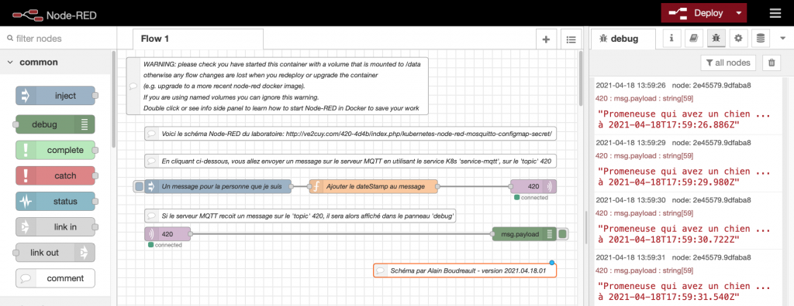
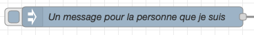
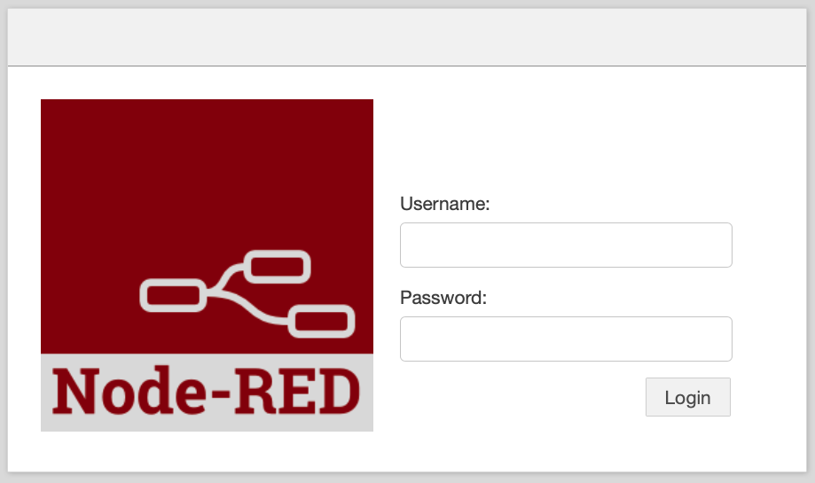

# 52 - Kubernetes:  Node-RED + Mosquitto + ConfigMap + Secret

*Révision du 2026.11.07*

*Document converti depuis 4204d4.ve2cuy.com — 5 avril 2021*

## Contenu

- [**TP02 ( 20% ) – Énoncé**](#section-tp02-20-enonce)
  - [1 – Mise en route du serveur MQTT Mosquitto – (30% de la note)](#section-tp02-20-enonce-1)
  - [2 – Mise en place du configmap et du secret](#section-tp02-20-enonce-2)
  - [3 – Mise en route de l’application Node-RED (40% de la note)](#section-tp02-20-enonce-3)
- [**À faire**](#section-a-faire)
- [**Remise ( 20% de la note finale du cours )**](#section-remise-20-de-la-note-finale-du-cours)

---

## TP02 ( 20% ) – Énoncé {#section-tp02-20-enonce}

* **Une application [Node-RED](https://nodered.org) sous Kubernetes.**
* **Un service MQTT (message broker), [Mosquitto,](https://mosquitto.org) sous Kubernetes.**
* **Un volume local, pour le schéma de départ de Node-RED.**
* **Des objets de type ‘ConfigMap’ pour les fichiers de configuration.**
* **Des objets de type ‘Secret’ pour les mots de passe et les certificats.**

### Mise en situation:

En utilisant des ‘***Pods***‘, des ‘***configMaps***‘ et des ‘***secrets***‘ de **Kubernetes**, **vous allez mettre en place**un schéma **Node-RED** qui traite les messages reçus d’un ‘*broker*‘ **MQTT**.

**Note**:  Pour connaître la raison d’un ‘**crash**‘ de pod:

> **kubectl logs –previews NOM-DU-POD**
>
> Pour forcer le suppression d’un Pod:
>
> **kubectl delete pods NOM-DU-POD –grace-period=0 –force**

---

**NOTE:  C’EST À VOUS, ÉTUDIANT(E)S, À RÉALISER LES EXERCICES DE CE DOCUMENT.**

Lien des: [PRÉ-REQUIS](Kubernetes-partie-2.md)

AU TERME DE CE DOCUMENT, VOUS AUREZ MIS EN PLACE UNE APPLICATION;

**SERVEUR-MQTT/APP-NODE-RED avec un schéma Node-RED par défaut**.

—

**PRÉCISION FINALE:~**

Ceci est l’**énoncé** du TP02.

Pour le réaliser, il suffit d’implémenter toutes les actions de ce document.

**SURPRISE:~**

La **solution** est dans les étapes

---

### 1 – Mise en route du serveur MQTT Mosquitto – (30% de la note) {#section-tp02-20-enonce-1}

**Action 1.0 –** Renseigner le fichier manifeste suivant:

```
# ------------------------------------------------------------------------------
# Fichier: mosquitto-depart.yml
# Projet: 420-4D4-Semaine 09
# Date: 2021.04.05
# ------------------------------------------------------------------------------
# Description:  Exemple d'un configMap pour un Pod MySQL
# ------------------------------------------------------------------------------
# Tester le serveur MQTT:
#   mosquitto_sub -h test.mosquitto.org -t "#" -v
# Tester le serveur local:
#   Créer des sujets:
#     mosquitto_sub -v -t '420' &
#     mosquitto_sub -v -t '420/intro-k8s' &
#   Envoyer des msg à un sujet:
#   mosquitto_pub -t '420/intro-k8s' -m '- Bienvenue au cours de Kubernetes.'
# ------------------------------------------------------------------------------

apiVersion: apps/v1
kind: Deployment
metadata:
  name: mosquitto
  labels:
    app: mosquitto
spec:
  replicas: 1
  selector:
    matchLabels:
      app: mosquitto
  template:
    metadata:
      labels:
        app: mosquitto
    spec:
      containers:
        - name: mosquitto
          image: eclipse-mosquitto:1.6.2
          ports:
          # Le port non sécurisé par défaut de Mosquitto est 1883
            - containerPort: 1883
```

**Action 1.1 –** Appliquer le manifeste et tester le serveur MQTT

```
$ kubectl exec -it mosquitto-58bf6c6b99-dvmpt -- sh

# Sous Git-Bash:
# $ winpty kubectl exec -it mosquitto-58bf6c6b99-dvmpt -- sh

/ # mosquitto_sub -v -t '420/intro-k8s' &
/ # mosquitto_pub -t '420/intro-k8s' -m '- Bienvenue au cours de Kubernetes.'
420/intro-k8s - Bienvenue au cours de Kubernetes.
```

**Action 1.2 –** Explorer la configuration du serveur mosquitto:

```
/ # ls mosquitto/
config  data    log

/ # ls mosquitto/config/
mosquitto.conf

/ # cat mosquitto/config/mosquitto.conf

# Config file for mosquitto
#
# See mosquitto.conf(5) for more information.
#
# Default values are shown, uncomment to change.
#
# Use the # character to indicate a comment, but only if it is the
# very first character on the line.

# =================================================================
# General configuration
# =================================================================
...
```

**Action 1.3 –** Quitter le ‘shell’ du conteneur:

```
/ # exit
```

---

### 2 – Mise en place du configmap et du secret {#section-tp02-20-enonce-2}

Ces objets serviront à fournir deux fichiers, un de configuration et un simulant un certificat.

**Action 2.1 –** Renseigner le fichier manifeste suivant :

```
# ------------------------------------------------------------------------------
# Fichier: configmap+secret-pour-mosquitto.yml
# Projet: 420-4D4-Semaine 09
# Date: 2021.04.05
# ------------------------------------------------------------------------------
# Description:  configMap et secret pour le Pod mosquitto
# ------------------------------------------------------------------------------
apiVersion: v1
kind: ConfigMap
metadata:
  name: mosquitto-fichier-de-configuration
data:
  mosquitto.conf: |
    log_dest stdout
    log_type all
    log_timestamp true
    listener 8080

---
apiVersion: v1
kind: Secret
metadata:
  name: mosquitto-fichier-secrets
type: Opaque
data:
  fichier.secret: |
    U2kgamUgdGUgbGUgZGlzLCBqZSB2YWlzIGRldm9pciB0ZSBzdXBwcmltZXIgLi4uCg==
```

**Action 2.2 –** Renseigner le fichier manifeste suivant :

Note: Ce manifeste est une modification (ajout) du fichier de l’action 1.0.

```
# ------------------------------------------------------------------------------
# Fichier: mosquitto-etape-02.yml
# Projet: 420-4D4-Semaine 09
# Date: 2021.04.05
# ------------------------------------------------------------------------------
# Description:  Exemple d'un configMap pour un Pod MySQL
# ------------------------------------------------------------------------------
# Tester le serveur MQTT:
#   mosquitto_sub -v -t '420' -p 8080 &
#   mosquitto_pub -t '420' -m '- mosquitto étape 02' -p 8080
# ------------------------------------------------------------------------------

apiVersion: apps/v1
kind: Deployment
metadata:
  name: mosquitto
  labels:
    app: mosquitto
spec:
  replicas: 1
  selector:
    matchLabels:
      app: mosquitto
  template:
    metadata:
      labels:
        app: mosquitto
    spec:
      containers:
        - name: mosquitto
          image: eclipse-mosquitto:1.6.2
          ports:
          # Le port a été modifié par le fichier de configuration
            - containerPort: 8080
          # Montage, au besoin, de volumes au niveau du conteneur.
          volumeMounts:
            - name: mosquitto-conf
              mountPath: /mosquitto/config
            - name: mosquitto-secret
              mountPath: /mosquitto/secret
              readOnly: true

      # Rappel: les volumes sont créés au niveau des Pods.
      volumes:
        - name: mosquitto-conf
          configMap:
            name: mosquitto-fichier-de-configuration
        - name: mosquitto-secret
          secret:
            secretName: mosquitto-fichier-secrets
```

---

***** NOTE IMPORTANTE *** –>**  Il faut renseigner un service pour le Pod Mosquitto sinon Node-RED ne sera pas en mesure de communiquer avec le serveur MQTT.  Cette partie est manquante dans ce document.  **C’est à vous de la compléter (30% de la note)**.  **Le nom du service doit être** ‘**service-mqtt**‘.  Il est renseigné ainsi dans le schéma de Node-RED.

---

**Action 2.3 –** Appliquer les manifestes suivants:

```
kubectl apply -f configmap+secret-pour-mosquitto.yml
kubectl apply -f mosquitto-etape-02.yml
```

**Action 2.4 –** Tester le serveur MQTT

```
$ kubectl exec -it mosquitto-647cb466df-2r4k6 -- sh

#NOTE: le service MQTT écoute maintenant sur le port 8080
/ # mosquitto_sub -v -t '420' -p 8080 &
/ # mosquitto_pub -t '420' -p 8080 -m '- Bienvenue au cours de Kubernetes.'
420 - Bienvenue au cours de Kubernetes.
```

---

### 3 – Mise en route de l’application Node-RED (40% de la note) {#section-tp02-20-enonce-3}

**Action 3.0 –** Renseigner le fichier manifeste suivant ‘node-red-depart.yml’ :

```
# ------------------------------------------------------------------------------
# Fichier: node-red-depart.yml
# Le schéma de node-RED est dans:  /data/flows.json
# Projet: 420-4D4-Semaine 09
# Date: 2021.04.05
# ------------------------------------------------------------------------------
# Description: Manifeste de l'application Node-RED avec un schéma par défaut.
# ------------------------------------------------------------------------------
# Tester le serveur MQTT:
# kubectl exec -it mosquitto-647cb466df-l9pfr -- sh
# mosquitto_sub -v -t '420' -p 8080 &
# --
# Injecter des messages via le UI de Node-RED
# ------------------------------------------------------------------------------
apiVersion: apps/v1
kind: Deployment
metadata:
  name: node-red
  labels:
    app: node-red
spec:
  selector:
    matchLabels:
      app: node-red
  template:
    metadata:
      labels:
        app: node-red
    spec:
      containers:
      - name: node-red
        image: nodered/node-red:latest
        ports:
        - containerPort: 1880
          name: port-node-red
        securityContext:
          privileged: true

        volumeMounts:
        - name: node-red-schema
          mountPath: /data/flows.json
          # subPath est requis sinon un dossier flows.json sera créé.
          subPath: flows.json

      volumes:
      - name: node-red-schema
        configMap:
          name: node-red-schema-de-depart

---
apiVersion: v1
kind: ConfigMap
metadata:
  name: node-red-schema-de-depart
data:
  flows.json: |
    [{"id":"f6f2187d.f17ca8","type":"tab","label":"Flow 1","disabled":false,"info":""},{"id":"f5391731.35522","type":"mqtt-broker","name":"serveur-mqtt","broker":"service-mqtt","port":"8080","clientid":"","usetls":false,"compatmode":false,"keepalive":"60","cleansession":true,"birthTopic":"","birthQos":"0","birthRetain":"false","birthPayload":"","closeTopic":"","closeQos":"0","closeRetain":"false","closePayload":"","willTopic":"","willQos":"0","willRetain":"false","willPayload":""},{"id":"3cc11d24.ff01a2","type":"comment","z":"f6f2187d.f17ca8","name":"WARNING: please check you have started this container with a volume that is mounted to /data\\n otherwise any flow changes are lost when you redeploy or upgrade the container\\n (e.g. upgrade to a more recent node-red docker image).\\n  If you are using named volumes you can ignore this warning.\\n Double click or see info side panel to learn how to start Node-RED in Docker to save your work","info":"\nTo start docker with a bind mount volume (-v option), for example:\n\n```\ndocker run -it -p 1880:1880 -v /home/user/node_red_data:/data --name mynodered nodered/node-red\n```\n\nwhere `/home/user/node_red_data` is a directory on your host machine where you want to store your flows.\n\nIf you do not do this then you can experiment and redploy flows, but if you restart or upgrade the container the flows will be disconnected and lost. \n\nThey will still exist in a hidden data volume, which can be recovered using standard docker techniques, but that is much more complex than just starting with a named volume as described above.","x":350,"y":80,"wires":[]},{"id":"ac89eb38.34256","type":"mqtt out","z":"f6f2187d.f17ca8","name":"","topic":"420","qos":"","retain":"","broker":"f5391731.35522","x":910,"y":300,"wires":[]},{"id":"97f4028e.8044f","type":"inject","z":"f6f2187d.f17ca8","name":"Un message pour la personne que je suis","props":[{"p":"payload"},{"p":"topic","vt":"str"}],"repeat":"","crontab":"","once":false,"onceDelay":0.1,"topic":"420","payload":"Promeneuse qui avez un chien ...","payloadType":"str","x":220,"y":300,"wires":[["f805ddfc.dba94"]]},{"id":"1479fb4.ba42505","type":"mqtt in","z":"f6f2187d.f17ca8","name":"","topic":"420","qos":"2","datatype":"auto","broker":"f5391731.35522","x":110,"y":404,"wires":[["2e45579.9dfaba8"]]},{"id":"2e45579.9dfaba8","type":"debug","z":"f6f2187d.f17ca8","name":"","active":true,"tosidebar":true,"console":false,"tostatus":false,"complete":"false","statusVal":"","statusType":"auto","x":890,"y":404,"wires":[]},{"id":"33225ffe.22472","type":"comment","z":"f6f2187d.f17ca8","name":"En cliquant ci-dessous, vous allez envoyer un message sur le serveur MQTT en utilisant le service K8s 'service-mqtt', sur le 'topic' 420 ","info":"","x":510,"y":244,"wires":[]},{"id":"3da3ee5f.e3488a","type":"comment","z":"f6f2187d.f17ca8","name":"Si le serveur MQTT recoit un message sur le 'topic' 420, il sera alors affiché dans le panneau 'debug'","info":"","x":400,"y":364,"wires":[]},{"id":"f805ddfc.dba94","type":"function","z":"f6f2187d.f17ca8","name":"Ajouter le dateStamp au message","func":"msg.payload = msg.payload + \" à \" + new Date().toISOString();\nreturn msg;\n","outputs":1,"noerr":0,"initialize":"","finalize":"","x":560,"y":300,"wires":[["ac89eb38.34256"]]},{"id":"bae13422.cd36b8","type":"comment","z":"f6f2187d.f17ca8","name":"Voici le schéma Node-RED du laboratoire: https://ve2cuy.github.io/4204d4/Documentation/Kubernetes/Kubernetes-Node-RED-Mosquitto.html","info":"Voici le schéma Node-RED du laboratoire: https://ve2cuy.github.io/4204d4/Documentation/Kubernetes/Kubernetes-Node-RED-Mosquitto.html","x":510,"y":184,"wires":[]},{"id":"f00dc3d5.9f90a8","type":"comment","z":"f6f2187d.f17ca8","name":"Schéma par Alain Boudreault - version 2021.04.05.01","info":"","x":760,"y":484,"wires":[]}]
---
apiVersion: v1
kind: Service
metadata:
  name: node-red
spec:
  selector:
    app: node-red
  type: LoadBalancer
  ports:
    - name: node-red-ui
      port: 1880
      protocol: TCP
      targetPort: port-node-red  # Fait référence à la valeur de la propriété de la ligne 23
```

**Action 3.1 –** Appliquer le schéma et tester Node-RED

```
kubectl apply -f node-red-depart.yml

minikube service node-red
```



Tester le serveur MQTT:

**Action 3.2 –** Appuyer plusieurs fois sur l’objet ‘Un message pour ..’



**Action 3.3 –** Vérifier que le serveur MQTT a bien reçu les messages:

```
√ node-red+mosquitto % kubectl exec -it mosquitto-647cb466df-l9pfr -- sh
/ # mosquitto_sub -v -t '420' -p 8080 &
/ #
420 Promeneuse qui avez un chien ... à 2021-04-05T23:37:26.915Z
420 Promeneuse qui avez un chien ... à 2021-04-05T23:37:27.776Z
420 Promeneuse qui avez un chien ... à 2021-04-05T23:37:28.154Z
420 Promeneuse qui avez un chien ... à 2021-04-05T23:37:28.394Z
```

---

### Activer le login de Node-RED (+ 12 points)

**Action supplémentaire pour les aventureux:**

Ajuster les manifestes précédents pour que Node-RED propose un écran de login comme page d’accueil:



user: 4204d4  (dans un secret)
password:  p4204d4 (dans un secret)

---

## À faire: {#section-a-faire}

#### Lister toutes les nouvelles propriétés, et leurs rôles, que vous avez rencontrées dans ce document: ( à ajouter sous forme de commentaires dans le fichier manifeste)

_________________________________________________________________________

_________________________________________________________________________

_________________________________________________________________________

_________________________________________________________________________

_________________________________________________________________________

---

## Remise ( 20% de la note finale du cours ) {#section-remise-20-de-la-note-finale-du-cours}

Un fichier ‘***420-4d4-tp02.yml’ via LEA***.

**Attention**:  Il ne faut remettre qu’un seul manifeste (à vous de les consolidés)

---

**—> DATE DE REMISE –** **Précisée dans LEA <—**

---

###### Document rédigé par Alain Boudreault (aka – ve2cuy) – version 2023.04.12.01

---

## Crédits

*Document rédigé par Alain Boudreault © 2021-2027*  
*Révision 2026.11.07.1*  

*Contenu par [VE2CUY](https://ve2cuy.github.io/blog/)*
