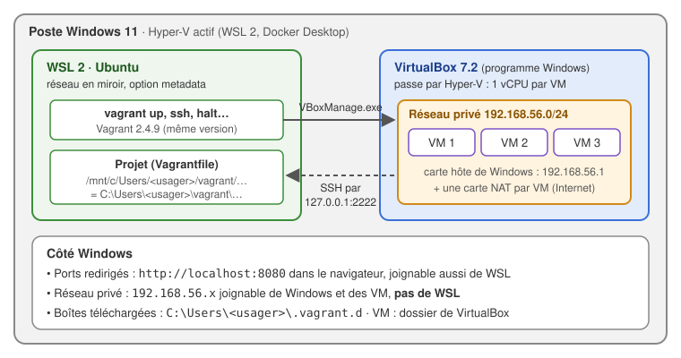
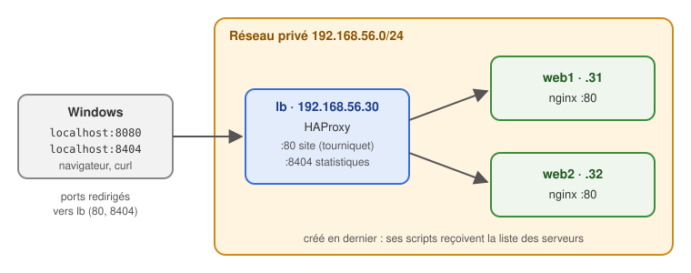

# 33 - Introduction à Vagrant

*Révision du 2026.11.09*

<p align="center">
    
</p>

**Objectif de la lecture** : créer des machines virtuelles à partir d'un fichier texte, avec Vagrant et VirtualBox, depuis WSL sur un poste Windows 11. C'est la préparation au [document 34](Kubernetes-Installation-cluster.md), où un `Vagrantfile` crée un amas Kubernetes HA de sept VM.

*A.B. aka ve2cuy*

> 💡 La section 3 configure le poste **une seule fois**. Suivre chaque étape dans l'ordre, puis lancer le script de vérification ([3.9](#section-3-9)) : il signale tout ce qui empêcherait les exemples de fonctionner. La section 9 explique chaque erreur connue et sa solution.

## Contenu

- [**1 – Vagrant en bref**](#section-1)
  - [1.1 – L'infrastructure en tant que code](#section-1-1)
  - [1.2 – Les notions de Vagrant](#section-1-2)
- [**2 – Le poste de travail : comment les pièces s'emboîtent**](#section-2)
- [**3 – Configurer le poste, étape par étape**](#section-3)
  - [3.1 – Prérequis](#section-3-1)
  - [3.2 – VirtualBox sous Windows](#section-3-2)
  - [3.3 – Vagrant sous Windows](#section-3-3)
  - [3.4 – WSL : le réseau en miroir](#section-3-4)
  - [3.5 – WSL : les droits des fichiers du disque C:](#section-3-5)
  - [3.6 – Vagrant dans WSL, à la même version](#section-3-6)
  - [3.7 – Les variables d'environnement](#section-3-7)
  - [3.8 – Le dossier des projets](#section-3-8)
  - [3.9 – Vérifier le poste](#section-3-9)
- [**4 – Exemple 1 : une première VM**](#section-4)
  - [4.1 – Le Vagrantfile](#section-4-1)
  - [4.2 – Le cycle de vie d'une VM](#section-4-2)
  - [4.3 – Les photos (snapshots)](#section-4-3)
- [**5 – Exemple 2 : approvisionnement, ports et dossier partagé**](#section-5)
- [**6 – Exemple 3 : plusieurs VM et un équilibreur de charge**](#section-6)
  - [6.1 – Le Vagrantfile](#section-6-1)
  - [6.2 – Les scripts d'approvisionnement](#section-6-2)
  - [6.3 – Lancer et vérifier](#section-6-3)
- [**7 – Laboratoire (durée 60 minutes)**](#section-7)
- [**8 – Les commandes de Vagrant**](#section-8)
- [**9 – Gestion des erreurs**](#section-9)
- [**10 – Vers le document 34**](#section-10)

---

## 1 – Vagrant en bref {#section-1}

### 1.1 – L'infrastructure en tant que code {#section-1-1}

Créer une VM à la main, c'est une suite de clics et de réponses : nom, mémoire, disque, ISO, installation du système, réseau, paquets. Refaire la même VM sur un autre poste, ou en créer sept identiques, devient vite long et source d'erreurs.

[Vagrant](https://developer.hashicorp.com/vagrant) (HashiCorp) décrit les VM dans un fichier texte, le `Vagrantfile`. Une seule commande, `vagrant up`, crée et configure toutes les VM du fichier. C'est de l'**infrastructure en tant que code** (*IaC, infrastructure as code*) :

* le `Vagrantfile` se partage dans Git, comme du code;
* le même fichier produit les mêmes VM, sur tous les postes, autant de fois que nécessaire;
* une VM brisée se remplace en deux commandes : `vagrant destroy`, puis `vagrant up`.

> 💡 Docker décrit des **conteneurs** dans un `Dockerfile` ou un `compose.yaml`. Vagrant décrit des **machines virtuelles** complètes, avec leur propre noyau Linux. Il en faut pour installer Kubernetes avec `kubeadm` (documents 24b et 34).

### 1.2 – Les notions de Vagrant {#section-1-2}

| Notion | Description |
|--------|-------------|
| **Vagrantfile** | Le fichier qui décrit les VM, écrit en Ruby. Un dossier = un projet = un `Vagrantfile`. |
| **Boîte** (*box*) | L'image de départ d'une VM, avec un système déjà installé. Téléchargée une fois du [catalogue de Vagrant](https://portal.cloud.hashicorp.com/vagrant/discover), puis réutilisée. Ex. : `bento/ubuntu-26.04`. |
| **Fournisseur** (*provider*) | Le logiciel de virtualisation qui fait tourner les VM : VirtualBox (par défaut), libvirt/KVM, VMware, Hyper-V. |
| **Approvisionnement** (*provisioning*) | Ce qui configure la VM après son premier démarrage : un script shell, une copie de fichiers… |
| **Réseau** | Une carte NAT par VM (Internet et `vagrant ssh`), des **ports redirigés** vers le poste et, au besoin, un **réseau privé** entre les VM et le poste. |
| **Dossier partagé** | Le dossier du projet, visible dans la VM sous `/vagrant`. |

---

## 2 – Le poste de travail : comment les pièces s'emboîtent {#section-2}

En classe, les VM sont créées avec **VirtualBox, installé sous Windows**, et pilotées par la commande `vagrant` **lancée dans WSL** (Ubuntu). Vagrant prévoit ce montage : dans WSL, il appelle `VBoxManage.exe`, le programme de commande de VirtualBox.



Pourquoi ce montage?

* **WSL** donne un terminal Linux (bash, ssh, curl, git) : les mêmes commandes que dans les VM et que dans le document 34.
* **VirtualBox** est le fournisseur le plus simple pour débuter, et il est gratuit.
* VirtualBox ne peut pas tourner **dans** WSL : il a besoin d'un pilote du noyau que le noyau de WSL n'accepte pas. Il est donc installé sous Windows.

Ce montage impose cinq règles, toutes expliquées à la section 3 :

| Règle | Pourquoi |
|-------|----------|
| Même version de Vagrant sous Windows et dans WSL | Vagrant le vérifie et refuse de démarrer sinon ([9.1](#section-9-1)) |
| Réseau de WSL en mode miroir | Vagrant joint les VM par `127.0.0.1:2222`, le `localhost` de Windows ([9.3](#section-9-3)) |
| Disque C: monté avec l'option `metadata` | Sinon la clé SSH des VM est lisible par tous et `ssh` la refuse ([9.6](#section-9-6)) |
| Projets sous `C:\Users\<usager>\` | VirtualBox, un programme Windows, doit pouvoir lire le dossier du projet ([9.7](#section-9-7)) |
| **Un seul processeur par VM** | Hyper-V est actif (WSL 2, Docker Desktop) : VirtualBox passe alors par Hyper-V, et une VM à 2 processeurs reste bloquée au démarrage ([9.4](#section-9-4)) |

> 💡 **VirtualBox sur Hyper-V.** Quand Hyper-V est actif, VirtualBox n'a plus d'accès direct à la virtualisation matérielle (VT-x, AMD-V). Il passe par l'interface de Windows (*Windows Hypervisor Platform*). Une tortue verte apparaît alors en bas à droite de la fenêtre d'une VM. Les VM sont un peu plus lentes, et limitées à un processeur. Le document 34 évite cette limite : les VM y sont créées par KVM, dans une VM Ubuntu sous Hyper-V.

---

## 3 – Configurer le poste, étape par étape {#section-3}

### 3.1 – Prérequis {#section-3-1}

| Élément | Valeur |
|---------|--------|
| Système | Windows 11 (22H2 ou plus récent), droits d'administrateur |
| Virtualisation | Activée dans le BIOS/UEFI du poste (Intel VT-x ou AMD-V) |
| WSL | WSL 2 version 2.0 ou plus, avec une distribution Ubuntu |
| Mémoire vive | 16 Go ou plus (chaque VM des exemples prend 0,75 à 1 Go) |
| Disque C: | 20 Go libres (une boîte : 1,5 Go; une VM : 3 à 5 Go) |

Vérifier WSL dans **PowerShell** :

```powershell
wsl --version            # « Version WSL : 2.x.x »
wsl -l -v                # la distribution Ubuntu, VERSION 2
```

Si WSL ou Ubuntu manque : `wsl --install -d Ubuntu-24.04` dans PowerShell en administrateur, redémarrer Windows, puis ouvrir **Ubuntu** depuis le menu Démarrer et créer l'usager Linux.

### 3.2 – VirtualBox sous Windows {#section-3-2}

Dans **PowerShell, en administrateur** :

```powershell
winget install --id Oracle.VirtualBox --exact
```

Ou télécharger l'installateur sur [virtualbox.org](https://www.virtualbox.org/wiki/Downloads) (*Windows hosts*). Accepter les valeurs par défaut : l'installation coupe le réseau quelques secondes, le temps de créer la carte réseau de VirtualBox.

Vérifier :

```powershell
& "C:\Program Files\Oracle\VirtualBox\VBoxManage.exe" --version     # ex. : 7.2.4r170995
```

> ⚠️ Si VirtualBox était déjà installé, ouvrir sa fenêtre et **retirer les VM marquées « inaccessible »** (clic droit, *Retirer*). Une seule de ces VM fait échouer `vagrant up` ([9.2](#section-9-2)).

### 3.3 – Vagrant sous Windows {#section-3-3}

Vagrant doit aussi être installé sous Windows, même si on ne l'utilise que dans WSL : Vagrant compare les deux versions ([9.1](#section-9-1)).

Dans **PowerShell, en administrateur** :

```powershell
winget install --id Hashicorp.Vagrant --exact
```

Ou télécharger l'installateur sur [developer.hashicorp.com/vagrant/install](https://developer.hashicorp.com/vagrant/install). Accepter la demande d'autorisation (UAC). À la fin, l'installateur demande de redémarrer Windows : ce n'est pas nécessaire pour la suite.

Noter la version installée, **elle servira à l'étape 3.6** :

```powershell
& "C:\Program Files\Vagrant\bin\vagrant.exe" --version     # ex. : Vagrant 2.4.9
```

### 3.4 – WSL : le réseau en miroir {#section-3-4}

Par défaut, WSL 2 a son propre réseau, derrière un NAT. Son `127.0.0.1` n'est **pas** celui de Windows. Or VirtualBox redirige le port SSH de chaque VM sur le `127.0.0.1` de **Windows** (port 2222). Sans le mode miroir, `vagrant up` attend la VM pendant 5 minutes, puis abandonne ([9.3](#section-9-3)).

En **mode miroir**, WSL partage les adresses de Windows, dont `127.0.0.1`. Ce réglage est dans le fichier `%USERPROFILE%\.wslconfig`, côté Windows.

Dans **PowerShell** (pas besoin d'être administrateur) :

```powershell
# Le fichier existe-t-il déjà?
Test-Path "$env:USERPROFILE\.wslconfig"
```

* **False** : le créer.

  ```powershell
  "[wsl2]`r`nnetworkingMode=mirrored" | Out-File -Encoding ascii "$env:USERPROFILE\.wslconfig"
  ```

* **True** : l'ouvrir (`notepad "$env:USERPROFILE\.wslconfig"`) et ajouter la ligne `networkingMode=mirrored` sous la section `[wsl2]`, sans effacer le reste.

Puis redémarrer WSL. Cette commande ferme tous les terminaux WSL et arrête Docker Desktop, s'il est ouvert : le relancer ensuite.

```powershell
wsl --shutdown
```

Vérifier dans un **nouveau terminal Ubuntu** :

```bash
wslinfo --networking-mode      # mirrored
```

### 3.5 – WSL : les droits des fichiers du disque C: {#section-3-5}

WSL voit le disque C: sous `/mnt/c`. Par défaut, tous les fichiers y ont les droits `rwxrwxrwx`, et `chmod` n'a aucun effet. Vagrant écrit la clé SSH de chaque VM dans le dossier du projet, sur le disque C:. Le programme `ssh` refuse une clé lisible par tous : `vagrant ssh` demande alors un mot de passe et semble bloqué ([9.6](#section-9-6)).

L'option `metadata` permet à WSL de garder de vrais droits Linux sur le disque C:. Elle se règle dans le fichier `/etc/wsl.conf`, **dans Ubuntu**.

```bash
# Voir le fichier actuel
cat /etc/wsl.conf
```

S'il ne contient pas déjà de section `[automount]`, l'ajouter :

```bash
sudo tee -a /etc/wsl.conf <<'EOF'

[automount]
options = "metadata,umask=22,fmask=11"
EOF
```

S'il en contient une, l'ouvrir (`sudo nano /etc/wsl.conf`) et y mettre la ligne `options = …` ci-dessus.

Redémarrer Ubuntu, dans **PowerShell** :

```powershell
wsl --terminate Ubuntu-24.04      # le nom donné par : wsl -l -v
```

Vérifier dans un **nouveau terminal Ubuntu** :

```bash
mount | grep " /mnt/c " | grep -o metadata      # metadata
```

### 3.6 – Vagrant dans WSL, à la même version {#section-3-6}

Dans **Ubuntu** : ajouter le dépôt de HashiCorp, puis installer **la version notée à l'étape 3.3**.

```bash
# Le dépôt de HashiCorp
sudo apt-get update
sudo apt-get install -y gpg wget
wget -qO- https://apt.releases.hashicorp.com/gpg | sudo gpg --dearmor -o /usr/share/keyrings/hashicorp-archive-keyring.gpg
echo "deb [signed-by=/usr/share/keyrings/hashicorp-archive-keyring.gpg] https://apt.releases.hashicorp.com $(. /etc/os-release; echo $VERSION_CODENAME) main" | sudo tee /etc/apt/sources.list.d/hashicorp.list
sudo apt-get update

# Les versions offertes
apt-cache madison vagrant | head -5

# Installer la même version que sous Windows (ici 2.4.9), puis la bloquer
sudo apt-get install -y vagrant=2.4.9-1
sudo apt-mark hold vagrant
vagrant --version      # Vagrant 2.4.9
```

* `apt-mark hold` empêche `apt upgrade` de changer la version de Vagrant dans WSL, ce qui briserait la correspondance avec Windows.
* Pour changer de version plus tard : mettre à jour **les deux côtés**. Sous Windows, `winget upgrade --id Hashicorp.Vagrant`; dans WSL, `sudo apt-mark unhold vagrant`, puis `sudo apt-get install vagrant=<version>-1` et de nouveau `sudo apt-mark hold vagrant`.

### 3.7 – Les variables d'environnement {#section-3-7}

Deux réglages dans `~/.bashrc`, **dans Ubuntu** :

```bash
cat >> ~/.bashrc <<'EOF'

# Document 33 : Vagrant dans WSL pilote le VirtualBox de Windows
export VAGRANT_WSL_ENABLE_WINDOWS_ACCESS="1"
export PATH="$PATH:/mnt/c/Program Files/Oracle/VirtualBox"
EOF
source ~/.bashrc
```

| Variable | Rôle |
|----------|------|
| `VAGRANT_WSL_ENABLE_WINDOWS_ACCESS=1` | Autorise Vagrant à utiliser les programmes de Windows (VirtualBox). Sans elle : *Vagrant is unable to use the VirtualBox provider from the Windows Subsystem for Linux* |
| `PATH` | Rend `VBoxManage.exe` trouvable depuis WSL |

> 💡 Avec cet accès, Vagrant range ses boîtes dans le dossier Windows de l'usager (`C:\Users\<usager>\.vagrant.d`), pas dans `~/.vagrant.d` de WSL.

### 3.8 – Le dossier des projets {#section-3-8}

Les projets Vagrant doivent être **sur le disque C:, sous le dossier Windows de l'usager** (`C:\Users\<usager>\`). VirtualBox est un programme Windows : il ne voit pas le disque Linux de WSL (`/home/...`). Un projet placé dans `~` donne l'erreur *The host path of the shared folder is not supported from WSL* ([9.7](#section-9-7)).

Dans **Ubuntu** :

```bash
# Le dossier Windows de l'usager, vu de WSL (ex. : /mnt/c/Users/etudiant)
WINHOME=$(wslpath "$(cmd.exe /c 'echo %USERPROFILE%' 2>/dev/null | tr -d '\r')")
echo $WINHOME

# Un dossier pour les projets Vagrant, et le dépôt du cours
mkdir -p "$WINHOME/vagrant" && cd "$WINHOME/vagrant"
git clone https://github.com/ve2cuy/4204d4.git
cd 4204d4/Installation/Vagrant/exemples
ls
```

```
01-premiere-vm  02-serveur-web  03-equilibreur  verifier-poste.sh
```

> 💡 Le même dossier s'ouvre dans l'Explorateur de Windows (`C:\Users\<usager>\vagrant`) et dans VS Code. Les scripts restent en fins de ligne Unix (LF), même si le dépôt est cloné avec Git pour Windows : le fichier `.gitattributes` du dossier `exemples` l'impose.

### 3.9 – Vérifier le poste {#section-3-9}

Le script [verifier-poste.sh](https://github.com/ve2cuy/4204d4/blob/main/Installation/Vagrant/exemples/verifier-poste.sh) vérifie chaque étape de cette section. Dans **Ubuntu**, depuis le dossier `exemples` :

```bash
bash verifier-poste.sh
```

Résultat attendu :

```
>>> 1. WSL
  [OK]  Ce terminal est bien dans WSL
  [OK]  Disque C: monté avec l'option metadata
  [OK]  Réseau de WSL en mode miroir
>>> 2. VirtualBox (Windows)
  [OK]  VirtualBox 7.2.4r170995
  [OK]  VBoxManage.exe dans le PATH
  [OK]  Aucune VM inaccessible dans VirtualBox
>>> 3. Vagrant
  [OK]  Vagrant 2.4.9 dans WSL
  [OK]  Vagrant 2.4.9 sous Windows
  [OK]  Même version des deux côtés
>>> 4. Variables d'environnement
  [OK]  VAGRANT_WSL_ENABLE_WINDOWS_ACCESS=1
>>> 5. Dossier courant
  [OK]  /mnt/c/Users/etudiant/vagrant/4204d4/Installation/Vagrant/exemples est dans le dossier Windows de l'usager (/mnt/c/Users/etudiant)

>>> Résultat : 11 vérification(s) réussie(s), 0 problème(s)
>>> Le poste est prêt : vagrant up
```

Chaque ligne `[!!]` donne la section à revoir.

---

## 4 – Exemple 1 : une première VM {#section-4}

### 4.1 – Le Vagrantfile {#section-4-1}

[01-premiere-vm/Vagrantfile](https://github.com/ve2cuy/4204d4/blob/main/Installation/Vagrant/exemples/01-premiere-vm/Vagrantfile) :

```ruby
# Document 33, exemple 1 : une première VM
Vagrant.configure("2") do |config|
  config.vm.box      = "bento/ubuntu-26.04"   # l'image de départ (la boîte)
  config.vm.hostname = "premiere"             # le nom de la machine dans Linux

  config.vm.provider "virtualbox" do |vb|
    vb.name   = "d33-premiere"   # le nom affiché dans VirtualBox
    vb.cpus   = 1                # 1 seul processeur : voir la section 9.4
    vb.memory = 1024             # en Mo
  end
end
```

* `Vagrant.configure("2")` : la version 2 du format, la seule en usage.
* `config.vm.box` : la boîte [bento/ubuntu-26.04](https://portal.cloud.hashicorp.com/vagrant/discover/bento/ubuntu-26.04), une Ubuntu Server 26.04 préparée par le projet [Bento](https://github.com/chef/bento). Elle contient l'usager `vagrant` (`sudo` sans mot de passe) et les Additions invité de VirtualBox.
* `config.vm.provider "virtualbox"` : les réglages propres à VirtualBox. Ceux d'un autre fournisseur (libvirt au document 34) vont dans un autre bloc `provider`.

> 💡 `vagrant init bento/ubuntu-26.04` crée un `Vagrantfile` de départ, plein de commentaires qui présentent toutes les options.

Dans **Ubuntu** :

```bash
cd 01-premiere-vm
vagrant up
```

**La première fois**, Vagrant télécharge la boîte (environ 1,5 Go) : compter 10 à 15 minutes. Les fois suivantes, la boîte est déjà là : 3 à 4 minutes, dont 2 minutes d'attente au démarrage, expliquées en [9.5](#section-9-5).

```
==> default: Box 'bento/ubuntu-26.04' could not be found. Attempting to find and install...
==> default: Adding box 'bento/ubuntu-26.04' (v202606.01.0) for provider: virtualbox (amd64)
==> default: Importing base box 'bento/ubuntu-26.04'...
==> default: Setting the name of the VM: d33-premiere
==> default: Forwarding ports...
    default: 22 (guest) => 2222 (host) (adapter 1)
==> default: Booting VM...
==> default: Waiting for machine to boot. This may take a few minutes...
    default: SSH address: 127.0.0.1:2222
    default: Vagrant insecure key detected. Vagrant will automatically replace
    default: this with a newly generated keypair for better security.
==> default: Machine booted and ready!
==> default: Setting hostname...
==> default: Mounting shared folders...
    default: /mnt/c/Users/etudiant/vagrant/4204d4/Installation/Vagrant/exemples/01-premiere-vm => /vagrant
```

Ce que Vagrant a fait :

1. télécharger la boîte et l'importer dans VirtualBox (VM `d33-premiere`);
2. rediriger le port 22 (SSH) de la VM vers le port 2222 de Windows;
3. démarrer la VM, attendre qu'elle réponde par SSH, puis remplacer la clé SSH publique de la boîte par une clé propre à cette VM;
4. donner le nom `premiere` à la machine et monter le dossier du projet sous `/vagrant`.

Se connecter à la VM :

```bash
vagrant ssh
```

```bash
vagrant@premiere:~$ hostname; lsb_release -ds; nproc
premiere
Ubuntu 26.04 LTS
1
vagrant@premiere:~$ sudo whoami
root
vagrant@premiere:~$ ls /vagrant
Vagrantfile
vagrant@premiere:~$ exit
```

Ouvrir aussi la fenêtre de VirtualBox : la VM `d33-premiere` y est, en marche, sans écran (*headless*).

### 4.2 – Le cycle de vie d'une VM {#section-4-2}

| Commande | Effet | État après | Durée mesurée |
|----------|-------|------------|:-------------:|
| `vagrant up` | Crée la VM (première fois) ou la démarre | `running` | 4 min (création), 1 à 3 min (démarrage) |
| `vagrant status` | Affiche l'état des VM du projet | | |
| `vagrant ssh` | Ouvre un terminal dans la VM | | |
| `vagrant ssh -c "commande"` | Exécute une commande dans la VM | | |
| `vagrant halt` | Arrêt propre (comme `shutdown`) | `poweroff` | 20 s |
| `vagrant suspend` / `vagrant resume` | Met en veille / réveille | `saved` | |
| `vagrant reload` | Redémarre, en relisant le `Vagrantfile` | `running` | 1 min |
| `vagrant destroy -f` | Efface la VM et son disque (pas la boîte) | `not created` | 15 s |

Essayer chaque commande, et suivre l'état dans la fenêtre de VirtualBox :

```bash
vagrant status
vagrant halt
vagrant status
vagrant up
vagrant ssh -c "uptime"
```

> 💡 Toutes les commandes `vagrant` se lancent **depuis le dossier du projet** : Vagrant y lit le `Vagrantfile` et le dossier caché `.vagrant`, qui relie le projet à ses VM dans VirtualBox. `vagrant global-status` liste les VM de tous les projets du poste.

### 4.3 – Les photos (snapshots) {#section-4-3}

Une photo garde l'état du disque d'une VM. Pratique avant une manipulation risquée. Sur ce poste, prendre les photos **VM arrêtée** ([9.13](#section-9-13)) :

```bash
vagrant halt
vagrant snapshot save avant              # photo nommée « avant » : quelques secondes
vagrant up
vagrant ssh -c "touch fichier-perdu; ls"
vagrant snapshot restore avant           # arrête la VM, revient à la photo, redémarre : 1 minute
vagrant ssh -c "ls"                      # fichier-perdu a disparu
vagrant snapshot list
vagrant snapshot delete avant
```

Fin de l'exemple 1 : effacer la VM. La boîte reste sur le poste, pour les exemples suivants.

```bash
vagrant destroy -f
vagrant box list          # bento/ubuntu-26.04 (virtualbox, ...)
cd ..
```

---

## 5 – Exemple 2 : approvisionnement, ports et dossier partagé {#section-5}

Une VM vide ne sert pas à grand-chose. L'**approvisionnement** installe et configure les logiciels au premier `vagrant up`. Ici : un serveur Web nginx, avec une page tirée du dossier partagé.

[02-serveur-web/Vagrantfile](https://github.com/ve2cuy/4204d4/blob/main/Installation/Vagrant/exemples/02-serveur-web/Vagrantfile) :

```ruby
# Document 33, exemple 2 : un serveur Web approvisionné par un script
Vagrant.configure("2") do |config|
  config.vm.box      = "bento/ubuntu-26.04"
  config.vm.hostname = "web"

  # Port 80 de la VM => port 8080 de Windows (http://localhost:8080)
  config.vm.network "forwarded_port", guest: 80, host: 8080
  # Réseau privé : la VM, Windows et WSL se joignent par cette adresse
  config.vm.network "private_network", ip: "192.168.56.20"

  config.vm.provider "virtualbox" do |vb|
    vb.name   = "d33-web"
    vb.cpus   = 1
    vb.memory = 1024
  end

  # Approvisionnement : exécuté en root au premier « vagrant up »
  config.vm.provision "shell", inline: <<-SHELL
    rm -f /etc/netplan/01-netcfg.yaml   # défaut de la boîte : document 33, section 9.5
    apt-get update -q
    apt-get install -y -q nginx
    cp /vagrant/index.html /var/www/html/index.html
  SHELL
end
```

| Ligne | Effet |
|-------|-------|
| `forwarded_port, guest: 80, host: 8080` | Le port 80 de la VM devient le port 8080 du `localhost` de Windows (et de WSL, grâce au mode miroir) |
| `private_network, ip: "192.168.56.20"` | Une deuxième carte réseau, sur le réseau « hôte seulement » de VirtualBox (`192.168.56.0/24`; Windows y est `192.168.56.1`) |
| `provision "shell", inline:` | Un script exécuté **en root**, une seule fois, au premier `vagrant up`. Le texte entre `<<-SHELL` et `SHELL` est le script. |
| `/vagrant/index.html` | Le fichier `index.html` du projet, vu de la VM par le dossier partagé |

Lancer :

```bash
cd 02-serveur-web
vagrant up            # environ 4 minutes : création, puis approvisionnement
```

La sortie de l'approvisionnement apparaît après `Running provisioner: shell...`. Vérifier :

```bash
# Depuis WSL, par le port redirigé
curl http://localhost:8080
```

```html
  <h1>Bonjour de la VM « web »</h1>
```

Puis ouvrir dans le **navigateur de Windows** :

* <http://localhost:8080> : par le port redirigé;
* <http://192.168.56.20> : par le réseau privé.

> ⚠️ Depuis **WSL**, `curl http://192.168.56.20` ne répond pas : en mode miroir, WSL ne reprend pas la carte « hôte seulement » de VirtualBox. Le réseau privé sert entre les VM, et depuis Windows ([9.10](#section-9-10)).

**Le dossier partagé fonctionne dans les deux sens.** Modifier `index.html` dans VS Code ou dans WSL (par exemple, changer le titre), puis recopier le fichier et recharger la page :

```bash
vagrant ssh -c "sudo cp /vagrant/index.html /var/www/html/"
curl http://localhost:8080
```

**Relancer l'approvisionnement.** Il ne s'exécute qu'au premier `vagrant up`. Pour le relancer sur une VM en marche, après une modification du script :

```bash
vagrant provision
```

Fin de l'exemple 2 :

```bash
vagrant destroy -f
cd ..
```

---

## 6 – Exemple 3 : plusieurs VM et un équilibreur de charge {#section-6}

Un seul `Vagrantfile` peut décrire plusieurs VM. Cet exemple crée deux serveurs Web et un équilibreur de charge **HAProxy** qui répartit les requêtes entre eux. Le document 34 utilise ce même principe, à plus grande échelle : deux équilibreurs devant trois contrôleurs Kubernetes.



### 6.1 – Le Vagrantfile {#section-6-1}

[03-equilibreur/Vagrantfile](https://github.com/ve2cuy/4204d4/blob/main/Installation/Vagrant/exemples/03-equilibreur/Vagrantfile) :

```ruby
# Document 33, exemple 3 : trois VM, un équilibreur de charge et deux serveurs Web
RESEAU   = "192.168.56"
NB_WEB   = (ENV["NB_WEB"] || 2).to_i          # ex. : NB_WEB=3 vagrant up
SERVEURS = (1..NB_WEB).map { |i| ["web#{i}", "#{RESEAU}.#{30 + i}"] }

Vagrant.configure("2") do |config|
  config.vm.box = "bento/ubuntu-26.04"
  config.vm.synced_folder ".", "/vagrant", disabled: true   # pas besoin ici

  config.vm.provider "virtualbox" do |vb|
    vb.cpus   = 1
    vb.memory = 768
  end

  # Les serveurs Web : web1, web2, ...
  SERVEURS.each do |nom, ip|
    config.vm.define nom do |n|
      n.vm.hostname = nom
      n.vm.network "private_network", ip: ip
      n.vm.provider("virtualbox") { |vb| vb.name = "d33-#{nom}" }
      n.vm.provision "shell", name: "web", path: "scripts/web.sh",
        env: { "NOM" => nom, "IP" => ip }
    end
  end

  # L'équilibreur de charge, créé en dernier
  config.vm.define "lb" do |n|
    n.vm.hostname = "lb"
    n.vm.network "private_network", ip: "#{RESEAU}.30"
    n.vm.network "forwarded_port", guest: 80,   host: 8080   # le site
    n.vm.network "forwarded_port", guest: 8404, host: 8404   # les statistiques
    n.vm.provider("virtualbox") { |vb| vb.name = "d33-lb" }
    n.vm.provision "shell", name: "equilibreur", path: "scripts/equilibreur.sh",
      env: { "SERVEURS" => SERVEURS.map { |nom, ip| "#{nom}:#{ip}" }.join(" ") }
  end
end
```

Ce qui est nouveau :

| Élément | Rôle |
|---------|------|
| Constantes en tête (`RESEAU`, `NB_WEB`, `SERVEURS`) | Le `Vagrantfile` est du Ruby : variables, boucles et calculs y sont permis. `SERVEURS` vaut `[["web1", "192.168.56.31"], ["web2", "192.168.56.32"]]`. |
| `ENV["NB_WEB"]` | Une variable d'environnement de WSL lue par le `Vagrantfile` : `NB_WEB=3 vagrant up` crée trois serveurs Web. |
| `config.vm.define nom` | Une VM nommée. Les commandes visent une VM par son nom : `vagrant ssh web1`, `vagrant halt lb`. Sans nom, elles visent toutes les VM. |
| Réglages communs, puis réglages par VM | Le bloc `provider` du haut s'applique à toutes les VM; chaque `define` ajoute les siens (nom dans VirtualBox, adresse). |
| `provision "shell", path:` | Le script est un fichier du projet (`scripts/web.sh`), copié dans la VM et exécuté en root. |
| `env:` | Des variables d'environnement passées au script : le même script sert à toutes les VM d'un même type. |
| `synced_folder ... disabled: true` | Pas de dossier partagé : les scripts sont copiés par Vagrant, et le démarrage est plus rapide. |

Les VM sont créées **une à la fois, dans l'ordre du fichier** : web1, web2, puis lb. L'équilibreur, créé en dernier, trouve les serveurs Web déjà en marche.

### 6.2 – Les scripts d'approvisionnement {#section-6-2}

[scripts/web.sh](https://github.com/ve2cuy/4204d4/blob/main/Installation/Vagrant/exemples/03-equilibreur/scripts/web.sh) :

```bash
#!/bin/bash
# Serveur Web : nginx et une page qui affiche le nom de la VM
# Variables reçues du Vagrantfile : NOM, IP
set -euo pipefail
export DEBIAN_FRONTEND=noninteractive

rm -f /etc/netplan/01-netcfg.yaml   # défaut de la boîte : document 33, section 9.5
apt-get update -q
apt-get install -y -q nginx
echo "<h1>Réponse de ${NOM} (${IP})</h1>" > /var/www/html/index.html
echo ">>> ${NOM} prêt : http://${IP}"
```

[scripts/equilibreur.sh](https://github.com/ve2cuy/4204d4/blob/main/Installation/Vagrant/exemples/03-equilibreur/scripts/equilibreur.sh) écrit la configuration de HAProxy à partir de la liste reçue dans `SERVEURS` :

```bash
#!/bin/bash
# Équilibreur de charge : HAProxy, en tourniquet (round robin) sur les serveurs Web
# Variable reçue du Vagrantfile : SERVEURS="web1:192.168.56.31 web2:192.168.56.32"
set -euo pipefail
export DEBIAN_FRONTEND=noninteractive

rm -f /etc/netplan/01-netcfg.yaml   # défaut de la boîte : document 33, section 9.5
apt-get update -q
apt-get install -y -q haproxy

{
  cat <<'FIN'
global
    log /dev/log local0

defaults
    mode    http
    timeout connect 5s
    timeout client  30s
    timeout server  30s

frontend site
    bind *:80
    default_backend serveurs_web

frontend statistiques
    bind *:8404
    stats enable
    stats uri /
    stats refresh 5s

backend serveurs_web
    balance roundrobin
    option httpchk GET /
FIN
  for s in ${SERVEURS}; do
    echo "    server ${s%%:*} ${s#*:}:80 check inter 2s"
  done
} > /etc/haproxy/haproxy.cfg

haproxy -c -f /etc/haproxy/haproxy.cfg
systemctl restart haproxy
echo ">>> Équilibreur prêt : http://localhost:8080 et http://localhost:8404"
```

* `set -euo pipefail` : le script s'arrête à la première erreur, et `vagrant up` l'affiche en rouge.
* `balance roundrobin` : les requêtes vont à tour de rôle à chaque serveur.
* `check inter 2s` : HAProxy vérifie chaque serveur aux 2 secondes, et retire de la rotation celui qui ne répond plus.
* `${s%%:*}` et `${s#*:}` : le nom et l'adresse, de part et d'autre du `:` de `web1:192.168.56.31`.

### 6.3 – Lancer et vérifier {#section-6-3}

```bash
cd 03-equilibreur
vagrant up            # environ 12 minutes pour les trois VM
vagrant status
```

```
web1                      running (virtualbox)
web2                      running (virtualbox)
lb                        running (virtualbox)
```

Le tourniquet, depuis WSL :

```bash
for i in 1 2 3 4; do curl -s http://localhost:8080; done
```

```html
<h1>Réponse de web1 (192.168.56.31)</h1>
<h1>Réponse de web2 (192.168.56.32)</h1>
<h1>Réponse de web1 (192.168.56.31)</h1>
<h1>Réponse de web2 (192.168.56.32)</h1>
```

La page de statistiques de HAProxy, dans le **navigateur de Windows** : <http://localhost:8404>. Les serveurs en santé sont en vert.

Entre les VM, le réseau privé fonctionne **par adresse** :

```bash
vagrant ssh lb -c "curl -s 192.168.56.32"
vagrant ssh web1 -c "ping -c 2 192.168.56.30"
```

> 💡 Les VM ne connaissent pas le nom des autres : `curl web1` ne répond pas depuis `lb`. Pour utiliser des noms, il faut les ajouter au fichier `/etc/hosts` de chaque VM, par l'approvisionnement. C'est ce que fait le document 34.

---

## 7 – Laboratoire (durée 60 minutes) {#section-7}


### Partie A – Manipuler l'exemple 3 (25 minutes)

Partir de l'exemple 3 en marche (section 6.3), avec la page de statistiques ouverte dans le navigateur de Windows.

1. **Panne d'un serveur Web.** Arrêter `web1` : `vagrant halt web1`. Que montre la page de statistiques? Que répond `curl http://localhost:8080`, plusieurs fois de suite? Combien de requêtes ont échoué?
2. **Retour du serveur.** `vagrant up web1`. Après combien de secondes `web1` revient-il dans la rotation? Pourquoi `vagrant up` est-il beaucoup plus rapide que la première fois?
3. **Un troisième serveur.** `NB_WEB=3 vagrant up web3`. Le tourniquet passe-t-il par `web3`? Pourquoi pas? Lancer `NB_WEB=3 vagrant provision lb`, puis vérifier de nouveau. Expliquer.
4. **Le piège de la variable.** Lancer `vagrant status` sans `NB_WEB=3`. Que devient `web3` dans la liste? Comment éviter ce piège (indice : où est lue la valeur par défaut de `NB_WEB`)?
5. **Une photo.** Arrêter `lb` et en prendre une photo (`vagrant halt lb`, puis `vagrant snapshot save lb bon`), le redémarrer (`vagrant up lb`), effacer la configuration de HAProxy (`vagrant ssh lb -c "sudo rm /etc/haproxy/haproxy.cfg && sudo systemctl restart haproxy"`), constater la panne, puis restaurer la photo.
6. Effacer toutes les VM : `NB_WEB=3 vagrant destroy -f`. Vérifier dans la fenêtre de VirtualBox qu'il ne reste aucune VM `d33-…`.

### Partie B – Écrire un Vagrantfile (35 minutes)

Dans un nouveau dossier `$WINHOME/vagrant/labo33`, écrire un `Vagrantfile` qui crée **une** VM :

| Exigence | Valeur |
|----------|--------|
| Boîte | `bento/ubuntu-26.04` |
| Nom dans VirtualBox / nom de la machine | `d33-docker` / `docker` |
| Processeur / mémoire | 1 / 2048 Mo |
| Réseau privé | `192.168.56.40` |
| Port redirigé | 80 de la VM vers 8081 de Windows |
| Approvisionnement (script `scripts/docker.sh`) | Corriger le défaut de la boîte (9.5), installer Docker (`docker.io`), ajouter l'usager `vagrant` au groupe `docker`, puis lancer un conteneur `nginx` publié sur le port 80, qui redémarre avec la VM |

Valider :

1. `vagrant up` se termine sans erreur (environ 5 minutes).
2. `vagrant ssh -c "docker ps"` fonctionne **sans** `sudo`.
3. La page d'accueil de nginx s'affiche dans le navigateur de Windows, à <http://localhost:8081> et à <http://192.168.56.40>.
4. Après `vagrant reload`, la page s'affiche encore, sans rien relancer à la main.
5. `vagrant destroy -f`, puis `vagrant up` : tout fonctionne de nouveau, sans intervention. C'est le but de l'infrastructure en tant que code.

<details>
<summary>Solution (à ouvrir après avoir essayé)</summary>

`Vagrantfile` :

```ruby
Vagrant.configure("2") do |config|
  config.vm.box      = "bento/ubuntu-26.04"
  config.vm.hostname = "docker"
  config.vm.network "private_network", ip: "192.168.56.40"
  config.vm.network "forwarded_port", guest: 80, host: 8081
  config.vm.synced_folder ".", "/vagrant", disabled: true

  config.vm.provider "virtualbox" do |vb|
    vb.name   = "d33-docker"
    vb.cpus   = 1
    vb.memory = 2048
  end

  config.vm.provision "shell", path: "scripts/docker.sh"
end
```

`scripts/docker.sh` :

```bash
#!/bin/bash
set -euo pipefail
export DEBIAN_FRONTEND=noninteractive

rm -f /etc/netplan/01-netcfg.yaml
apt-get update -q
apt-get install -y -q docker.io
usermod -aG docker vagrant
docker run -d --name web --restart unless-stopped -p 80:80 nginx
```

</details>

---

## 8 – Les commandes de Vagrant {#section-8}

Dans le dossier du projet. `[nom]` vise une VM d'un projet à plusieurs VM; sans nom, la commande vise toutes les VM du projet.

| Commande | Action |
|----------|--------|
| `vagrant init [boîte]` | Créer un `Vagrantfile` de départ |
| `vagrant validate` | Vérifier la syntaxe du `Vagrantfile` |
| `vagrant up [nom]` | Créer (première fois) et démarrer |
| `vagrant up --provision` | Démarrer et relancer l'approvisionnement |
| `vagrant status` | État des VM du projet |
| `vagrant ssh [nom]` | Terminal dans une VM (usager `vagrant`, `sudo` sans mot de passe) |
| `vagrant ssh [nom] -c "cmd"` | Exécuter une commande dans une VM |
| `vagrant ssh-config [nom]` | Adresse, port et clé SSH (pour `ssh` ou VS Code) |
| `vagrant port [nom]` | Ports redirigés |
| `vagrant halt [nom]` | Arrêt propre |
| `vagrant suspend` / `vagrant resume` | Veille / réveil |
| `vagrant reload [nom]` | Redémarrer en relisant le `Vagrantfile` |
| `vagrant provision [nom]` | Relancer l'approvisionnement sur une VM en marche |
| `vagrant snapshot save/restore/list/delete [nom] photo` | Photos (VM arrêtée : [9.13](#section-9-13)) |
| `vagrant destroy -f [nom]` | Effacer les VM |
| `vagrant global-status [--prune]` | Toutes les VM Vagrant du poste (`--prune` : oublier les VM disparues) |
| `vagrant box list` | Boîtes téléchargées |
| `vagrant box outdated` / `vagrant box update` | Vérifier ou télécharger une version plus récente de la boîte |
| `vagrant box prune` | Effacer les anciennes versions des boîtes |

---

## 9 – Gestion des erreurs {#section-9}

Chaque erreur de cette section a été rencontrée en préparant ce document, sur un poste Windows 11 avec Hyper-V, WSL 2 et Docker Desktop. Commencer toujours par `bash verifier-poste.sh` ([3.9](#section-3-9)).

### 9.1 – Versions différentes de Vagrant {#section-9-1}

```
Vagrant cannot currently enable access to manage machines within the Windows
environment because the version of Vagrant installed on Windows does not
match this version of Vagrant running within the Windows Subsystem for Linux.
  Windows Vagrant version: 2.4.1
  Windows Subsystem for Linux Vagrant version: 2.4.9
```

**Solution** : installer la même version des deux côtés. Le plus simple : mettre Windows à jour (`winget upgrade --id Hashicorp.Vagrant` dans PowerShell en administrateur), puis, dans WSL, installer la même version ([3.6](#section-3-6)).

### 9.2 – Une VM « inaccessible » dans VirtualBox {#section-9-2}

```
There was an error while executing `VBoxManage`, a CLI used by Vagrant
for controlling VirtualBox.
Command: ["showvminfo", "c2b9a79e-...", "--machinereadable"]
Stderr: VBoxManage.exe: error: The object functionality is limited
VBoxManage.exe: error: Details: code E_ACCESSDENIED (0x80070005), component MachineWrap
```

**Cause** : avant de démarrer une VM, Vagrant vérifie les ports redirigés de **toutes** les VM de VirtualBox. Une VM dont les fichiers ont été effacés ou déplacés (disque externe débranché, dossier supprimé) reste inscrite, marquée `<inaccessible>`, et la vérification échoue.

**Solution** : retirer ces inscriptions. Dans la fenêtre de VirtualBox : clic droit sur chaque VM inaccessible, puis *Retirer*. Ou dans WSL :

```bash
VBoxManage.exe list vms | grep inaccessible
VBoxManage.exe unregistervm <uuid>       # l'identifiant entre accolades
```

Les fichiers n'existent déjà plus : rien n'est effacé.

### 9.3 – `vagrant up` attend la VM, puis abandonne {#section-9-3}

```
    default: SSH address: 127.0.0.1:2222
    default: Warning: Connection refused. Retrying...
    default: Warning: Connection refused. Retrying...
Timed out while waiting for the machine to boot.
```

**Cause 1 : le réseau de WSL n'est pas en mode miroir.** Le port 2222 est ouvert sur le `127.0.0.1` de Windows, que WSL ne voit pas. Vérifier `wslinfo --networking-mode`, puis refaire l'étape [3.4](#section-3-4).

**Cause 2 : la VM est bloquée au démarrage**, avec `Connection reset` ou `Connection refused` jusqu'à la fin. Vérifier le nombre de processeurs ([9.4](#section-9-4)).

Après la correction : `vagrant destroy -f`, puis `vagrant up`.

### 9.4 – Une VM à 2 processeurs ne démarre jamais {#section-9-4}

Avec `vb.cpus = 2` ou plus, `vagrant up` se termine comme en 9.3. La VM est en marche dans VirtualBox, mais son journal (`VBox.log`, dans le dossier de la VM) s'arrête à :

```
HM: HMR3Init: Attempting fall back to NEM: VT-x is not available
...
EFI: debug point DXE_AP
```

**Cause** : Hyper-V est actif (WSL 2, Docker Desktop). VirtualBox passe alors par l'interface d'Hyper-V (*NEM*), et le micrologiciel UEFI de la boîte reste bloqué en démarrant le deuxième processeur. Changer les options de VirtualBox (*x2APIC*, *paravirtualisation*) n'y change rien.

**Solution** : **`vb.cpus = 1`** pour toutes les VM. La même VM, avec un seul processeur, démarre en une trentaine de secondes.

### 9.5 – Chaque démarrage attend 2 minutes {#section-9-5}

`Waiting for machine to boot` dure environ 2 minutes, même pour un simple `vagrant reload`. Dans la VM :

```bash
systemd-analyze blame | head -1
```

```
2min 311ms systemd-networkd-wait-online.service
```

**Cause** : la boîte `bento/ubuntu-26.04` contient le fichier `/etc/netplan/01-netcfg.yaml`, qui configure une carte `eth0`. Sous VirtualBox, la carte s'appelle `enp0s3` : Ubuntu attend `eth0` jusqu'à la fin du délai, 2 minutes.

**Solution** : effacer ce fichier. C'est la première ligne de l'approvisionnement des exemples 2 et 3 :

```bash
rm -f /etc/netplan/01-netcfg.yaml
```

Le premier démarrage d'une VM attend encore 2 minutes (l'approvisionnement vient après), mais plus les suivants : un `vagrant reload` passe de 3 minutes à 1 minute. Pour une VM sans approvisionnement, comme l'exemple 1 : `vagrant ssh -c "sudo rm -f /etc/netplan/01-netcfg.yaml"`.

### 9.6 – `vagrant ssh` demande un mot de passe, ou semble bloqué {#section-9-6}

`vagrant up` fonctionne, mais `vagrant ssh` demande `vagrant@127.0.0.1's password:` ou n'affiche rien.

**Cause** : la clé privée de la VM, dans `.vagrant/machines/<nom>/virtualbox/private_key`, a les droits `-rwxrwxrwx`. Le programme `ssh` refuse une clé lisible par tous, puis se rabat sur un mot de passe. (`vagrant up` n'est pas touché : il utilise sa propre bibliothèque SSH, qui ne vérifie pas les droits.)

```bash
ls -l .vagrant/machines/*/virtualbox/private_key
```

**Solution** : l'option `metadata` du disque C: ([3.5](#section-3-5)). Ensuite, corriger les clés déjà créées :

```bash
chmod 600 .vagrant/machines/*/virtualbox/private_key
```

> 💡 Le mot de passe de l'usager `vagrant` des boîtes Bento est `vagrant`. Le taper dépanne, mais ne règle rien.

### 9.7 – Le projet n'est pas sur le disque C: {#section-9-7}

```
vm:
* The host path of the shared folder is not supported from WSL. Host
path of the shared folder must be located on a file system with
DrvFs type. Host path: .
```

**Cause** : le projet est sur le disque Linux de WSL (`/home/...`), que VirtualBox ne voit pas.

**Solution** : déplacer le projet sous `/mnt/c/Users/<usager>/` ([3.8](#section-3-8)).

### 9.8 – Vagrant n'a pas accès à Windows {#section-9-8}

```
Vagrant is unable to use the VirtualBox provider from the Windows Subsystem for
Linux without access to the Windows environment.
```

**Solution** : la variable `VAGRANT_WSL_ENABLE_WINDOWS_ACCESS` n'est pas définie dans ce terminal. Refaire l'étape [3.7](#section-3-7), ou `source ~/.bashrc`.

### 9.9 – Un port est déjà utilisé {#section-9-9}

```
Vagrant cannot forward the specified ports on this VM, since they
would collide with some other application that is already listening
on these ports. The forwarded port to 8080 is already in use on the host machine.
```

**Cause** : une autre VM (l'exemple 2 et l'exemple 3 utilisent tous les deux le port 8080) ou un autre logiciel du poste (un conteneur Docker, par exemple) occupe déjà ce port.

**Solution** : arrêter l'autre VM (`vagrant global-status`, puis `vagrant halt <id>`), ou choisir un autre port (`host: 8090`). L'option `auto_correct: true` laisse Vagrant choisir un port libre : `vagrant port` l'affiche.

### 9.10 – WSL ne joint pas le réseau privé {#section-9-10}

Depuis WSL, `curl http://192.168.56.20` ou `ping 192.168.56.20` ne répond pas, alors que la même adresse fonctionne depuis Windows et depuis les autres VM.

**Cause** : en mode miroir, WSL ne reprend pas la carte « hôte seulement » de VirtualBox (192.168.56.1). C'est une limite de WSL, pas une erreur de configuration.

**Solution** : dans WSL, passer par un **port redirigé** (`localhost:8080`), ou exécuter la commande dans une VM (`vagrant ssh lb -c "curl 192.168.56.31"`). Depuis Windows, le réseau privé fonctionne (navigateur, `curl.exe`, `ping`).

### 9.11 – Un script échoue avec `$'\r': command not found` {#section-9-11}

**Cause** : le script a des fins de ligne Windows (CRLF), ajoutées par un éditeur ou par Git pour Windows (`core.autocrlf`).

**Solution** : dans VS Code, cliquer sur `CRLF` dans la barre d'état et choisir `LF`, puis enregistrer. Ou dans WSL : `sed -i 's/\r$//' scripts/*.sh`. Dans vos propres dépôts, un fichier `.gitattributes` contenant `*.sh text eol=lf` règle le problème pour de bon.

### 9.12 – Les VM d'un projet effacé apparaissent encore {#section-9-12}

`vagrant global-status` liste des VM qui n'existent plus, ou des projets d'un autre dossier.

**Solution** : `vagrant global-status --prune`. Pour une VM restée dans VirtualBox après l'effacement de son dossier de projet : l'arrêter puis la supprimer dans la fenêtre de VirtualBox (*Retirer*, puis *Supprimer tous les fichiers*).

### 9.13 – La VM reste figée après la restauration d'une photo {#section-9-13}

`vagrant snapshot restore` se termine comme en 9.3 (*Timed out while waiting for the machine to boot*), puis `vagrant halt` ou `vagrant destroy` ne rend plus la main.

**Cause** : la photo a été prise **VM en marche**. Elle contient alors aussi l'état de la mémoire, et la restauration reprend la VM là où elle était. Avec VirtualBox sur Hyper-V, cette reprise laisse parfois Linux figé.

**Solution** : prendre les photos **VM arrêtée** (`vagrant halt`, puis `vagrant snapshot save`). La restauration redémarre alors la VM normalement, en une minute. Pour débloquer une VM figée : dans la fenêtre de VirtualBox, clic droit sur la VM, *Fermer*, puis *Éteindre*; si la fenêtre ne répond pas, terminer les processus `VBoxHeadless.exe` de cette VM dans le Gestionnaire des tâches. Ensuite : `vagrant destroy -f`.

---

## 10 – Vers le document 34 {#section-10}

Le [document 34](Kubernetes-Installation-cluster.md) crée un amas Kubernetes HA de sept VM avec un seul `vagrant up`. Tout ce qui a été vu ici s'y retrouve :

| Notion du document 33 | Dans le document 34 |
|-----------------------|---------------------|
| Plusieurs VM nommées (`config.vm.define`), dans une boucle | Deux équilibreurs, trois contrôleurs, deux nœuds ouvriers |
| Réseau privé `192.168.56.0/24` | Le même réseau, plus une IP virtuelle (192.168.56.10) |
| Approvisionnement par scripts (`path:`) avec des variables (`env:`) | `commun.sh`, `equilibreur.sh`, `controleur.sh`, `ouvrier.sh` |
| HAProxy en tourniquet, page de statistiques | HAProxy devant l'API de Kubernetes (port 6443), plus keepalived |
| Ordre de création des VM | Équilibreurs, puis premier contrôleur, puis les autres |
| `vagrant halt` d'une VM | Les tests de panne de l'amas |

Une différence importante : les nœuds de Kubernetes exigent **2 processeurs**, ce que VirtualBox sur Hyper-V ne permet pas ([9.4](#section-9-4)). Le document 34 utilise donc un autre fournisseur, **libvirt/KVM**, dans une VM Ubuntu Server sous Hyper-V. Le `Vagrantfile` et les commandes restent les mêmes.

Avant de passer au document 34, effacer les VM de ce document et, si l'espace disque manque, la boîte :

```bash
vagrant global-status --prune
vagrant box remove bento/ubuntu-26.04      # facultatif : 1,5 Go
```

---

## Références

* [Documentation de Vagrant](https://developer.hashicorp.com/vagrant/docs)
* [Vagrant et WSL](https://developer.hashicorp.com/vagrant/docs/other/wsl)
* [Le fournisseur VirtualBox](https://developer.hashicorp.com/vagrant/docs/providers/virtualbox)
* [Le Vagrantfile](https://developer.hashicorp.com/vagrant/docs/vagrantfile), [réseau](https://developer.hashicorp.com/vagrant/docs/networking), [approvisionnement](https://developer.hashicorp.com/vagrant/docs/provisioning/shell), [plusieurs machines](https://developer.hashicorp.com/vagrant/docs/multi-machine)
* [WSL : réseau en miroir](https://learn.microsoft.com/fr-ca/windows/wsl/networking#mirrored-mode-networking), [wsl.conf et .wslconfig](https://learn.microsoft.com/fr-ca/windows/wsl/wsl-config)
* [Boîtes Bento](https://portal.cloud.hashicorp.com/vagrant/discover/bento)
* [HAProxy : configuration](https://docs.haproxy.org/)

---

## Crédits

*Document rédigé par Alain Boudreault © 2021-2027*  
*Révision 2026.11.09.1*  

*Contenu par [VE2CUY](https://ve2cuy.github.io/blog/)*
