# 53 - Épreuve synthèse 2023

*Révision du 2026.11.07*

*Document converti depuis 4204d4.ve2cuy.com — 29 avril 2023*

---

## Version 2023.05.09.01


### Pondération:       50% – partie A = 10%, partie B = 40% Date de remise:  2023.05.19, minuit

---

## NOTE IMPORTANTE

Pour une correction de **90/100**, il est possible réaliser, à la maison, la partie **B** de ce projet grace à la fonction ***Kubernetes*** de ***Docker Desktop***. Il suffit de remplacer le volume ***Longhorn*** par un volume local. Dans ce cas, le défi WordPress ne sera pas considéré.

---

### Critères de performance:

* À partir d’une infrastructure K8s – Un cluster H.A dans le D139,
* En utilisant la technologie de conteneurs – ***docker***,
* À partir de dépôts publics de conteneurs – ***docker hub***,
* En utilisant le format de représentation de données ***YAML***,
* En utilisant **un seul** manifeste ***Kubernetes***,
* À partir d’un conteneur personnalisé (application **html/css/*****php***),
* À partir d’un conteneur de base de données (***MariaDB***),
* À partir de données persistantes (***K8s pv et pvc***),
* **À partir d’un volume persistant NFS en nuage (Au choix: Linode, AWS, Google Cloud)**
* À partir de ports IP exposés (***kubectl services***),
* En masquant les informations sensibles grace aux ‘***K8s:******secrets***‘,
* En utilisant l’orchestration de conteneurs (***kubernetes***),
* En utilisant une technologie d’équilibrage (Metallb, ***K8s ingress CTRL***),
* En utilisant la redondance de conteneurs (***K8s replicatsets***),
* En utilisant l’approche d’unification du développement logiciel et de l’administration des infrastructures informatiques (***DevOps*** – hum, pas certain cette année 😉),

**Réaliser, documenter et automatiser les cycles d’édition, de production et de distribution d’une application apache2/php dans un réseau K8s à charge équilibrée – déploiement réalisé sur un cluster local** **.**

---

## Les fichiers de départ de la partie B sont à:

https://github.com/ve2cuy/420-4D4.TP03.Depart.git

Pour cloner le projet à partir du ***cli*** de ***git***:

```
git clone https://github.com/ve2cuy/420-4D4.TP03.Depart.git
```

---

## Contenu

- [**Partie A (10%) – Déployer une infrastructure K8S H.A.**](#section-partie-a-10-deployer-une-infrastructure)
  - [A.1 – En équipe de n, il faut déployer 3 serveurs Proxmox.](#section-a-1)
  - [A.2 – Créer 4 VMs Ubuntu serveur 22.04.](#section-a-2)
  - [A.3 – Installer un Amas K8S sur les 4 VM](#section-a-3)
  - [A.4 – Installer le loadbalancer metallb](#section-a-4)
  - [A.5 – Installer un ingress controler](#section-a-5)
  - [A.6 – Installer Rancher et tester](#section-a-6)
  - [A.7 – Importer votre cluster K8S](#section-a-7)
  - [A.8 – Installer le ‘monitoring’ sur votre cluster](#section-a-8)
  - [A.9 – Installer Longhorn et tester](#section-a-9)
  - [A.10 – Tester le cluster de votre équipe à partir de votre poste de travail](#section-a-10)
  - [A.11 – Documenter toutes les étapes de la mise en place des points précédents](#section-a-11)
- [**Partie B (40%) – En cours de rédaction Attention – version 0.314159265359 Il y aura des ajouts**](#section-partie-b-40-en-cours-de-redaction-attent)
- [**Objectif**](#section-objectif)
- [**1 – Détails de déploiement de l’image principale du projet**](#section-1)
- [**Volume NFS en nuage**](#section-volume-nfs-en-nuage)
- [**2 – NextCloud**](#section-2)
- [**3 – MatterMost**](#section-3)
- [**4 – Défi WordPress – 10 % extra pour les aventureux**](#section-4)
- [**5 – Documentation du projet**](#section-5)
- [**6 – Méthodes de remise de l’épreuve synthèse**](#section-6)
- [**Journaux d’un projet fonctionnel**](#section-journaux-dun-projet-fonctionnel)

---

## Partie A (10%) – Déployer une infrastructure K8S H.A. {#section-partie-a-10-deployer-une-infrastructure}

### A.1 – En équipe de n, il faut déployer 3 serveurs Proxmox. {#section-a-1}

Le mot de passe pour les serveurs, les VM et Rancher sera communiqué en classe.

Toutes les adresses IP doivent être fixes, serveurs, VM, nœuds K8s. Voici la plage disponible:

* Réseau: 192.168.138.0
* Masque 255.255.254.0 (/23)
* Gateway (passerelle) 192.168.138.1
* Plage IP disponibles pour les VMs et le loadbalancer: 192.168.139.200 à 254
* DNS (à votre choix)
* Adresses IP pour les serveurs Promox:
  * serveur01 : **192.168.139.197**
  * serveur02 : **192.168.139.198**
  * serveur03 : **192.168.139.199**

**NOTE**: À vous de gérer la plage IP disponibles en collaboration avec l’ensemble des participants.

---

### A.2 – Créer 4 VMs Ubuntu serveur 22.04. {#section-a-2}

Il faut créer **4** vms (une VM par équipe) Ubuntu 22.0**4** par serveur Proxmox avec les ressources nécessaires pour rouler K8S, Rancher, metallb, longhorn, Ingress, le monitoring (prometheus, grafana) et les déploiements de la partie 2. Les VMs seront nommées, E1-VM1, E2-VM1, E3-VM1 et E**4**-VM1 sur le serveur **Promox 01**, E1-VM2, E2-VM2 sur le serveur **Promox 01**, E3-VM2 sur le serveur **Promox 02** et E**4**-VM2 sur le serveur **Promox 03**, E1-VM3, E2-VM3, E3-VM3 et E**4**-VM3 sur le serveur **Promox 02** et E1-VM**4**, E2-VM**4**, E3-VM**4** et E**4**-VM**4** sur le serveur **Promox 03**.

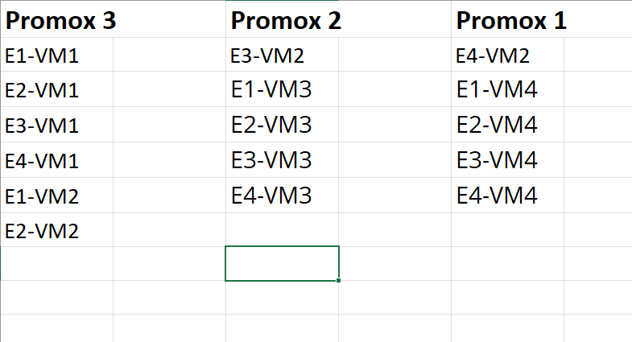

---

### A.3 – Installer un Amas K8S sur les 4 VM {#section-a-3}

Il faut installer un amas K8S constitué de 4 noeuds – 1 master, 3 worker – selon la topologie suivante:

* Le master sur E(1..4)-VM1
* Les 3 worker node sur E(1..4)-VM2 à VM4

---

### A.4 – Installer le loadbalancer [metallb](https://metallb.universe.tf) {#section-a-4}

* Utiliser 2 adresses IP de la banque des adresses disponibles

---

### A.5 – Installer un ingress controler {#section-a-5}

```
alain@k8s01:~$ k get pod -n ingress-nginx
NAME                                        READY   STATUS                   RESTARTS   AGE
ingress-nginx-controller-7d9674b7cf-nrb87   1/1     Running                  0          9d
```

---

### A.6 – Installer [Rancher](https://www.rancher.com/) et tester {#section-a-6}

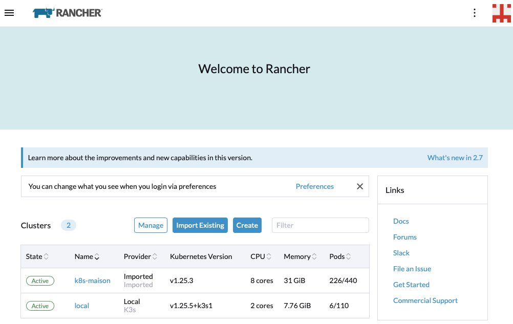

* Utiliser la méthode d’installation avec Docker (pas Helm), sur le master node.

---

### A.7 – Importer votre cluster K8S {#section-a-7}

* Cette opération peut-être longue – 30 minutes –

---

### A.8 – Installer le ‘monitoring’ sur votre cluster {#section-a-8}

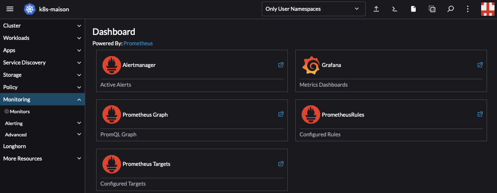

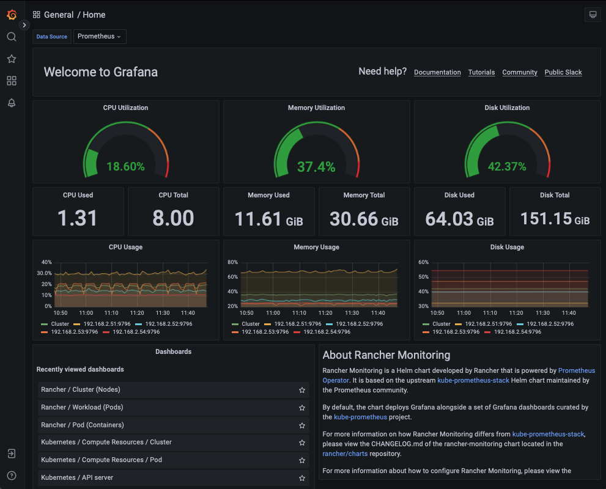

---

### A.9 – Installer [Longhorn](https://longhorn.io/) et tester {#section-a-9}

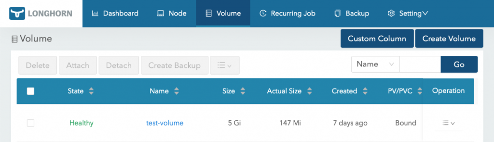

---

### A.10 – Tester le cluster de votre équipe à partir de votre poste de travail {#section-a-10}

* export KUBECONFIG=~/un-cluster-k8s.conf

---

### A.11 – Documenter toutes les étapes de la mise en place des points précédents {#section-a-11}

**NOOOOOTE**: Chaque étudiant est responsable de la rédaction de son document. **Cette étape n’est pas un travail d’équipe** 🫥.

---

**FIN DE LA PARTIE A**

---

## Partie B (40%) – En cours de rédaction Attention – version 0.314159265359 Il y aura des ajouts {#section-partie-b-40-en-cours-de-redaction-attent}


---


Cette partie doit-être déployée sur le cluster K8S du D139.

Il est possible de développer le projet à la maison sur un cluster équivalent (Par exemple, 4 VM sous VirtualBox) et de déployer la version finale au D139.

**ATTENTION – Il ne faut pas enregistrer** de manifestes sur les noeuds de votre amas – cluster K8S -. La commande ***kubectl*** doit être utilisée sur votre poste de travail et non pas lors d’une session ssh. Si vous placez des manifestes sur un des noeuds, ils seront disponibles à **TOUS**!!!

De plus, il faut **ABSOLUMENT** créer un espace de nom – ***namespace*** – à partir de votre matricule et créer TOUTES les RESSOURCES du projet dans cet espace de nom. VOIR LA SECTION COPIER/COLLER pour des exemples.

---

## Objectif {#section-objectif}

Déployer, en utilisant **l’infrastructure du D139** , une application ***apache2/php*** – en **10** *duplicas –* qui affiche la page suivante:

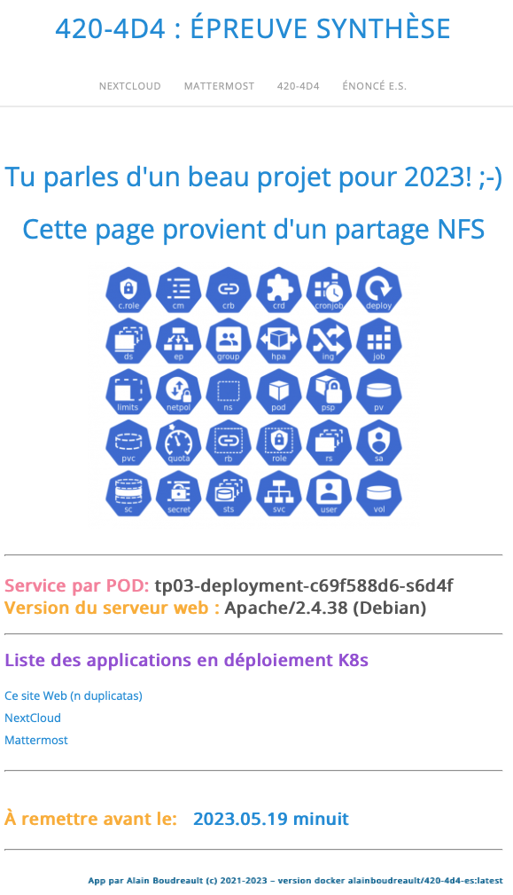

---

## 1 – Détails de déploiement de l’image principale du projet {#section-1}

### Il faut,

* Créer une image personnalisée – **DockerFile –**
  * à partir de ‘**php:8.0.3-apache-buster**‘,
  * nommée **Matricule-TP03**,
  * qui a comme page d’accueil un fichier index.php qui affiche « Ici la voix des Mistérons! »,
  * publiée sur docker hub.
* Déployer sur **10 Pods**.
* Utiliser une règle ingress: ***accueil.tp03***
* Renseigner: **imagePullPolicy: IfNotPresent – Always au besoin –**.
* Programmer, dans le ficher ***index.php***, stocké sur le **PV-NFS-CLOUD**, le code ***php*** qui affiche;
  * le nom du Pod   – **ATTENTION**: Pondération importante.
  * **la version du serveur Web**

**Par exemple,**

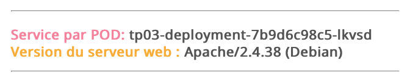

* Monter le Volume **PV-NFS-CLOUD** sur le fichier ‘index.php’ qui est le dossier  sur service Web
  * **Note**: **====>** Il faut utiliser la directive ‘[**subPath**](https://kubernetes.io/fr/docs/concepts/storage/volumes/#utilisation-de-subpath):’ pour monter un fichier à partir d’un Volume.

**NOTE IMPORTANTE**: Seulement le fichier ***index.php*** – la version [index.php.PV-NFS-CLOUD](https://github.com/ve2cuy/420-4D4.TP03.Depart/blob/main/index.php.PV-NFS-CLOUD "index.php.PV-NFS-CLOUD") – doit être stocké dans le volume NFS de la VM en nuage.  Les feuilles de styles – ***css* –** sont stockées dans l’image personnalisée.

---

**NOTE**: L’application de départ est disponible [ici](https://github.com/ve2cuy/420-4D4.TP03.Depart).

**NOTE**:  Pour tester l’application localement, ‘*docker build*‘:

```
docker build --tag tp03:latest .
docker run --rm -p 80:80 tp03:latest
```

Puis dans un fureteur:

```
http://localhost
```

Le conteneur que vous construirez affichera **initialement la page suivante:**

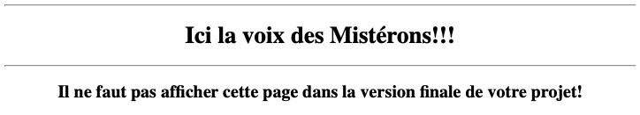

---

**IMPORTANT** – Lors de son utilisation dans le déploiement K8S, ce conteneur doit utiliser un volume NFS pour le fichier index.php.

Ce qui devrait alors produire le résultat suivant:


---

**Cette application** doit proposer **deux liens**  – **ATTENTION**: Pondération importante -, via le menu et son contenu, vers **deux** autres applications déployées avec K8s

1. [NextCloud](https://hub.docker.com/_/nextcloud)
2. [MatterMost](https://docs.mattermost.com/install/docker-local-machine.html)

**IMPORTANT**: Il faut **ABSOLUMENT** référer à ces applications à partir de leur nom de domaine. Il ne pas coder à la dure l’adresse IP dans le fichier index.php.  Il faut utiliser des règles ingress pour faire le lien vers le service  – **Pondération importante** -.

**NOTE**:  Il faut de *Nombreuses* secondes, avant que ces applications soient *téléchargées* et *fonctionnelles*.

---

## Volume NFS en nuage {#section-volume-nfs-en-nuage}

Le fichier ‘***index.php***‘ du site principal doit être stocké et lu à partir d’un Volume persistant – **PV** – de type **NFS** hébergé sur un service en nuage tel que [Linode](https://www.linode.com), [AWS](https://aws.amazon.com/fr/) ou [Google cloud](https://cloud.google.com).

**NOTE**: Pour des raisons de sécurité, le partage NFS doit-être renseigné en lecture seule (RO).

**ATTENTION**, Pondération importante

---

## 2 – NextCloud {#section-2}

[**NextCloud**](https://hub.docker.com/_/nextcloud) est une application qui permet l’accès à des fichiers personnels via une interface Web.

Voici une page exemple:

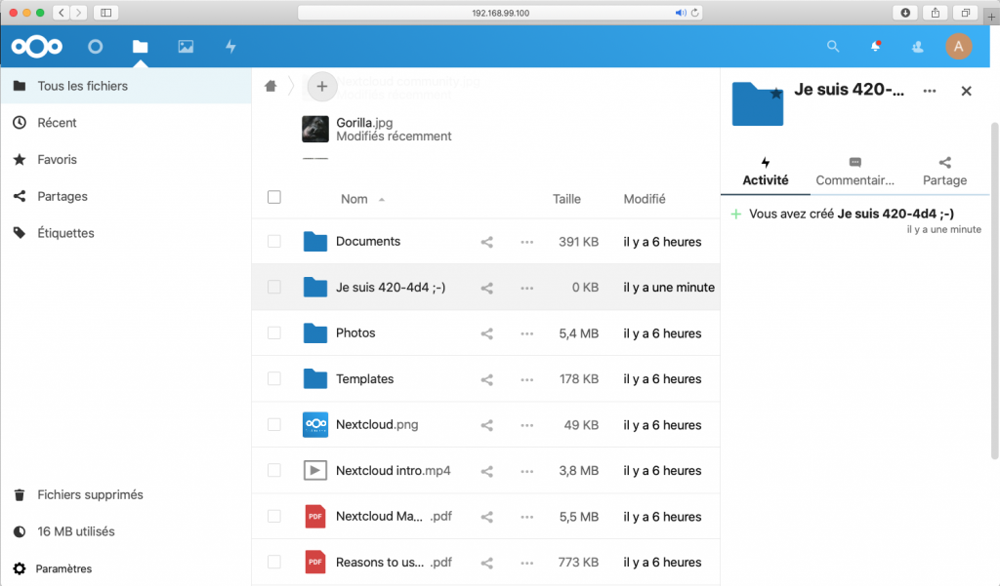

###

### Détails de déploiement de NextCloud

### Il faut,

* Déployer – **ATTENTION**, Pondération importante –  cette application, **en utilisant un SGDB MariaDB** et **un volume persistant (pv, pvc) pour le dossier racine de NextCloud -> ‘/var/www/…’**.
  * Pour le volume, PV et PVC, il faut utiliser longhorn  – **ATTENTION**, Pondération importante –
  * **SUGGESTION**: Faire fonctionner l’application avant d’implémenter le volume persistant 😉
* Utiliser une règle ingress: ***nextcloud.tp03***
* **Les mots de passe, le nom de la BD, l’adresse du SGBD, les comptes****d’accès (bd et NextCloud)** doivent-être stockés dans une ressource de type ‘**secrets**‘.
  * **mariadb**
    * Mot de passe du compte root: **secret**
    * Nom de la BD -> **nextcloud**
    * Utilisateur de la DB -> **nextcloud**
    * Mot de passe de l’utilisateur -> **secret**
  * **NextCloud**
    * Nom du compte -> admin
    * Mot de passe -> admin

      NEXTCLOUD_TRUSTED_DOMAINS -> à définir par vous
* Renseigner le compte **admin** de ***NextCloud*** via une variable d’environnement.  **IL NE FAUT PAS****voir apparaitre l’écran suivant au démarrage de l’application** :

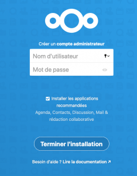

**ATTENTION**: Pondération importante pour ce point!

*Si les paramètres – **variables d’environnement –** ont été renseignés correctement, la page d’accueil de l’application sera présentée:*

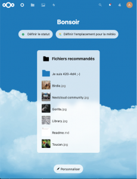

[Référence sur docker hub](https://hub.docker.com/_/nextcloud)

**NOTE**:  Dans le cas d’un message d’erreur indiquant que le domaine n’est pas autorisé,

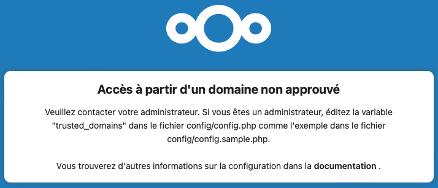

il faudra alors définir correctement la variable d’environnement suivante:

```
NEXTCLOUD_TRUSTED_DOMAINS =
```

**INDICE**: Utiliser l’adresse du loadbalancer et le nom de domaine

**NOTE**: Dans le cas de l’erreur suivante:

```
Internal Server Error

The server encountered an internal error and was unable to complete your request.
Please contact the server administrator if this error reappears multiple times, please include the technical details below in your report.
More details can be found in the server log.
```

La variable NEXTCLOUD_TRUSTED_DOMAINS n’est probablement pas définie.

**ATTENTION** – Pour la préservation des données, il faut utiliser un volume PV de type ‘[Longhorn](https://longhorn.io/)‘ d’une taille de **2Go**, nommé ***nextcloud-votre-matricule***.

```
√ tp03-solution-v2022-avec-NFS % k get pv -n tp03
NAME              CAPACITY   ACCESS MODES   RECLAIM POLICY   STATUS   CLAIM                  STORAGECLASS      REASON   AGE
nextcloud-alain   2Gi        RWO            Retain           Bound    tp03/nextcloud-alain   longhorn-static            18m

√ tp03-solution-v2022-avec-NFS % k get pvc -n tp03
NAME              STATUS   VOLUME            CAPACITY   ACCESS MODES   STORAGECLASS      AGE
nextcloud-alain   Bound    nextcloud-alain   2Gi        RWO            longhorn-static   43s
```

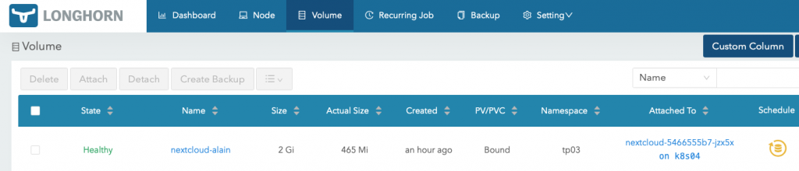

---

**NOTE**: Si la valeur de NEXTCLOUD_TRUSTED_DOMAINS n’est pas renseignée correctement lors d’un test, il sera peut-être nécessaire de recréer le volume+PV+PVC dans longhorn 😉.

Si tout va bien, nous obtiendrons l’écran suivant:

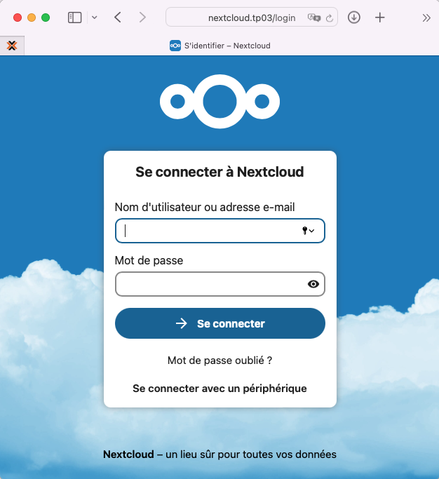

Il ne reste qu’à se connecter en utilisant les valeurs renseignée par les secrets du déploiement de Nextcloud.

---

## 3 – MatterMost {#section-3}

[‘*Mattermost*](https://fr.wikipedia.org/wiki/Mattermost) *est un logiciel et un service de messagerie instantanée libre auto-hébergeable. Il est conçu comme un chat interne pour les organisations et les entreprises, et il est présenté comme une alternative à Slack*‘

Voici une page exemple:

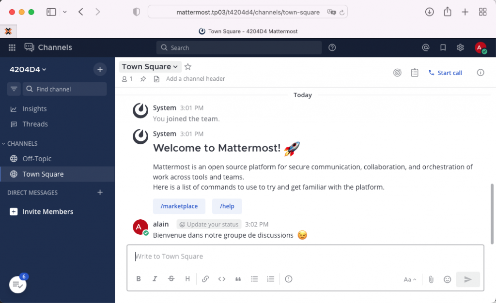

###

### Détails de déploiement de Mattermost

### Il faut – ATTENTION, Pondération importante – ;

* Utiliser l’image *mattermost/mattermost-preview*
* Utiliser une règle ingress: ***mattermost.tp03***

Voici la page d’accueil d’une nouvelle installation de ***Mattermost***:

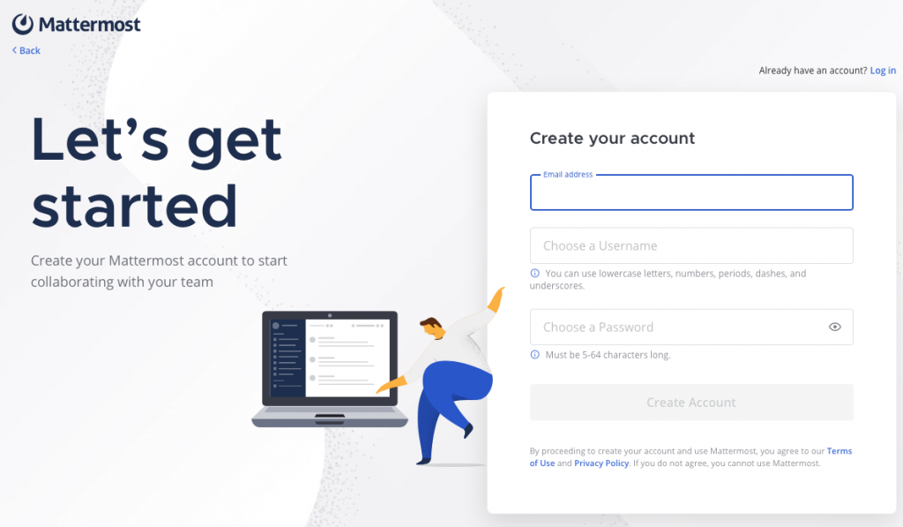

[Référence diagnostic](https://docs.mattermost.com/install/troubleshooting.html)
[Référence1 – Utilisation sous docker](https://docs.mattermost.com/install/docker-local-machine.html)
[Référence2 – GitHub](https://github.com/mattermost/mattermost-docker)

---

## 4 – Défi WordPress – 10 % extra pour les aventureux {#section-4}

### Ce ne sera pas facile, à moins d’être aussi bon que moi 😉

### Critères de réussite du défi:

* WordPress dans 2 pods
* Les données de la BD sur un volume longhorn
  * Nom du volume et PV/PVC = v-matricule-bd-wordpress
* Le thème ‘simple style’ disponible via un ***configmap***
  * Le fichier ***footer.php***, dans le configmap précédent, modifié pour afficher le ID du POD
* Le dossier wp-content sur un volume longhorn
  * Nom du volume et PV/PVC = v-matricule-wp-content
* Une règle Ingress pour docum.tp03

**Note**: Pour obtenir le 10 points bonus, il faut réaliser avec succès tous les points du défi.

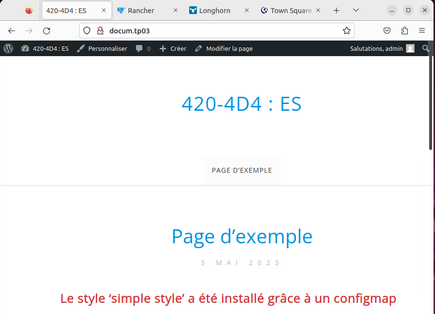


---

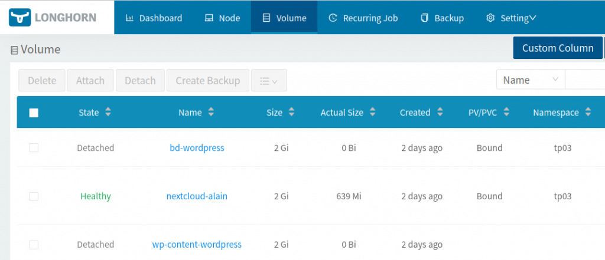

---

## 5 – Documentation du projet {#section-5}

* Il faut documenter l’entête de chacune des ressources du fichier yml
  * Auteur
  * Date
  * Description
* Il faut renseigner – **ATTENTION**, Pondération importante – le fichier README.md à partir d’un résumé du projet, le temps – heures – consacré à sa réalisation, les difficultés rencontrées et au moins une capture d’écran de votre solution.

---

## 6 – Méthodes de remise de l’épreuve synthèse {#section-6}

* Partie A – Un document Word via LEA
* Partie B
  * Via LEA
    * Le fichier README.md,
    * la capture d’écran,
    * le fichier hosts
    * un seul manifest – incluant les services, ingress, espace de nom, volumes, secrets, …

### Pondération:       50% (10/40) Date de remise:  2023.05.19 (minuit)

---

## Journaux d’un projet fonctionnel {#section-journaux-dun-projet-fonctionnel}

**1 – État de départ – avant le déploiement**

```
# État K8s de départ:

√ tp03.v2 % kubectl get all
NAME                 TYPE        CLUSTER-IP   EXTERNAL-IP   PORT(S)   AGE
service/kubernetes   ClusterIP   10.96.0.1    <none>        443/TCP   2d5h

√ tp03.v2 % kubectl get service
NAME         TYPE        CLUSTER-IP   EXTERNAL-IP   PORT(S)   AGE
kubernetes   ClusterIP   10.96.0.1    <none>        443/TCP   2d5h

√ tp03.v2 % kubectl get pv
No resources found

√ tp03.v2 % kubectl get pvc
No resources found in default namespace.
```

**2 – Déploiement du projet**

```
# Application du manifeste du TP03
√ tp03.v2 % kubectl apply -f tp03.yml
persistentvolume/pv-tp03 created
persistentvolumeclaim/pvc-nextcloud created
deployment.apps/tp03-deployment created
service/tp03-service created
deployment.apps/mariadb-nextcloud created
service/service-mariadb-nextcloud created
deployment.apps/nextcloud created
service/service-nextcloud created
deployment.apps/mattermost created
service/service-mattermost created
secret/tp03-top-secret created
```

**3 – État après le déploiement**

```
√ tp03.v2 % kubectl get all
NAME                                     READY   STATUS    RESTARTS   AGE
pod/mariadb-nextcloud-67f4646cd7-9wbdl   1/1     Running   0          3m14s
pod/mattermost-8764bf86-p66zd            1/1     Running   0          3m14s
pod/nextcloud-7bcfdb6648-zcm7s           1/1     Running   0          3m14s
pod/tp03-deployment-7b9d6c98c5-4wr9k     1/1     Running   0          3m14s
pod/tp03-deployment-7b9d6c98c5-78nt7     1/1     Running   0          3m14s
pod/tp03-deployment-7b9d6c98c5-7f2dw     1/1     Running   0          3m14s
pod/tp03-deployment-7b9d6c98c5-blrlh     1/1     Running   0          3m14s
pod/tp03-deployment-7b9d6c98c5-bx9k6     1/1     Running   0          3m14s
pod/tp03-deployment-7b9d6c98c5-gfkhz     1/1     Running   0          3m14s
pod/tp03-deployment-7b9d6c98c5-h5l5h     1/1     Running   0          3m14s
pod/tp03-deployment-7b9d6c98c5-jbdv6     1/1     Running   0          3m14s
pod/tp03-deployment-7b9d6c98c5-kn6c5     1/1     Running   0          3m14s
pod/tp03-deployment-7b9d6c98c5-scm5w     1/1     Running   0          3m14s
pod/tp03-deployment-7b9d6c98c5-xx4j7     1/1     Running   0          3m14s
pod/tp03-deployment-7b9d6c98c5-zhmxw     1/1     Running   0          3m14s

NAME                                READY   UP-TO-DATE   AVAILABLE   AGE
deployment.apps/mariadb-nextcloud   1/1     1            1           3m14s
deployment.apps/mattermost          1/1     1            1           3m14s
deployment.apps/nextcloud           1/1     1            1           3m14s
deployment.apps/tp03-deployment     12/12   12           12          3m14s

NAME                                           DESIRED   CURRENT   READY   AGE
replicaset.apps/mariadb-nextcloud-67f4646cd7   1         1         1       3m14s
replicaset.apps/mattermost-8764bf86            1         1         1       3m14s
replicaset.apps/nextcloud-7bcfdb6648           1         1         1       3m14s
replicaset.apps/tp03-deployment-7b9d6c98c5     12        12        12      3m14s
```

**4 – Contenu du ‘pvc’**

```
$ ls /mnt/nextcloud/
3rdparty  apps         core         data        lib           ocs           remote.php  status.php
AUTHORS   config       cron.php     index.html  occ           ocs-provider  resources   themes
COPYING   console.php  custom_apps  index.php   ocm-provider  public.php    robots.txt  version.php
$
```

**5 – Contenu du ‘secret’**

```
√ tp03.v2 % kubectl describe secrets tp03-top-secret
Name:         tp03-top-secret
Namespace:    default
Labels:       <none>
Annotations:  <none>

Type:  Opaque

Data
====
NEXTCLOUD_ADMIN_PASSWORD:  5 bytes
NEXTCLOUD_ADMIN_USER:      5 bytes
MYSQL_DATABASE:            9 bytes
MYSQL_HOST:                25 bytes
MYSQL_PASSWORD:            6 bytes
MYSQL_USER:                9 bytes
```

**6 – Liste des ‘services’**

```
√ tp03-solution-v2023-avec-NFS % k get service -n tp03
NAME                        TYPE        EXTERNAL-IP   PORT(S)    AGE
service-mariadb-nextcloud   ClusterIP   <none>        3306/TCP   39s
service-mattermost          ClusterIP   <none>        80/TCP     38s
service-nextcloud           ClusterIP   <none>        80/TCP     39s
tp03-service                ClusterIP   <none>        80/TCP     39s
```

7 – Liste des règles ingress

```
√ tp03-solution-v2022-avec-NFS % k get ingress -n tp03

NAME         CLASS HOSTS             ADDRESS        PORTS
ingress-tp03 nginx accueil.tp03,
                   mattermost.tp03,
                   nextcloud.tp03    192.168.2.61   80
```

---

### Bonne chance dans votre réalisation de l’épreuve synthèse 😉

---

###### Document rédigé par Alain Boudreault (c) 2021-2023 – version 2023.04.29.01

---

## Crédits

*Document rédigé par Alain Boudreault © 2021-2027*  
*Révision 2026.11.07.1*  

*Contenu par [VE2CUY](https://ve2cuy.github.io/blog/)*
