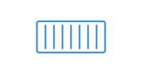
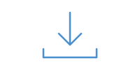
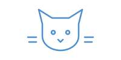
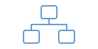
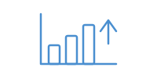

## Présentation sommaire du cours

Ce cours permettra à l'étudiant, à partir de l'approche DevOps, de réaliser, de documenter et d'automatiser les cycles d'édition, de production et de distribution d'une application en utilisant des outils d'intégration et de déploiement continus (CI/CD). À la fin du cours, l'étudiant sera en mesure d'utiliser un outil de type orchestration de conteneurs, permettant d'automatiser les parties du développement logiciel liées aux builds, aux tests et au déploiement.

- **Programme** : 420.B0 · Techniques de l'informatique
- **Famille** : Soutien aux utilisateurs et réseau
- **Pondération** : 1-3-2
- **Préalable** : 420-3C3-JR

Évaluation, hiver 2026 :

- **Projet de mi-session** : TP01 sur Docker · 30 %
- **Épreuve synthèse, volet A** : TP02 sur K8s · 35 %
- **Épreuve synthèse, volet B** : examen pratique, semaine 16 · 35 %

## Horaire et disponibilités de l'enseignant

**Alain Boudreault**, enseignant au département de Techniques de l'informatique, Cégep de Saint-Jérôme

- **Courriel** : [Aboudrea@cstj.qc.ca](mailto:Aboudrea@cstj.qc.ca)
- **Téléphone** : poste 6516
- **Local** : D125e

[Disponibilités pour la session H26](Documentation/images/Horaire-H26.png) · [Calendrier scolaire H26 (PDF)](Documentation/Contenu/Calendriers_H26_CSTJ.pdf)

## A) Plan de cours

 *Plan de cours, contenus et copier/coller*

-  - · [Plan de cours](Documentation/420-4D4-JR_ab_pc_H26.pdf)
  - Hiver 2026 · PDF officiel
-  - · [Contenus du cours](Documentation/Contenu/)
  - Le dossier des contenus de la session
-  - · [Les copier/coller](Documentation/CopierColler.md) · 👍
  - Commandes et alias Docker et K8s · stubs Compose et K8s · scripts d'installation
-  - · Description de l'épreuve synthèse · à suivre

## B) Concepts et outils de base (Docker)

 *Conteneurs, images, Dockerfile, Compose*

-  01 · [Conteneurs et machines virtuelles](Documentation/Docker/Intro-a-docker-et-kubernetes.md)
  - VM et conteneurs · Docker et Kubernetes · Podman, Buildah, Kaniko
-  02 · [Installation de Docker](Installation/Docker/Installation-de-Docker.md)
  - Docker Desktop · Ubuntu · Vagrant · Windows et macOS
-  03 · [Introduction à Docker](Documentation/Docker/Introduction-a-Docker.md)
  - Commandes de base : run, ps, images, exec · ports IP · logs et inspect
-  04 · [YAML – Introduction](Documentation/Yaml/yaml.md)
  - Commentaires · scalaires · listes et structures · nœuds réutilisables
-  05 · [Référence YAML](Documentation/Yaml/yaml-reference.md)
  - Règles, types de données, collections, ancres · pièges courants
-  06 · [Exemple d'un document YAML](Documentation/Yaml/yaml-exemple-ibm.md)
  - Un exemple complexe et sa conversion en JSON
-  07 · [Docker Hub](Documentation/Docker/Docker-Hub.md)
  - Publier une image personnalisée · stockage persistant
-  08 · [Dockerfile – Introduction](Documentation/Docker/Dockerfile-Introduction.md)
  - FROM, RUN, COPY, ENV, WORKDIR, EXPOSE · CMD et ENTRYPOINT · cache
-  09 · [Convention de nommage des labels](Documentation/Docker/Dockerfile-convention-de-nommage.md)
  - Métadonnées des images · org.label-schema et OCI
-  10 · [Image d'une application Node.js](Documentation/Docker/Dockerfile-Exemple-node.js.md)
  - Dockerfile · Express.js · arguments · image multi-plateforme
-  11 · [SuperMinou 🐈](Documentation/Docker/Dockerfile-atelier-de-renforcement.md) · formatif
  - Dockerfile – formatif 01 de l'épreuve synthèse, volet B
-  12 · [Les réseaux Docker](Documentation/Docker/Introduction-aux-reseaux.md)
  - Réseaux host et macvlan
-  13 · [Application multi-services](Documentation/Docker/Application-multi-services.md)
  - Variables d'environnement · MariaDB + Adminer
-  14 · [Retour sur les fusions (bind)](Documentation/Docker/Retour-sur-les-fusions-Bind.md)
  - Dossiers liés · Node-RED, MySQL et WordPress · Portainer
-  15 · [Docker Compose – Partie 1](Documentation/Docker/Docker-compose-p1.md)
  - Services, options et configuration
-  16 · [Docker Compose – Partie 2](Documentation/Docker/Docker-compose-p2.md)
  - Multi-services · build · variables et fichier .env
-  17 · [Docker Compose – Partie 3](Documentation/Docker/Docker-compose-p3.md)
  - Services d'initialisation · depends_on · healthcheck
-  18 · [Laboratoire Drupal](Documentation/Docker/Docker-compose-laboratoire-Drupal.md) · à revoir 🛑
  - Docker Compose : Drupal et sa base de données
-  19 · [Dépôt privé d'images – Harbor](Installation/Registre-prive-d-images.md)
  - Installation · registre non sécurisé · droits d'accès
-  20 · [GitHub Actions](Documentation/Automatisation/github-action.md)
  - Build et push automatiques vers Docker Hub
-  21 · [GitHub Actions, version 2](Documentation/Automatisation/github-action-v2.md)
  - Projet complet de CI/CD : application, workflows, releases
-  22 · [Homepage](Documentation/Docker/homepage.md)
  - Tableau de bord des services · configuration et widgets
-  23 · [Docker – Référence rapide](Documentation/Docker/Docker-Reference-rapide.md) · 👍
  - Les commandes Docker essentielles

## C) Kubernetes (K8s)

 *Orchestration, manifestes, volumes, services*

-  24 · [Installation d'un nœud unique](Documentation/Kubernetes/Installation-un-seul-noeud.md) · 👍
  - Amas K8s d'un seul serveur sous Linux · worker · kind
-  25 · [Kubernetes – Introduction](Documentation/Kubernetes/Kubernetes-Introduction.md) · 👍
  - Minikube et kubectl · pods et déploiements · manifestes
-  26 · [kubectl, renforcement](Documentation/Kubernetes/Kubernetes-Introduction-kubectl.md)
  - run, create, expose, scale, logs · conteneur d'initialisation
-  27 · [Manifestes expliqués, version courte](Documentation/Kubernetes/Kubernetes-Manifestes-Expliques-version-courte.md)
  - Pod, Deployment, ConfigMap, Secret, Service
-  28 · [Manifestes expliqués, version longue](Documentation/Kubernetes/Kubernetes-Manisfestes-Expliques-version-longue.md)
  - Chaque ressource, avec des exemples commentés
-  29 · [Manifestes, gestion des ressources](Documentation/Kubernetes/Kubernetes-Manifestes-Gestion-des-ressources.md)
  - requests et limits · CPU et mémoire
-  30 · [Kubernetes – Partie 2](Documentation/Kubernetes/Kubernetes-partie-2.md) · 👍
  - MongoDB + Mongo Express · laboratoires WordPress et PostgreSQL
-  31 · [ConfigMap et Secrets](Documentation/Kubernetes/Kubernetes-Config-map-et-secret.md) · 👍
  - envFrom · volume à partir d'un configmap · secrets
-  32 · [Gestion des ressources](Documentation/Kubernetes/Kubernetes-Manifestes-Gestion-des-ressources.md) · 👍
  - Qualité de service : Guaranteed, Burstable, BestEffort
-  33 · Préparation de l'atelier cluster K8s
  - Installation d'un cluster avec Vagrant
-  34 · [Installation d'un cluster](Documentation/Kubernetes/Kubernetes-Installation-cluster.md)
  - 1 master, 2 nodes · Vagrant · kubeadm
-  35 · [Les volumes](Documentation/Kubernetes/Kubernetes-Les-volumes.md) · 👍
  - emptyDir, hostPath, PV et PVC, NFS
-  36 · [Les volumes, partie 2](Documentation/Kubernetes/Kubernetes-Volumes-p2.md) · 🧠
  - hostPath · stockage S3 : MinIO et Garage
-  37 · [Les services](Documentation/Kubernetes/Kubernetes-Services.md) · 🧠
  - ClusterIP, NodePort, LoadBalancer, ExternalName
-  38 · [LoadBalancer et ingress avec Traefik](Documentation/Kubernetes/MetalLB-Traefik.md)
  - MetalLB · Traefik par Helm · Google Cloud et DuckDNS
-  39 · [LoadBalancer et ingress avec Nginx](Documentation/Kubernetes/Kubernetes-LoadBalancer-et-Ingress.md) · désuet
  - MetalLB · ingress Nginx
-  40 · [Équilibreur de charge MetalLB](Documentation/Kubernetes/Equilibreur-de-charge-externe-MetalLB.md)
  - Information supplémentaire : installation, Layer 2, Traefik
-  41 · Espaces de nom (namespaces) · 🧠
-  42 · ServiceAccount · 🧠
-  43 · [Cluster sur Google Cloud](Documentation/Kubernetes/Kubernetes-Google.cloud.md) · 🧠
  - gcloud · contexte du cluster · facturation
-  44 · [Helm – Introduction](Documentation/Kubernetes/Helm-introduction.md) · 👍
  - Charts, repositories et releases · exemples
-  45 · Automatisation des builds d'images · 🧠
  - Docker et GitHub
-  46 · [Autoscaling](Documentation/Kubernetes/Kubernetes-autoscalling.md) · 👍
  - HPA, VPA, Cluster Autoscaler, KEDA
-  47 · [kubectl – Référence rapide](Documentation/Kubernetes/Kubernetes-Reference-rapide.md) · 👍
  - Pods, déploiements, services, contextes, namespaces

## D) Projets et épreuve synthèse

 *TP01, volets A et B, énoncés 2023*

-  48 · [Projet de mi-session – TP01](https://github.com/ve2cuy/4204D4-TP01-H26-depart) · 30 %
  - Docker · dépôt de départ sur GitHub
-  49 · [Épreuve synthèse, volet A](Documentation/Projet-Session/README.md) · 35 %
  - TP02 K8s · applications en local, puis en nuage
-  50 · Épreuve synthèse, volet B · 35 %
  - Examen pratique

Énoncés des années précédentes :

-  51 · Énoncé du TP01, version 2023 · 30 %
  - Docker
-  52 · [Énoncé du TP02](Documentation/Kubernetes/Kubernetes-Node-RED-Mosquitto.md) · 20 %
  - K8s : Node-RED + Mosquitto + ConfigMap + Secret
-  53 · [Épreuve synthèse, version 2023](Documentation/Projet-Session/Epreuve-synthese-2023.md) · 50 %
  - Infrastructure K8s H.A. · NextCloud et Mattermost

## E) Laboratoires et outils

 *Laboratoires, outils et scripts*

-  54 · [Google Cloud, NFS et Harbor](Documentation/Laboratoires/NFS-Habor.md) · laboratoire
  - Laboratoire en deux parties
-  55 · [LazyDocker](https://github.com/jesseduffield/lazydocker)
  - Interface en mode texte pour Docker
-  56 · [K9s](https://k9scli.io/)
  - Interface en mode texte pour Kubernetes
-  57 · [Arcane](https://getarcane.app/)
  - Interface Web de gestion de Docker
-  58 · [Portainer](https://www.portainer.io/)
  - Gestion de Docker et de Kubernetes par le Web
-  59 · [Rancher](https://www.rancher.com/quick-start)
  - Gestion de clusters Kubernetes
-  60 · [Longhorn](https://longhorn.io/)
  - Stockage distribué pour Kubernetes
-  61 · [Script d'installation d'un serveur K8s](Installation/Kubernetes/script-serveur.md)
  - server.sh
-  62 · [Script d'installation d'un nœud K8s](Installation/Kubernetes/script-noeud.md)
  - node.sh
